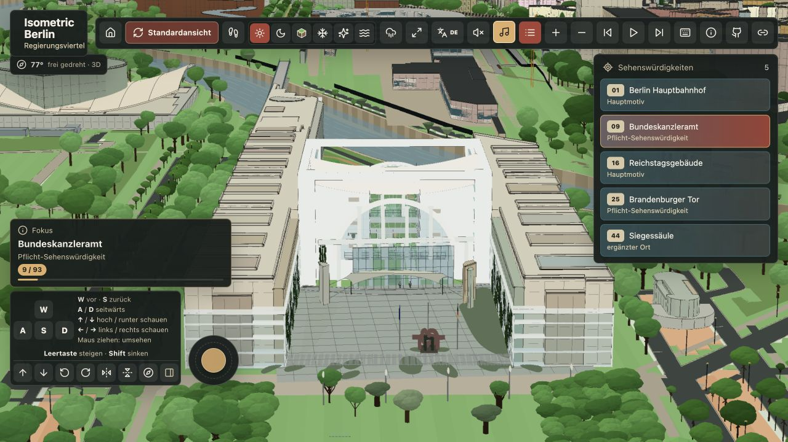

# Isometric Berlin

**Berlin entdecken. Perspektive wechseln.**

Eine frei erkundbare 3D-Stadt aus offenen Geodaten: durch Straßen spazieren,
über die Spree fliegen und Berliner Architektur aus der isometrischen
Perspektive erleben.

An explorable 3D Berlin built from open geodata. Walk its streets, fly above
the Spree and discover the city's architecture from an isometric perspective.

**[Viewer öffnen / Explore Berlin](https://klotzkette.github.io/isometric-berlin/)** ·
[Download](https://github.com/Klotzkette/isometric-berlin/releases/latest/download/isometric-berlin-regierungsviertel-local.zip) ·
[Deutsch](#deutsch) · [English](#english)



*Bundeskanzleramt und Spree · Federal Chancellery and Spree.*

© OpenStreetMap contributors · 3D building models: Geoportal Berlin
(dl-de/zero-2-0) · Visual references: Wikimedia Commons/Wikipedia ·
3D mesh: Berlin Partner für Wirtschaft und Technologie GmbH.
[Quellennachweise / Full credits](NOTICE.md)

## Deutsch

### Die Stadt erkunden

Isometric Berlin verbindet die Formen einer Stadtkarte mit der Freiheit einer
begehbaren 3D-Welt. Reichstag, Kanzleramt, Kulturforum, Potsdamer Platz und viele
weitere Orte erhalten eigene architektonische Details. Straßen, Wasser,
Grünflächen und Bahntrassen geben der Stadt ihren Zusammenhang. Im Hauptbahnhof
führen Treppen und Rolltreppen durch die Ebenen; Reichstag und Abgeordnetenhaus
erhalten begehbare Plenarsäle, der Reichstag auch den Weg in die Glaskuppel.
Ein Klick auf den Reichstag öffnet seinen Längsschnitt durch Plenarsaal, Büros
und Nebenräume. **Untergeschoss** und **Verbindungen** zeigen die untere Ebene
und die dargestellten Tunnel; **Schnitt schließen** stellt die Außenansicht wieder her.
Raumaufteilungen und Innenmaße sind [architektonische Modellnäherungen](docs/reichstag-section-v319.md).

- **Frei bewegen:** die Ansicht drehen und zoomen, zu Fuß durch Berlin gehen
  oder über die Dächer schweben. Maus, Tastatur und Touch werden unterstützt.
- **93 Tourstationen:** bekannte Wahrzeichen und kleinere Entdeckungen direkt
  ansteuern oder die Stadt auf eigene Faust erkunden.
- **Fünf Ansichten im Browser:** Tag, Nacht, Schneesturm, Minecraft und
  Schwellenraum. Beim Wechsel bleiben Standort und Blickrichtung erhalten.
- **Direkt im Browser:** auf Desktop, Tablet und Smartphone, mit deutscher
  und englischer Oberfläche. Konto, API-Schlüssel und KI-Modell sind für
  den Viewer nicht erforderlich.

`W` / `A` / `S` / `D` bewegen durch die Stadt, Ziehen mit der Maus richtet den
Blick aus. Im Flug steigt die Leertaste auf und `Shift` sinkt ab; zu Fuß springt
die Leertaste. Der Joystick unterstützt Maus und Touch. Alle Bedienelemente
stehen im Hilfemenü des Viewers; **Freikommen** hilft an Hindernissen.

### Berlin mit unterschiedlichen Detailstufen

Das Regierungsviertel bildet den Ausgangspunkt. Die Stadt reicht über das
Zentrum hinaus in zahlreiche Kieze, die City West und Bereiche entlang der
Ringbahn sowie in ausgewählte Außenbereiche und Verbindungskorridore bis zum
BER. Die 93 Tourstationen bilden einen kuratierten Rundgang innerhalb dieser
weiteren Stadtlandschaft.

Die Detaillierung hängt vom Ort und von den verfügbaren Quellen ab:
individuell anhand von Fotoreferenzen ausgearbeitete Gebäude ergänzen amtliche
LoD2-Geometrie, OSM-Daten und einfachere Umgebungsmodelle. Ausgewählte Straßenfronten
in [50 Häusergruppen](docs/cluster-facades-v320.md) erhalten örtlich passende
Fensterproportionen, Rahmen, Laibungen, Sockel und Gesimse.
[Ministerien und Landesvertretungen](docs/government-offices-v321.md) werden anhand
amtlicher Standorte und öffentlicher Architekturquellen zugeordnet und ausgearbeitet.
[Hochschulstandorte](docs/universities-v322.md),
[Kindertheater und Archenhold-Sternwarte](docs/youth-theatres-v322.md) sowie
[öffentliche Denkmäler](docs/memorial-accuracy-v322.md) verbinden vermessene
Gebäudeformen mit ortsspezifischen Fassaden und charakteristischen Details.
[Schulen, Museen und Gerichte](docs/public-institutions-v326.md),
[benannte U-Bahn-Zugänge](docs/ubahn-access-v326.md), [Straßen- und Bahnverläufe](docs/network-fidelity-v326.md) und die
[Landschaft um Rehberge und Plötzensee](docs/north-east-public-sites-v326.md)
folgen eigenen Standort- und Geometrienachweisen. Auf der
[Pfaueninsel](docs/southwest-sites-v326.md) gehören Schloss, Wege und frei
umherlaufende blaue und weiße Pfauen zur Landschaft.
Abdeckung und
Genauigkeit sind in den [Datennotizen](docs/data.md) und den
[Angaben zur metrischen Präzision](docs/metric-precision.md) dokumentiert.
Die [Detailnotizen zu Altstadt, Mauerorten und Spreeufer](docs/fidelity-v297-v299.md)
erläutern auch die gezeichneten Wandbilder und ihre Grenzen.
Die Häuser im [Boxhagener Viertel](docs/friedrichshain-v303.md), die Dorfhöfe
von [Böhmisch-Rixdorf](docs/rixdorf-v304.md) und die
[Neuköllner Wahrzeichen](docs/neukoelln-landmarks-v305.md) besitzen eigene
Quellen- und Detailnachweise. Die [nördlichen Parks und Schulbauten](docs/north-sites-v306.md),
[Ringbahn und Europasportpark](docs/rail-sse-v307.md) sowie die
[Klinikstandorte](docs/hospitals-v308.md) sind ebenfalls einzeln dokumentiert.

Beim Start zeigt ein durchgehender Balken die laufenden Aufbauschritte.
Weitere Stadtbereiche werden passend zur Ansicht nachgeladen.
Die vollständige gezeichnete Detailstufe steht auch auf Touchgeräten bereit.

### Herunterladen und lokal starten

Der [ZIP-Download](https://github.com/Klotzkette/isometric-berlin/releases/latest/download/isometric-berlin-regierungsviertel-local.zip)
enthält den vollständigen statischen Viewer mit seinen Stadtdateien.
Voraussetzungen sind **Python 3** und ein moderner Browser mit WebGL.

1. Das gesamte ZIP entpacken.
2. Den passenden Starter öffnen:

   | System | Starter im entpackten Ordner |
   |---|---|
   | Windows | `OPEN-3D-WINDOWS.bat` |
   | macOS | `OPEN-3D-MAC.command` |
   | Linux | `sh start-linux.sh` im Terminal |

3. Das Serverfenster während der Nutzung geöffnet lassen. Der Starter öffnet
   den Viewer über lokales HTTP im Browser.

Falls macOS den Starter blockiert: Rechtsklick → **Öffnen**.
Alternativ im entpackten Ordner `python3 serve-local.py` ausführen.
`START-HERE.html` erklärt den Start; für `index.html` wird der lokale Server
benötigt. Nach dem Download lässt sich die Stadt offline erkunden.

## English

### Explore the city

Isometric Berlin brings together an isometric map and a freely navigable 3D
world. Dedicated architectural details give places such as the Reichstag,
Chancellery, Kulturforum and Potsdamer Platz their character. Streets, parks,
waterways and railway lines connect them into a city you can explore. Connected
stairs and escalators lead through Hauptbahnhof, while the Reichstag and Berlin
House of Representatives include walkable plenary rooms and the Reichstag dome.
Click the Reichstag to open a longitudinal section through the chamber, offices
and adjoining rooms. **Basement** and **Connections** reveal the lower level
and represented tunnels; **Close section** restores the exterior. Room layouts
and interior dimensions are [architectural display estimates](docs/reichstag-section-v319.md).
[50 selected building groups](docs/cluster-facades-v320.md) include local facade
proportions, window frames and reveals, sills, plinths and eave details.
[University campuses](docs/universities-v322.md),
[youth theatres and Archenhold Observatory](docs/youth-theatres-v322.md), and
[public monuments](docs/memorial-accuracy-v322.md) combine measured building forms
with individual facades and recognizable architectural features.

- **Move freely:** orbit, zoom, walk through the streets or fly above the
  rooftops, using a mouse, keyboard or touch controls.
- **Follow 93 tour stops:** jump to major landmarks and smaller discoveries,
  then venture beyond the curated route.
- **Choose five views in the browser:** Day, Night, Snowstorm, Minecraft and
  Schwellenraum. Switching views preserves your location and direction.
- **Open it in a browser:** desktop, tablet and phone are supported, with
  German and English controls. The viewer needs no account, API key or AI model.

Use `W` / `A` / `S` / `D` to move and drag the mouse to look around. In flight,
`Space` rises and `Shift` descends; while walking, `Space` jumps. The joystick
works with mouse and touch. The viewer's Help menu lists the full controls,
and **Get unstuck** provides a way out of obstacles.

### Coverage and detail

The government district is the starting point for a wider Berlin landscape:
the centre, many neighbourhoods, City West, parts of the Ringbahn, and selected
outer areas and connecting corridors reaching BER airport. The 93-stop tour
sits within this broader coverage.

Detail varies by place and source. Individually authored, photo-guided
buildings sit alongside official LoD2 geometry, OpenStreetMap data and simpler
context models. See the [data notes](docs/data.md) and
[metric precision notes](docs/metric-precision.md) for coverage and accuracy.
The [ministries and state representations](docs/government-offices-v321.md)
have an address and architecture audit covering all federal ministries,
Berlin's Senate departments and all 16 Länder.
The [Boxhagener quarter](docs/friedrichshain-v303.md),
[Böhmisch-Rixdorf](docs/rixdorf-v304.md) and
[Neukölln landmarks](docs/neukoelln-landmarks-v305.md) have separate architectural
and source notes.

The [northern parks and school](docs/north-sites-v306.md),
[Ringbahn and Europasportpark](docs/rail-sse-v307.md) and
[hospital campuses](docs/hospitals-v308.md) have individual source notes.
Startup shows actual file and construction work; further areas load for the
current view. Touch devices retain the full drawn detail.

### Run locally

The [ZIP download](https://github.com/Klotzkette/isometric-berlin/releases/latest/download/isometric-berlin-regierungsviertel-local.zip)
contains the complete static viewer and city assets. You need **Python 3**
and a modern WebGL browser.

1. Extract the entire ZIP.
2. On Windows, open `OPEN-3D-WINDOWS.bat`; on macOS, open
   `OPEN-3D-MAC.command`; on Linux, run `sh start-linux.sh` in a terminal.
3. Keep the server window open while exploring. The launcher opens the viewer
   in your browser over local HTTP.

If macOS blocks the launcher, right-click it and choose **Open**.
You can also run `python3 serve-local.py` inside the extracted folder.
`START-HERE.html` explains the launch steps; `index.html` needs the local
server. Once downloaded, the viewer works offline.

## Entwicklung / Development

Der Viewer basiert auf **React, TypeScript, Three.js und Vite**.
Die Python-Werkzeuge bereiten Geodaten auf und erstellen die Download-Pakete.
Die benötigten Stadtdateien liegen im Repository; zum Start sind keine
weiteren Geodaten-Downloads nötig.

The viewer uses **React, TypeScript, Three.js and Vite**. Python tools handle
geodata processing and release packaging. The repository includes the runtime
city data, so you can build and run it without downloading source geodata.

Mit [uv](https://docs.astral.sh/uv/) und [Bun](https://bun.sh/), ab Repository-Wurzel:

With [uv](https://docs.astral.sh/uv/) and [Bun](https://bun.sh/), from the repository root:

```bash
uv sync
cd src/app
bun install
bun run build
cd ../..
uv run python3 scripts/serve_local_viewer.py
```

Der lokale Viewer öffnet unter `http://127.0.0.1:8766/`; bei belegtem Port
wählt der Starter den nächsten freien Port. Für die Entwicklung in `src/app`
`bun run dev` verwenden. Ein Download-Paket erstellst du nach dem Build mit:

The local viewer opens at `http://127.0.0.1:8766/`; if the port is busy, the
launcher chooses the next available one. For development, run `bun run dev`
in `src/app`. After building, create a download package with:

```bash
uv run python3 scripts/package_static_site.py
```

## Dokumentation / Documentation

| Thema / Topic | Einstieg / Read more |
|---|---|
| Übersicht / Documentation index | [docs/README.md](docs/README.md) |
| Einrichtung / Setup | [docs/setup.md](docs/setup.md) |
| Viewer und Bedienung / Viewer and controls | [docs/app.md](docs/app.md) |
| Daten und Quellen / Data and sources | [docs/data.md](docs/data.md) |
| Architekturdetails / Building detail | [docs/building-attribute-detail.md](docs/building-attribute-detail.md) |
| Veröffentlichung und Pakete / Deployment and packaging | [docs/deployment.md](docs/deployment.md) |
| Versionsgeschichte / Release history | [CHANGELOG.md](CHANGELOG.md) |

**Local v1.0.216** ·
[Versionsgebundener Download / Versioned download](https://github.com/Klotzkette/isometric-berlin/releases/download/v1.0.216/isometric-berlin-regierungsviertel-local.zip) ·
[Releases](https://github.com/Klotzkette/isometric-berlin/releases)

## Quellen, Lizenz und Dank / Sources, license and credits

Die Grundlage ist **[Andy Coenens](https://cannoneyed.com)
[isometric.nyc](https://isometric.nyc)**. Sein MIT-lizenziertes Projekt
[cannoneyed/isometric-nyc](https://github.com/cannoneyed/isometric-nyc)
(© 2025 Andy Coenen) hat die Idee und wesentliche Projektstrukturen geprägt.
Sein [Werkstattbericht](https://cannoneyed.com/projects/isometric-nyc)
beschreibt den ursprünglichen Ansatz.

This project builds on **[Andy Coenen's](https://cannoneyed.com)
[isometric.nyc](https://isometric.nyc)** and its MIT-licensed
[open-source code](https://github.com/cannoneyed/isometric-nyc)
(© 2025 Andy Coenen). His idea and project structure underpin the Berlin
adaptation; his [write-up](https://cannoneyed.com/projects/isometric-nyc)
explains the original approach.

| Quelle / Source | Beitrag und Nachweis / Contribution and credit |
|---|---|
| Geoportal Berlin | LoD2-Gebäude, ALKIS, Luftbilder, Gelände, Bäume und Beleuchtung / LoD2 buildings, ALKIS, aerial imagery, terrain, trees and lighting · [dl-de/zero-2-0](https://www.govdata.de/dl-de/zero-2-0) |
| OpenStreetMap | Straßen, Wasser, Grünflächen und weitere Stadtinformationen / Streets, water, green spaces and other city data · © OpenStreetMap contributors · [ODbL](https://www.openstreetmap.org/copyright) |
| Berlin 3D Mesh 2025 | 3D mesh: **Berlin Partner für Wirtschaft und Technologie GmbH** · [Downloadportal und Lizenz / Portal and license](https://www.businesslocationcenter.de/berlin3d-downloadportal/) |
| Wikimedia Commons / Wikipedia | Visuelle Referenzen mit dateibezogenen Lizenzen / Visual references under per-file licenses · [Bildnachweise / Reference credits](references/wikimedia/README.md) |
| Bildhauerei in Berlin | Kindertransport visual references: **© Pauline Ahrens, 2021 / Bildhauerei in Berlin (CC BY 4.0)** · [Referenz / Reference](https://bildhauerei-in-berlin.de/bildwerk/denkmal-zur-erinnerung-an-die-kindertransporte-und-die-deportation-von-kindern-1938-1945-5234/) |

Der Code steht unter der **[MIT-Lizenz](LICENSE)**, © 2026 Klotzkette.
Die verwendeten Daten und Referenzen behalten ihre jeweiligen Lizenzen.
Vollständige Quellen- und Lizenzangaben stehen in **[NOTICE.md](NOTICE.md)**
und im Viewer unter **Quellen & Lizenzen**.

Code is released under the **[MIT license](LICENSE)**, © 2026 Klotzkette.
Data and reference materials retain their respective licenses. Complete
notices are in **[NOTICE.md](NOTICE.md)** and the viewer's **Sources & licenses** menu.
