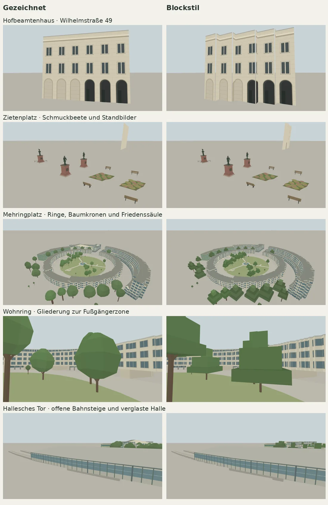

# Wilhelmstraße, Mehringplatz und Hallesches Tor

Die Eingangsfassade des Bundesarbeitsministeriums an der Wilhelmstraße 49 hat sechs Achsen. Im Erdgeschoss unterscheiden sich die drei nördlichen Blendbögen von den drei dunklen, offenen Arkaden im Süden. Zwei Reihen gekuppelter Fenster, deren Sohlbänke, die Steinlagen und das kräftige Gesims geben dem Hofbeamtenhaus seine Proportionen. Die neue Front liegt auf den vermessenen Außenwänden von zwei amtlichen Gebäudeteilen. Im Blockstil folgt sie den tatsächlich dargestellten Wandstufen. Die übrigen Gebäude des Ministeriums und die älteren Fassadendetails am Komplex bleiben Teil des Ensembles. [BMAS zum Haupteingang](https://www.bmas.de/DE/Ministerium/Zu-Gast-im-BMAS/Haupteingang/haupteingang.html) · [Straßenansicht von Jörg Zägel](https://commons.wikimedia.org/wiki/File:Berlin,_Mitte,_Wilhelmstrasse,_Haupteingang_Bundessozialministerium.jpg)

Auf dem Zietenplatz sind sechs kartierte Schmuckbeete, vierzehn ausgerichtete Sitzbänke und die blaue Informationstafel verortet. Zu dem bereits vorhandenen Standbild des Alten Dessauers kommen die Standbilder von Keith, Seydlitz, Schwerin, Winterfeldt und Zieten mit abgestuften Sockeln. Die Standorte sind kartiert. Haltung, Kleidung, Fahne, Bronzetafeln und Bepflanzung sind für die isometrische Ansicht vereinfacht. [Gedenktafel und Ortsgeschichte des Zietenplatzes](https://www.gedenktafeln-in-berlin.de/gedenktafeln/detail/zietenplatz/new66c49db12290e898068622) · [Gelände- und Objektdaten](../geo_data/regierungsviertel/arbeitsministerium-quartier-v383.json)

## Wohnringe am Mehringplatz

Der innere Wohnring war im früheren Modell ein vom Boden an geschlossenes Gebäude. Drei amtliche LoD2-Teile bilden jetzt die gekrümmten Obergeschosse und die südliche Wohnbrücke. Achtzehn in OpenStreetMap mit offenem Erdgeschoss erfasste Abschnitte grenzen die Durchgänge von den Treppenkernen ab. Die Stützenpositionen innerhalb dieser Abschnitte und die lichten Höhen sind modelliert. Für die anschließenden Häuser am äußeren Ring liefern vierzehn weitere Gebäude- und Gebäudeteile die Grundrisse und Dachkanten. Schaufensterbänder, Brüstungen, Fenstergruppen und der westliche Gebäudeflügel der AOK greifen die dokumentierte Architektur auf. Die genaue Teilung der einzelnen Fenster ist angenähert. [Landesdenkmalamt zum Mehringplatz](https://denkmaldatenbank.berlin.de/daobj.php?obj_dok_nr=09097784,T) · [Fotografien der Wohnringe](https://betonstadtberlin.de/mehringplatz-berlin-kreuzberg/) · [Amtliches Berliner Gebäudemodell](https://gdi.berlin.de/data/a_lod2/atom/LoD2_390_5817.zip)

Der Platz enthält die kartierten Wege, die zentrale Rasenfläche und die Friedenssäule mit geflügelter Viktoria und Brunnenbecken. Der Berliner Straßen- und Anlagenbaumbestand liefert 56 zusätzliche Baumstandorte mit erfasster Höhe und Kronendurchmesser. Sieben bereits dargestellte Baumstandorte wurden beim Abgleich wiedererkannt. [Platzgestaltung und Projektbilder](https://www.stadtkontor.de/projektsteuerung/gestaltung-oeffentlicher-raum/mehringplatz-berlin/) · [Wiedereröffnung 2022](https://www.berlin.de/ba-friedrichshain-kreuzberg/aktuelles/pressemitteilungen/2022/pressemitteilung.1205560.php) · [Baumkataster Berlin](https://gdi.berlin.de/services/wfs/baumbestand?service=WFS&request=GetCapabilities)

## Hochbahnhof Hallesches Tor

Die beiden Seitenbahnsteige folgen ihren kartierten Grundrissen und der Höhe der vorhandenen Hochbahnviadukts. Das Luftbild zeigt die offene westliche Bahnsteigstrecke, die rund 58 Meter lange mittlere Halle und den östlichen Abschluss. Dachgrat, Traufen und Verlauf der Außenwände folgen dem Luftbild. Dachhöhe, Fensterteilungen und Stahlprofile sind anhand von Außenaufnahmen angenähert. Das frühere durchgehende Bahnhofsvolumen ist an dieser Stelle aus beiden Darstellungen entfernt. [Landesdenkmalamt zum Hochbahnhof](https://denkmaldatenbank.berlin.de/daobj.php?obj_dok_nr=09031090) · [Außenaufnahmen des Hochbahnhofs](https://de.wikipedia.org/wiki/U-Bahnhof_Hallesches_Tor) · [TrueDOP 2026](https://gdi.berlin.de/services/wms/truedop_2026?service=WMS&request=GetCapabilities) · [Verwendete Standort- und Vermessungsdaten](../geo_data/regierungsviertel/mehringplatz-v383.json.gz)

Die Bildtafel zeigt dieselben Blickpunkte in beiden Stilen. Sie wurde mit den Geometrien der beiden neuen Viewer-Modelle gerendert. Das Straßenmodell, die benachbarten Häuser und der vorhandene Hochbahnviadukt werden im vollständigen Viewer separat gezeichnet.

