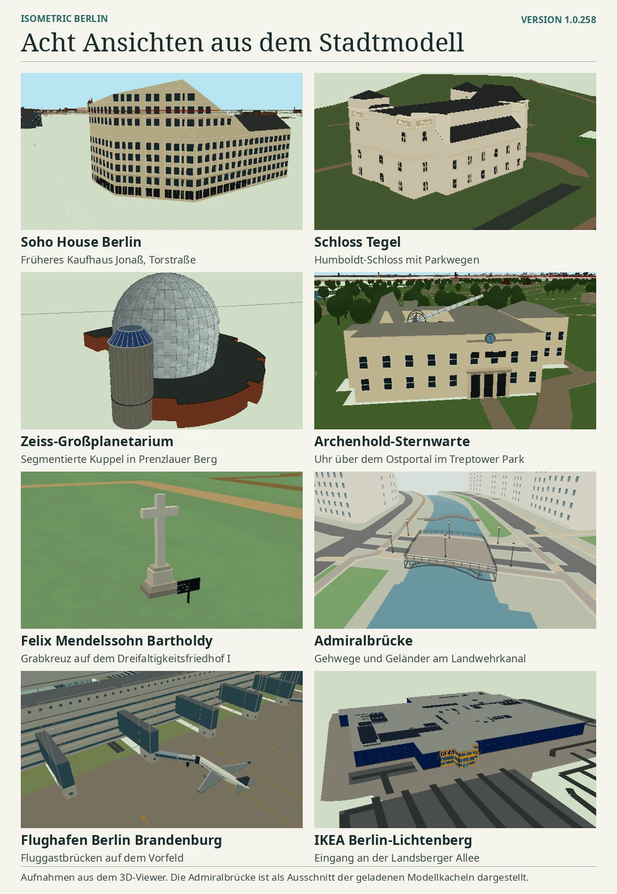

# Berliner Bauwerke, Friedhöfe und Stadtwege in v1.0.258

Über **Sehenswürdigkeiten → Ort suchen** lassen sich die neuen Orte direkt öffnen. Mehrteilige Namen funktionieren auch in anderer Reihenfolge, etwa „Grab Nico“ oder „Neukölln Weserstraße“. Jeder Treffer hat eine eigene Kameraposition und lässt sich als Link teilen. Die bestehende Rundfahrt hat weiterhin 93 Stationen.

## Historische Architektur und Astronomie

30 weitere Berliner Denkmale haben differenzierte Gebäudehüllen, Dachformen oder Fassaden auf Grundlage von Denkmalinventar, Gebäudevermessung und historischen Aufnahmen erhalten. Dazu zählen die Gipsformerei, das Ballhaus Pankow, die Kantgaragen und das Harnack-Haus. Am früheren Kaufhaus Jonaß, dem heutigen Soho House, sind die Straßenfronten eigens ausgearbeitet. Am Zeiss-Großplanetarium in Prenzlauer Berg folgen die Metallfalze der Kuppel. Im Treptower Park gehört das Zeiss-Kleinplanetarium zur Archenhold-Sternwarte. Deren beobachtete Ostfassade erhält Portal und Uhr. [Liste aller 30 Bauwerke und Quellen](historische-bauwerke-v378.md) · [Soho House öffnen](https://klotzkette.github.io/isometric-berlin/#landmark=soho-house-berlin-ehemaliges-kaufhaus-jonass) · [Archenhold-Sternwarte öffnen](https://klotzkette.github.io/isometric-berlin/#landmark=archenhold-sternwarte-mit-zeiss-kleinplanetarium)

## Gräber und Gedenkstätten

Das sowjetische Ehrenmal in der Nähe des Brandenburger Tors liegt an der Straße des 17. Juni. Im Treptower Park sind die fünf Gedenkplatten auf der Hauptachse, in der Schönholzer Heide die 16 Grabkammern erkennbar. Der Commonwealth-Friedhof an der Heerstraße zeigt einzeln lokalisierte Stelen. Ein eigener Blick führt zum Grabfeld eines dokumentierten US-amerikanischen Fliegers in kanadischem Dienst. Am Columbiadamm kennzeichnet das französische Grabdenkmal die Soldatengräber des Krieges 1870/71. Für die Zeit nach 1945 unterscheidet die Karte den Zugang zum französischen Garnisonsgräberfeld in Heiligensee von der heutigen Gedenktafel am ehemaligen Friedhof Frohnau. [Zugang in Heiligensee](https://klotzkette.github.io/isometric-berlin/#landmark=cimetiere-francaise-zugang-zum-friedhof-heiligensee) · [Gedenktafel in Frohnau](https://klotzkette.github.io/isometric-berlin/#landmark=gedenktafel-am-ehemaligen-franzosischen-ehrenfriedhof-frohnau) · [Ortsverzeichnis, Grablagen und Quellen](memorials-v378.md) · [Grabfeld an der Heerstraße](https://klotzkette.github.io/isometric-berlin/#landmark=us-flieger-im-commonwealth-friedhof-grabfeld-2) · [Französische Soldatengräber](https://klotzkette.github.io/isometric-berlin/#landmark=franzosische-soldatengraber-1870-71-am-columbiadamm)

Für Theodor und Emilie Fontane, E. T. A. Hoffmann, Felix Mendelssohn Bartholdy sowie Nico und ihre Mutter Margarete Päffgen gibt es Nahansichten. Hoffmanns Stein trägt die Initialen „E.T.W.“. Nicos Grab liegt auf dem Friedhof Grunewald-Forst. [Fontane](https://klotzkette.github.io/isometric-berlin/#landmark=grab-von-theodor-und-emilie-fontane) · [Hoffmann](https://klotzkette.github.io/isometric-berlin/#landmark=grab-von-e-t-a-hoffmann) · [Mendelssohn](https://klotzkette.github.io/isometric-berlin/#landmark=grab-von-felix-mendelssohn-bartholdy) · [Nico](https://klotzkette.github.io/isometric-berlin/#landmark=grab-von-nico-und-margarete-paffgen)

## Hermannplatz und Weserstraße

Am Hermannplatz liegen rund 2.700 m² Steinpflaster und 99 m² Mosaik auf den vermessenen Flächen. Das Platzpolygon enthält 15 innere Aussparungen. Der Zuschnitt der Beläge berücksichtigt Baumscheiben und Treppenzugänge. Die Nahansicht zeichnet die Steinlagen, beim Herauszoomen verschwinden die schmalen Fugen allmählich. Poller, Bordsteine und Übergänge folgen den kartierten Linien beider Straßen. Insgesamt sind 218 feste und sechs herausnehmbare Poller, 83 reguläre und neun abgesenkte Bordsteinlinien sowie 72 taktile Übergangspunkte erfasst. Die neun betroffenen Stadtkacheln laden beim Annähern. [Hermannplatz öffnen](https://klotzkette.github.io/isometric-berlin/#landmark=hermannplatz-in-neukolln) · [Weserstraße öffnen](https://klotzkette.github.io/isometric-berlin/#landmark=weserstrasse-fahrradstrasse-in-neukolln) · [Geodaten der Straßenbefahrung Berlin](https://gdi.berlin.de/services/wfs/strassenbefahrung?SERVICE=WFS&REQUEST=GetCapabilities) · [Quellobjekte und Flächenbilanz](../geo_data/regierungsviertel/neukoelln-street-v378-receipt.json)

## Wasser, Wald und Strände

Am Landwehrkanal haben 37 Querungen am Hauptlauf und vier an den Seitenarmen eigene Baukörper. Die historischen Geländer und das Stahltragwerk der Admiralbrücke, die beiden Durchlässe der Schlesischen Brücke und die Schleusentore liegen an ihren jeweiligen Standorten. Rund 102 km kartierte Uferwege, Hecken, Geländer und Gehölzflächen ergänzen die Ufer innerhalb der rund 322 km² großen Modellfläche. [Brückenverzeichnis, Abdeckung und Quellen](waterways-v378.md) · [Admiralbrücke](https://klotzkette.github.io/isometric-berlin/#landmark=admiralbrucke)

Der Zentrale Festplatz, Schloss Tegel, der Tegeler Forst, das Tegeler Fließ und die Strände am Tegeler See und am Wannsee haben eigene Einstiege. Am Schloss folgen Dach und Flügel der amtlichen Gebäudeform. An den Badestellen treffen die kartierten Sandflächen auf den Wasserspiegel. [Landschaft und Vermessung](tegel-landschaft-v378.md) · [Schloss Tegel](https://klotzkette.github.io/isometric-berlin/#landmark=schloss-tegel) · [Tegeler Fließ](https://klotzkette.github.io/isometric-berlin/#landmark=tegeler-fliess-am-eichwerdersteg) · [Strandbad Wannsee](https://klotzkette.github.io/isometric-berlin/#landmark=strandbad-wannsee) · [Zentraler Festplatz](https://klotzkette.github.io/isometric-berlin/#landmark=zentraler-festplatz-berlin)

## Flugplätze, Stadtautobahn und Ringbahn

Die A100, A103, A111, A113 und die öffentliche S-Bahn-Trasse zum BER folgen kartierten Achsen. Überdeckte Strecken berücksichtigen die Tunnellage. 22 Stationen am Ring haben kartierte taktile Bahnsteigkanten. Fünf Bahnhöfe zeigen zusammen 16 illustrative S-Bahn-Wagen. Am BER verbinden ausgefahrene Fluggastbrücken das Terminal mit unbeschrifteten Standmodellen. Der Tower hat ein dekoratives Blinklicht. Auch der frühere Flugplatz Gatow, die stillgelegte Startbahn in Tegel und das Flugzeug auf dem Tempelhofer Feld sind direkt auffindbar. [Verkehrswege und fünf Bahnhofskameras](transportV378-korridore.md) · [Flugplätze und Vorfeld](transportV378-flugplaetze.md) · [BER-Fluggastbrücken](https://klotzkette.github.io/isometric-berlin/#landmark=flughafen-ber-fluggastbrucken) · [Ostkreuz](https://klotzkette.github.io/isometric-berlin/#landmark=s-bahnhof-ostkreuz)

## Einrichtungshäuser und Baumärkte

Die Suche unterscheidet die Einrichtungshäuser in Tempelhof, Spandau, Lichtenberg und Waltersdorf von den drei IKEA-Planungsstudios. Waltersdorf liegt in Brandenburg. Der Standortvergleich umfasst auch OBI, BAUHAUS, HELLWEG, HORNBACH, toom, Globus Baumarkt und Holz Possling. Die Zuordnungen beziehen sich auf den **23. November 2026**. Angekündigte Betreiberwechsel und geschlossene Filialen sind im Quelleninventar einzeln ausgewiesen. [Standortliste und Bestandsabgleich](einrichtungshaeuser-und-baumaerkte-v378.md) · [Standortinventar](../geo_data/regierungsviertel/retail-sites-v378-receipt.json) · [Erklärung von OBI zur Übernahme](https://www.obi.de/corporate/presse/pm_freigabe_uebernahme)

## Speicherbedarf und Laden

Die regionalen Ergänzungen laden erst beim Annähern. Dazu gehören 68 historische Architekturpakete, 41 Uferpakete, 36 Verkehrspakete, neun Pakete für Hermannplatz und Weserstraße, sieben Landschaftspakete und drei regionale Einzelhandelsdateien. Die Suche lädt den zusätzlichen Ortskatalog beim Öffnen eines Ortslinks, bei der Suche oder bei der Wiederaufnahme der Navigation.

| Umfang in Byte | v1.0.257 | v1.0.258 | Differenz |
| --- | ---: | ---: | ---: |
| Start-JavaScript, drei Dateien (gzip 9) | 126.512 | 127.486 | +974 |
| Vollständige Pages-Ausgabe | 975.722.015 | 978.422.652 | +2.700.637 |
| Standard-ZIP | 956.739.930 | 957.803.866 | +1.063.936 |
| Kompakte ZIP | 777.157.717 | 778.221.653 | +1.063.936 |
| TAR.GZ | 955.213.840 | 956.218.531 | +1.004.691 |

Die Startgröße ist die Summe der einzeln mit gzip auf Stufe 9 komprimierten JavaScript-Dateien der ersten HTML-Antwort. Die Übertragungsgröße im Browser hängt von der Serverkompression und vom Cache ab. Für die 6.174 regulären Stadtkachel-Dateien wurden Größe und SHA-256-Prüfsumme geprüft.
