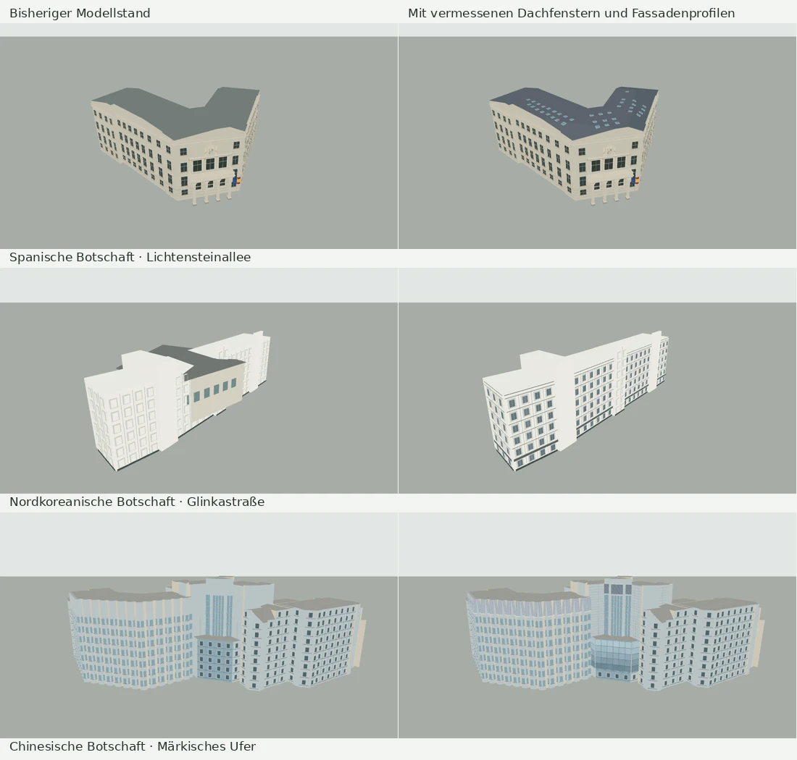
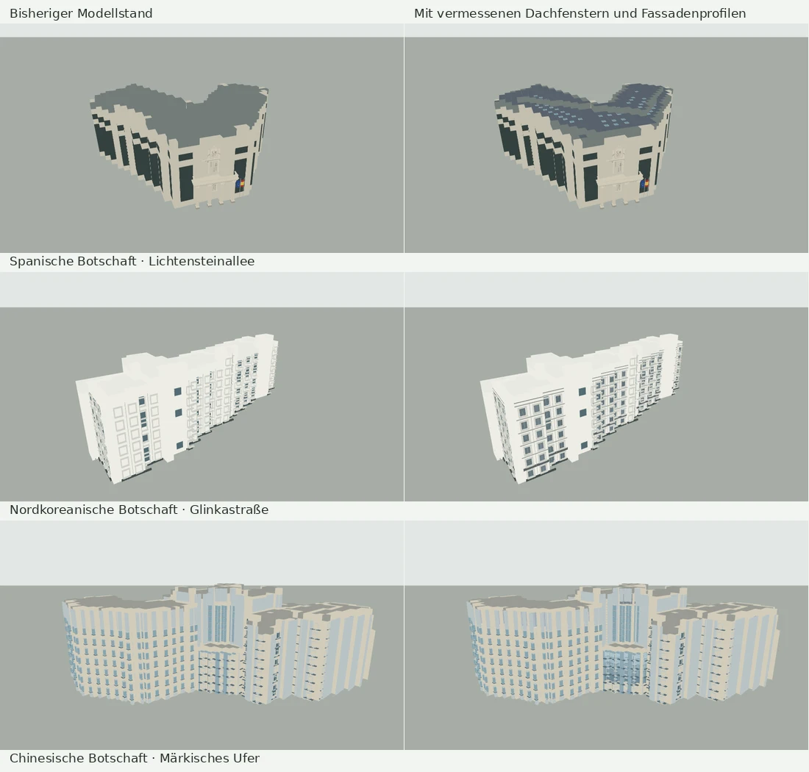

# Botschaften am Märkischen Ufer, an der Glinkastraße und am Neuen See

Die drei Ziele sind als eigene Ansichten anwählbar. Die modellierten Details folgen dem jeweiligen amtlichen Gebäudekörper. Dachfenster, Fassadenraster und Farbwerte sind für die isometrische Darstellung vereinfacht.

| Standort | Änderungen | Grundlage |
| --- | --- | --- |
| Spanische Botschaft, Lichtensteinallee | 38 im Luftbild erkennbare Dachfenster auf den Flügeln und über der abgeschrägten Ecke. Die dunkle, leicht blaugraue Eindeckung folgt den vorhandenen Dachschrägen. Der vier­säulige Balkon und die fünf Baukörper gehören zum Bestandsmodell. | Berliner TrueDOP 2026, Hauptdach von LoD2-Teil `DEBE3DflaRtl1pZV`. [Denkmaldatenbank Berlin](https://denkmaldatenbank.berlin.de/daobj.php?obj_dok_nr=09050276) |
| Nordkoreanische Botschaft, Glinkastraße | 168 dunkle Fensterfelder mit schmalen Mittelprofilen füllen die bestehenden Fensterachsen. Horizontale Betonkanten, Dachrand und dunkles Band über dem Sockel fassen die Fensterreihen zusammen. | Acht LoD2-Bauteile des Gebäudes `DEBE01YYK00007QN`, Außenaufnahme vom 9. April 2024. [Ankermast, CC BY 4.0](https://commons.wikimedia.org/wiki/File:Nordkoreanische_Botschaft,_Berlin.jpg) |
| Chinesische Botschaft, Märkisches Ufer | Der gebogene Flügel hat im oberen Geschoss einen gefalzten silbernen Abschluss. Über der zentralen Glasfront sitzen dunkle Lamellen. Das vorgelagerte niedrigere Gebäude zeigt durchgehende spiegelnde Glasfelder. Die seitlichen Hochbauten besitzen feine Plattenfugen. | Fünf Bauteile des LoD2-Gebäudes `DEBE01YYK000095y`, Außenaufnahme vom 4. Juni 2026. [Roy Zuo, CC BY-SA 4.0](https://commons.wikimedia.org/wiki/File:(20260604)_China_embassy_demo_2653.jpg) |

Der frühere schematische Bau an der Glinkastraße hatte einen 36 × 23 Meter großen Grundriss und ein Giebeldach. Von seinen 828 Quadratmetern lagen rund 358 Quadratmeter außerhalb des achtteiligen amtlichen Grundrisses. Die reguläre Stadtansicht verwendet dort den vermessenen Bestand. Adressen, Rohdatenabfragen, Bildnachweise und die im Orthofoto abgelesenen Dachfenstermitten stehen im [Quellennachweis](../geo_data/regierungsviertel/embassy-sites-v380-survey.json).

## Modellvergleich

Die Bilder zeigen dieselben Kameras und dieselbe Beleuchtung links im bisherigen Stand und rechts nach der Überarbeitung. Für eine freie Sicht auf die Fassade werden nur die betroffenen Gebäudekörper und ihre zugehörigen Details gerendert.

## Daten und Prüfung

Die Stein- und Glasprofile verwenden pro Standort und Darstellungsart eine zusätzliche Zeichenoperation. Die sechs separat ladbaren Geometriepakete belegen zusammen 38.366 Byte als JSON-Dateien. Bei der Blockdarstellung sitzen die Details auf vorhandenen waagerechten oder senkrechten Blockflächen. Die Dachfenster werden an Höhensprüngen der vorhandenen Stufen getrennt.

Der Generator vergleicht mit `python scripts/build_embassy_sites_v380.py --check` alle sechs Pakete bytegenau. Der Regressionstest prüft die Begrenzungen der sechs Modelle, achsenparallele Blockflächen, Speicherabrechnung, konkurrierendes Laden, Abbruch und die einmalige Gebäudedarstellung an der Glinkastraße. Er läuft unter `src/app` mit `bun test tests/embassy-sites-v380.test.ts`.
