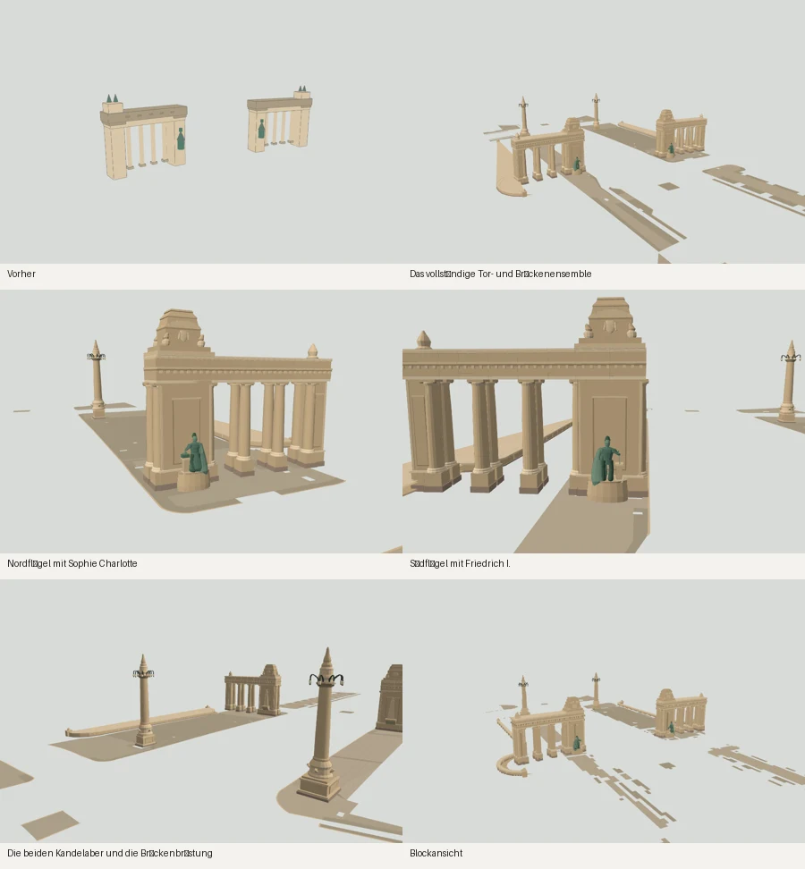

# Charlottenburger Tor und Charlottenburger Brücke

Die neue Ansicht folgt der heutigen Anlage an der Straße des 17. Juni. Östlich des Landwehrkanals stehen die beiden geschwungenen Torflügel. Westlich stehen wieder beide hohen Kandelaber. Zwischen ihnen liegen die Fahrbahnen, die beiden steinernen Vorplätze und die Brückeneinfassungen. [Ensemble öffnen](https://klotzkette.github.io/isometric-berlin/#landmark=charlottenburger-tor) · [Kandelaber öffnen](https://klotzkette.github.io/isometric-berlin/#landmark=kandelaber-an-der-charlottenburger-brucke)

Die Torflügel stehen auf ihren getrennt erfassten Grundrissen. Die mittleren Abschnitte folgen der leichten Krümmung des Tuffsteinbaus. Beide Seiten zeigen die hohen Granitsockel, gekuppelten Säulen mit Kapitellen, das abgestufte Gebälk, die steinernen Trophäen und den niedrigeren Außenpfeiler. Die Berliner Oberflächen- und Geländemodelle ergeben über den Kolonnaden rund 14,7 m und über dem nördlichen Hauptpfeiler rund 19,7 m Höhe. Der räumliche Aufbau folgt diesen Werten. Die frühere Darstellung reichte an ihren Spitzen bis etwa 26 m über ihren Sockel. [Landesdenkmalamt Berlin, Objekt 09096448](https://denkmaldatenbank.berlin.de/daobj.php?obj_dok_nr=09096448) · [Amtliche Aufnahme des Nordflügels](https://denkmaldatenbank.berlin.de/media/uploads/Cha/02/09096448a.jpg) · [Kartierte Torgrundrisse](https://www.openstreetmap.org/relation/13918836)

An der Tiergartenseite steht nördlich Sophie Charlotte mit dem Modell ihres Schlosses, südlich Friedrich I. mit Zepter und Mantel. Auf der Kanalseite sitzen die flachen Obelisken und Schiffsschnäbel. Die Modelle der bronzenen Figuren geben Haltung, Kleidung und Attribute aus den Fotografien wieder. Gesichter, Schmuck und Reliefs sind vereinfacht. Die seit 1945 verschollenen Tiergruppen Georg Wrbas sind im heutigen Zustand ausgespart. [Bezirksamt mit Aufnahmen beider Herrscherfiguren](https://www.berlin.de/ba-charlottenburg-wilmersdorf/ueber-den-bezirk/bauwerke/artikel.1368662.php) · [Sophie Charlotte öffnen](https://klotzkette.github.io/isometric-berlin/#landmark=charlottenburger-tor-sophie-charlotte) · [Friedrich I. öffnen](https://klotzkette.github.io/isometric-berlin/#landmark=charlottenburger-tor-friedrich-i)

Die 2010 wiederaufgestellten Kandelaber erhalten je acht herabhängende Bogenlampen. Beide sind 22 m hoch und stehen auf ihren eigenen vierseitigen Grundrissen. Der nördliche und südliche Sockel unterscheiden sich in den Kartendaten. Die Kanalbrüstung mit ihrem Deckgesims und den Endpfeilern folgt den im Luftbild sichtbaren Kanten. Am Südostende umfasst sie den gerundeten Aussichtspunkt. In der Brückenmitte bleibt die schon modellierte Durchfahrt offen. [Nördlicher Sockel](https://www.openstreetmap.org/way/114399857) · [Südlicher Sockel](https://www.openstreetmap.org/way/106961073) · [Berliner Orthophoto Frühjahr 2025](https://gdi.berlin.de/services/wms/dop_2025_fruehjahr?SERVICE=WMS&REQUEST=GetCapabilities)

Den angrenzenden Straßenraum bilden 5.374 m² kartierter Gehwegbelag. Der Abgleich umfasst 135 vollständige oder zugeschnittene Datensätze der Straßenbefahrung zu Gehweg, Fahrbahn, Grünfläche und Baumscheibe. Der Gehweg schließt an rund 610 m erfasste Fahrbahnkante an. Baumscheiben und grüne Aussparungen bleiben offen. Feine Steinlagen am Brückenkopf und die Profile der bildhauerischen Details sind zeichnerische Annäherungen. Die Straßenbefahrung stammt aus 2014/15. Einzelne zwischenzeitliche Änderungen können davon abweichen. [Geobasisdaten der Straßenbefahrung Berlin](https://gdi.berlin.de/services/wfs/strassenbefahrung?SERVICE=WFS&REQUEST=GetCapabilities) · [Gelände- und Oberflächenstichproben, Umrisse und Flächen](../geo_data/regierungsviertel/charlottenburger-tor-v379-survey.json.gz)

Für die gezeichnete Ansicht und den Blockmodus gibt es getrennte Daten. Beim Annähern lädt der Viewer nur die gewählte Darstellung. Jede Variante benötigt für dieses Ensemble einen einzigen Zeichenaufruf. Die beiden früheren neun Meter hohen Gebäudekästen der Kandelaber und die zugehörige zwölf Meter hohe Rasterzelle werden anhand ihrer ursprünglichen Geometrie identifiziert. [Reproduzierbarer Modellgenerator](../scripts/build_charlottenburger_tor_v379.py)
