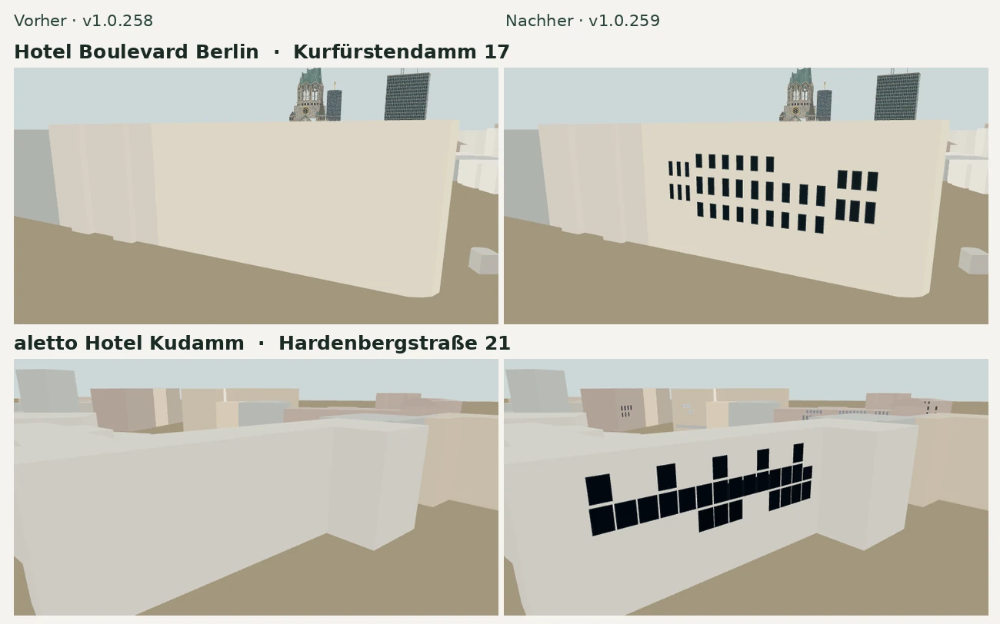

# Fassaden zwischen Hardenbergstraße und Kurfürstendamm

In der City West zeigen 89 Gebäude auf 150 Außenwänden Fensterreihen, verglaste Bänder und Brüstungsfelder. Die Maße kommen aus Schrägluftaufnahmen von 2013, die 2014 mit dem texturierten Berliner Stadtmodell veröffentlicht wurden. Die Öffnungen sitzen auf den vorhandenen LoD2-Gebäudeumrissen. Im Blockstil folgen sie den tatsächlich freiliegenden Seiten der Vier-Meter-Blöcke. [Texturiertes Berliner Stadtmodell](https://www.3dcitydb.net/3dcitydb/fileadmin/mydata/Berlin_Demo/Berlin_Buildings_rgbTexture_ScaleFactor_0.3/) · [Zuordnungen, Bildquellen und Prüfsummen](../geo_data/regierungsviertel/citywest-fronts-v379-evidence.json.gz)

Am **Hotel Boulevard Berlin, Kurfürstendamm 17**, sind drei Außenwände mit 64 Fensterfeldern und einem Brüstungsfeld erfasst. Am **aletto Hotel Kudamm, Hardenbergstraße 21**, sind es auf zwei Außenwänden 31 Fensterfelder, 28 verglaste Felder und sechs Brüstungsfelder. Die Namen und Hausnummern stammen aus den zugeordneten OpenStreetMap-Grundrissen. Seit dem Aufnahmejahr veränderte Fenster und Fassaden können heute anders aussehen. [Kurfürstendamm 17](https://www.openstreetmap.org/way/181500151) · [Hardenbergstraße 21](https://www.openstreetmap.org/way/290078078)

Die Bildpaare zeigen die echte Ferngeometrie der Versionen 1.0.258 und 1.0.259. Pro Adresse sind Kamera, Beleuchtung, Nachbargebäude und Bildausschnitt gleich. Der neutrale Untergrund lässt die Wandflächen erkennen. Im ursprünglichen WebGL-Bild mit 720 × 455 Pixeln ändern sich am Kurfürstendamm 10.764 und an der Hardenbergstraße 20.056 Bildpunkte um mehr als zwei Graustufen.

## Welche Details sind belegt?

Für die Zuordnung wurden 174 fotografierte Wandansichten mit erhaltenen Modellkanten verglichen. Eine übernommene Wand musste zur Bauhöhe und zum registrierten Wandverlauf passen. Die Erzeugung schließt verdeckte Öffnungen gegenüber Nachbargebäuden sowie bereits eigenständig modellierte Gebäude aus. Fensterachsen, Geschossabstände, Gruppen, Proportionen und Farbflächen stammen aus den Bildausschnitten. Wo die Bildauflösung nur ein zusammenhängendes Glasband erkennen lässt, bleibt es im Modell als Fläche erhalten. Schmale Laibungen und Fensterbänke sind maßstäblich ergänzte Zeichendetails. [Erzeugung der Fassadendaten](../scripts/build_citywest_fronts_v379.py)

| Geprüfte Felder in der gesamten City West | Anzahl |
| --- | ---: |
| Fensterfelder | 1.711 |
| Größere Verglasungen | 58 |
| Brüstungs- und Materialfelder | 86 |
| Insgesamt | 1.855 |

Der Regressionstest gleicht alle 150 Kanten mit den ursprünglichen Gebäudeumrissen ab und prüft die Ausdehnung der 1.855 Felder. In der gezeichneten Nah- und Fernansicht ergeben sich dieselben 5.335 Vierecke. An den ausgeschnittenen Originalsäulen des Blockmodells erzeugen Mobil- und Desktopprofil jeweils 7.352 Vierecke mit identischen Positionen für alle 89 Gebäude. Der komprimierte Vektordatensatz für die Fassaden umfasst 16.309 Byte bei gzip-Stufe 9. [Fassadendaten](../src/app/src/data/cityWestFrontsV379.json) · [Regressionstest mit Originalgeometrie](../src/app/tests/city-west-fronts-v379.test.ts)
