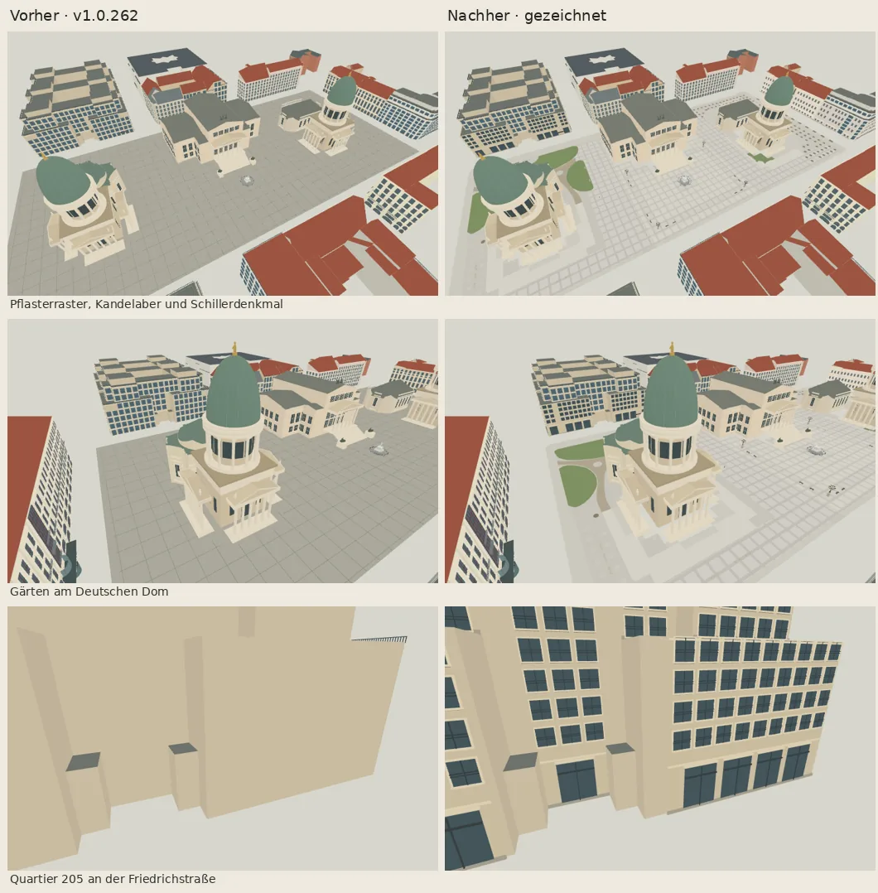
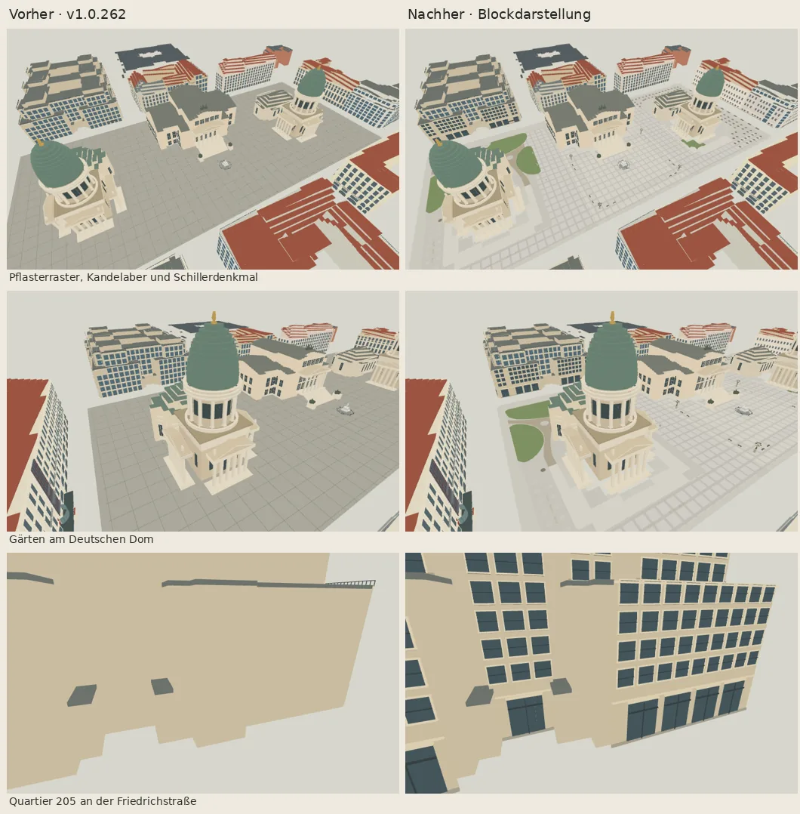

# Gendarmenmarkt und Friedrichstraße

Vor dem Konzerthaus war eine einzige graue Fläche mit einem frei gewählten Fugenabstand von 7,5 Metern zu sehen. Sie folgte dem 38.092 Quadratmeter großen Ortsumriss und lag auch am Deutschen Dom über den Gärten. Jetzt bestimmt die Fußgängerfläche der OSM-Relation 3573535 die Außengrenze. Vier kartierte Rasenflächen sowie ein kleineres Pflanzbeet am Französischen Dom haben wieder eigene Flächen. Die 123 Baumscheiben wurden mit dem Berliner Baumkataster abgeglichen. Die vorhandenen Bäume werden weiterhin von der städtischen Baumschicht gezeichnet. [Platz im Viewer](https://klotzkette.github.io/isometric-berlin/?theme=day&lang=de#landmark=gendarmenmarkt) · [OpenStreetMap](https://www.openstreetmap.org/relation/3573535) · [Berliner Baumkataster](https://gdi.berlin.de/services/wfs/baumbestand?service=WFS&request=GetCapabilities)

Bei der 2025 abgeschlossenen Sanierung behielt Berlin das historische Raster auf 14.000 Quadratmetern bei. 180 Flächen der Straßenbefahrung dokumentieren unter anderem die Natursteinfelder und die breiteren Pflasterstreifen dazwischen. Die Fortsetzung des Fünfmeterrasters auf den seitlichen Vorplätzen wurde am TrueDOP 2026 abgelesen. Der Viewer setzt das Muster als zusammenhängende Fläche um. Die 33 Sitzplätze sind sowohl als Banklinie vermessen als auch bei OpenStreetMap erfasst. Vier mehrarmige Kandelaber und zwei Trinkbrunnen stehen an ihren kartierten Positionen. Für die Gestaltung der Kandelaber diente die Außenaufnahme der restaurierenden Firma als Vorlage. Metallprofile, Steinfarben und die einzelnen Laternenhöhen sind Annäherungen. [Senatsmeldung zur Wiedereröffnung](https://www.berlin.de/sen/uvk/presse/pressemitteilungen/2025/pressemitteilung.1540307.php) · [Straßenbefahrung](https://gdi.berlin.de/services/wfs/strassenbefahrung?service=WFS&request=GetCapabilities) · [TrueDOP 2026](https://gdi.berlin.de/services/wms/truedop_2026?service=WMS&request=GetCapabilities) · [Restaurierte Leuchten](https://www.hahnlichtberlin.de/referenzen/gendarmenmarket-sanierung-2025/)

Am Quartier 205 fehlten auf der Seite zur Friedrichstraße die Fenster. Elf amtliche Wandflächen dieser Seite tragen jetzt das für Oswald Mathias Ungers typische steinerne Raster mit quadratischen, viergeteilten Öffnungen sowie verglasten Erdgeschossen und zurückgesetzten oberen Stockwerken. Auch am nördlichen Platzrand und an der Ecke Markgrafenstraße/Taubenstraße folgen die unterschiedlichen Häuser ihrem jeweiligen Fassadenbild. Insgesamt wurden 40 historische Fotoansichten von fünf Gebäudefamilien an die zugehörigen LoD2-Wände registriert. Daraus wurden 646 obere Fensterpositionen abgeleitet. Die historischen Fotografien dienen zur Bestimmung der Fassadenteilung. Fenstermaße, heutige Glasfarben und der Einzelhandel sind daraus nur begrenzt ablesbar. [Gebäudequellen und Fotos](gendarmenmarkt-perimeter-sources-v146.md) · [Protokoll der Fassadenregistrierung](../geo_data/regierungsviertel/gendarmen-fronten-v383.json.gz)

Die Bildpaare zeigen das ursprüngliche und das überarbeitete Modell mit jeweils identischer Kamera. Sie zeigen die zuständigen Platz- und Gebäudeobjekte isoliert. Weitere Ebenen wie die umgebenden Straßen und die städtischen Baumkronen sind im regulären Viewer zu sehen.

