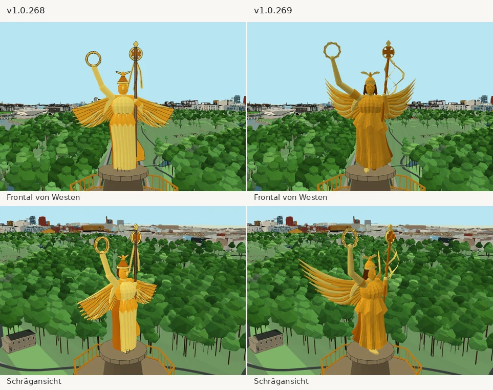

# Die Viktoria auf der Berliner Siegessäule

Friedrich Drakes Viktoria blickt am Großen Stern nach Westen. Die Figur ist 8,32 m hoch, ihr Schuh misst 92 cm. Sie trägt einen Adlerhelm, hebt mit der rechten Hand einen Lorbeerkranz und hält links ein Feldzeichen mit dem Eisernen Kreuz. Blattgold auf Ölgrund überzieht den Bronzeguss. [Bestandsaufnahme von Bildhauerei in Berlin](https://bildhauerei-in-berlin.de/bildwerk/siegessaeule-4706/) · [Historische Informationstafel des Bezirks Mitte](https://www.berlin.de/kunst-und-kultur-mitte/geschichte/erinnerungskultur/gedenktafel-datenbank/id-1084_geschichte-der-siegessaeule.pdf)

Von vorn zeigt sich ein breiter Fächer hinter den Schultern. Seitlich wird sichtbar, wie weit die Flügel hinter den Oberkörper reichen. Von unten treten die aufgerollten Gewandkanten, die langen Bänder am Feldzeichen und die einzelnen Blätter des Kranzes hervor. Neigung und scheinbare Höhe der Flügelspitzen ändern sich mit der Kameraposition. Flügeltiefe, Faltenabstände und Glanzlichter im Modell sind bildgestalterische Annäherungen. [Bereits verwendete Frontalansicht von AlterVista](https://commons.wikimedia.org/wiki/File:Berlin_Siegessaeule_Victoria.jpg)

## Die Figur im Viewer

Beide Spalten zeigen denselben Kamerastand und dasselbe Tageslicht. In der unteren Reihe sieht man, wie weit die Schwingen hinter die Figur reichen. [Siegessäule im Viewer öffnen](https://klotzkette.github.io/isometric-berlin/?theme=day&lang=de#landmark=siegessaule)

## Weitere fotografische Referenzen

| Sichtbares Detail | Aufnahme und Urheber | Lizenz |
| --- | --- | --- |
| Dreiviertelansicht mit erhobenem Kranz und abstehendem Gewandsaum | [Siegessaeule Goldelse Berlin2007.jpg](https://commons.wikimedia.org/wiki/File:Siegessaeule_Goldelse_Berlin2007.jpg), VollwertBIT | [CC BY-SA 3.0](https://creativecommons.org/licenses/by-sa/3.0/) |
| Griff am unteren Stabende und benachbarte Stofffalte | [Viktoria Berlin (DSC00406).jpg](https://commons.wikimedia.org/wiki/File:Viktoria_Berlin_%28DSC00406%29.jpg), Polibil | [CC BY-SA 4.0](https://creativecommons.org/licenses/by-sa/4.0/) |
| Hand mit einzelnen Lorbeerblättern von unten | [Viktoria Berlin (DSC00409).jpg](https://commons.wikimedia.org/wiki/File:Viktoria_Berlin_%28DSC00409%29.jpg), Polibil | [CC BY-SA 4.0](https://creativecommons.org/licenses/by-sa/4.0/) |
| Staffelung der Federn und hochgerollter Gewandsaum | [Berliner Siegessäule Viktoria-01.jpg](https://commons.wikimedia.org/wiki/File:Berliner_Siegess%C3%A4ule_Viktoria-01.jpg), Muck | [CC BY-SA 4.0](https://creativecommons.org/licenses/by-sa/4.0/) |
| Vorne fast gerade fallende Falten neben einem seitlich ausschwingenden Saum | [Berliner Siegessäule Viktoria-02.jpg](https://commons.wikimedia.org/wiki/File:Berliner_Siegess%C3%A4ule_Viktoria-02.jpg), Muck | [CC BY-SA 4.0](https://creativecommons.org/licenses/by-sa/4.0/) |
| Griff und Bänder des Feldzeichens | [Berliner Siegessäule Viktoria-03.jpg](https://commons.wikimedia.org/wiki/File:Berliner_Siegess%C3%A4ule_Viktoria-03.jpg), Muck | [CC BY-SA 4.0](https://creativecommons.org/licenses/by-sa/4.0/) |
| Rückansicht von unten mit mehreren gewellten Saumkanten | [Berliner Siegessäule Viktoria-04.jpg](https://commons.wikimedia.org/wiki/File:Berliner_Siegess%C3%A4ule_Viktoria-04.jpg), Muck | [CC BY-SA 4.0](https://creativecommons.org/licenses/by-sa/4.0/) |
| Seitenansicht mit langem nach hinten ausgreifendem Flügel | [Berlin-Siegessaeule-22-Engel-2017-gje.jpg](https://commons.wikimedia.org/wiki/File:Berlin-Siegessaeule-22-Engel-2017-gje.jpg), Gerd Eichmann | [CC BY-SA 4.0](https://creativecommons.org/licenses/by-sa/4.0/) |
| Schrägansicht der beiden Flügel und des erhobenen Arms | [Berlin Victory Column (28481759940).jpg](https://commons.wikimedia.org/wiki/File:Berlin_Victory_Column_%2828481759940%29.jpg), Gary Todd | [CC0](https://creativecommons.org/publicdomain/zero/1.0/) |
