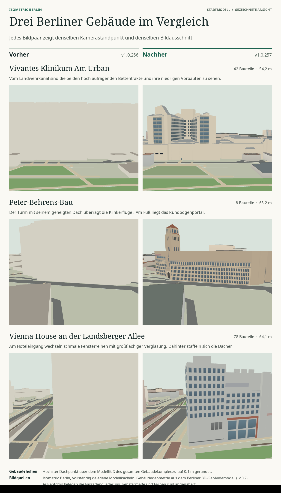

# Die 50 größten bislang undetaillierten Baukörper in Berlin

Die Auswahl bezieht sich auf die in Version 1.0.256 sichtbare Stadt. Die Rangfolge ergibt sich aus dem modellierten oberirdischen Bauvolumen. Dafür werden die Grundflächen auf jeder Höhenstufe vereinigt. Ein Hof bleibt ausgespart, und an einer Kachelgrenze setzt sich dasselbe Gebäude fort. 31 der ausgewählten Gebäude liegen in mehreren Kacheln. Die Grenze auf Rang 50 liegt bei 197.186,64 m³. Das ist ein Wert des Stadtmodells. Ein nach DIN ermittelter Bruttorauminhalt kann abweichen. [Rangliste und zugehörige Wände](../geo_data/regierungsviertel/windowless-buildings-v377.json)

Die Auswertung umfasst 3.087 Umgebungskacheln, die zentralen Gebäudeprismen und den separat geladenen Bestand in Alt-Mitte. Bei den größten Kandidaten wurden vorhandene Fenstergeometrie, bereits ausgearbeitete Fassaden und ihre tatsächlich eingeblendeten Nachfolgermodelle berücksichtigt. Die Treptowers besaßen zum Beispiel schon Fensterreihen. [Auswahlverfahren](../scripts/build_windowless_buildings_v377.py) · [Prüfung des Zentrums](../geo_data/regierungsviertel/windowless-core-audit-v377.json) · [Prüfung von Alt-Mitte](../geo_data/regierungsviertel/windowless-resident-audit-v377.json)

Zwei zunächst qualifizierte Körper schieden beim Vergleich mit dem amtlichen TrueDOP 2026 aus. An der Ferdinand-Schultze-Straße war die frühere Halle bereits geräumt. Das alte Stadionoval im Friedrich-Ludwig-Jahn-Sportpark war eine Rückbaufläche. Die Modelle dieser früheren Bauzustände bleiben im Bestand. Den Platz in der Fassadenrunde erhielten das abgestufte Wohnhochhaus am Platz der Vereinten Nationen und die umgenutzten Werkstatthallen an der Alboinstraße. [Luftbilddienst Berlin](https://gdi.berlin.de/services/wms/truedop_2026?service=WMS&request=GetCapabilities) · [Wohnhochhaus und Platzanlage](https://denkmaldatenbank.berlin.de/daobj.php?obj_dok_nr=09085180) · [Reichsbahnausbesserungswerk Tempelhof](https://denkmaldatenbank.berlin.de/daobj.php?obj_dok_nr=09066445%2CT)

## Wie eine Aufnahme auf die richtige Außenwand kommt

Das Land Berlin hat seine damaligen LoD2-Gebäude mit Schrägluftbildern aus dem Jahr 2013 texturiert und das Modell 2014 aktualisiert. Für jede passende Fassade wurden die Bildkoordinaten der historischen Wanddreiecke auf die heute im Viewer vorhandene Wand projiziert. Die Lage der Wandebenen darf höchstens 1,25 Meter voneinander abweichen. Auf diese Weise ließen sich für 44 der 50 Baukörper Bildbereiche zuordnen. Historische Aufnahmen können Bäume, Schatten und spätere Umbauten enthalten. Deshalb belegt ein zugeordneter Bildbereich für sich allein noch kein Fenster. Neuere Aufnahmen, LoD2-Wände, ALKIS und kartierte Gebäudeeingänge ergänzen diese Auswertung. [Amtliche Beschreibung der Schrägluftbilder](https://fbinter.stadt-berlin.de/fb_daten/beschreibung/lod2.html) · [Bildentzerrung](../scripts/capture_historic_building_fronts_v377.py) · [Bildnachweise und Urheber](../geo_data/regierungsviertel/facade-evidence-v377.json)

Wiederkehrende Fenster, Glasfelder, Brüstungen, Stützen und geschlossene Bekleidungen sind als maßstäbliche, stilisierte Flächen auf der jeweiligen Wand dargestellt. Einzelne Fenstermaße, Laibungen, Helligkeitswerte und Farben sind Annäherungen. Bei Hallen oder Mauern gehören größere geschlossene Flächen zum tatsächlichen Erscheinungsbild. Bei nachweislich neu errichteten oder umfassend umgebauten Gebäuden wie UP! Berlin und DSTRCT.Berlin haben jüngere Ansichten Vorrang. Der historische Stadtzustand einzelner Gebäude, darunter das SEZ an der Landsberger Allee, gehört zur dargestellten Modellfassung. [Berliner Senat zum Standort des ehemaligen SEZ](https://www.berlin.de/sen/stadt/presse/pressemeldungen/pressemitteilung.1413719.php)

## Vier Gebäude mit neuer dreidimensionaler Hülle

Das Klinikum Am Urban, der Peter-Behrens-Bau, das Vienna House und das B:HUB hatten früher eine ebene Dachfläche in der größten Höhe des jeweiligen Gebäudes. Über dem Klinikvorbau stand dadurch im Modell eine hohe Wand, obwohl auf Fotos an dieser Stelle die zurückgesetzten Bettentrakte zu sehen sind. Für die gezeichnete Ansicht bilden nun 133 amtliche Gebäudeteile die Außenwände und Dächer dieser vier Häuser. Der Viewer ersetzt die zugehörigen alten Wand-, Dach- und Konturlinien in ihren zehn Kacheln. Zu den Formen gehören der V-förmige Bettentrakt, der abgestufte Behrens-Turm und die zurückspringenden Bürogeschosse des B:HUB. Beim Begehen folgen die Dachflächen ebenfalls den neuen Höhen. [Amtliche Gebäudehüllen und Prüfsummen](../geo_data/regierungsviertel/surveyed-building-shells-v377-receipt.json) · [Fassadenfotos und örtliche Zuordnung](fassaden-fotobelege-v377.md)

## Darstellung im Viewer

Die gezeichnete und die blockartige Ansicht binden jede Ergänzung an ihre eigene Wandgeometrie. Eine Kachel lädt die Fassadendaten erst bei Bedarf. Wiederholte Fensterreihen eines Feldes werden auf zwei Dreiecken gezeichnet. Rahmen und Sprossen entstehen beim Zeichnen. Die historischen Fotodateien verbleiben in der Quellenprüfung. Die reproduzierbare Auswertung liefert 370 entzerrte Wandabschnitte mit messbaren Öffnungen oder Materialmerkmalen an 38 Gebäuden. Die übrigen Gebäude wurden anhand einzeln zugeordneter Außenansichten, Katasterdaten oder dokumentierter Bauteile bearbeitet. [Darstellung im Viewer](../src/app/src/surveyedBuildingFacadesV377.ts)

Drei Direktansichten öffnen die Kamera an einer bearbeiteten Außenwand. [Klinikum Am Urban](https://klotzkette.github.io/isometric-berlin/?theme=day#landmark=vivantes-klinikum-am-urban) · [Vienna House](https://klotzkette.github.io/isometric-berlin/?theme=day#landmark=vienna-house-an-der-landsberger-allee) · [Peter-Behrens-Bau](https://klotzkette.github.io/isometric-berlin/?theme=day#landmark=peter-behrens-bau)

## Bildvergleich und Speicherbedarf

Für alle 50 Gebäude wurde die Änderung mit derselben Kamera in der gezeichneten Ansicht und im Blockmodus gerendert. In allen 100 Bildpaaren waren an dem jeweils geprüften Gebäude Änderungen sichtbar.

Die kompakte Offline-ZIP wächst gegenüber v1.0.256 um 190.000 Bytes auf 777.157.717 Bytes. Die Standard-ZIP wächst um 190.001 Bytes auf 956.739.930 Bytes. Beim ersten Seitenaufruf wächst das direkt eingebundene JavaScript um 311 Bytes vor Transportkompression. Die Fassaden und die vier Gebäudehüllen lädt der Viewer nach Bedarf. Eine Ladezeit auf individuellen Endgeräten wurde für diese Runde nicht gemessen.

## Die Gebäude im Einzelnen

Die Volumen sind auf volle Kubikmeter gerundet. Die Kartenlinks markieren die jeweilige Gebäudekomponente. Die letzte Spalte nennt die in der gezeichneten Ansicht verwendeten Fassadenelemente.

| Rang | Gebäude oder Standort | Modellvolumen | Dargestellte Elemente |
| ---: | --- | ---: | --- |
| 1 | [Vivantes Klinikum Am Urban](https://www.openstreetmap.org/?mlat=52.494311&mlon=13.408799#map=18/52.494311/13.408799) | 722.814 m³ | Fenster, Glasfelder, Brüstungen und Wandfelder, Pfeiler und senkrechte Gliederung, Eingänge |
| 2 | [Peter-Behrens-Bau](https://www.openstreetmap.org/?mlat=52.456293&mlon=13.531875#map=18/52.456293/13.531875) | 694.621 m³ | Fenster, Glasfelder, Brüstungen und Wandfelder, Pfeiler und senkrechte Gliederung, Eingänge, Rundbogenportal |
| 3 | [Gebäude für Wirtschaft oder Gewerbe, Wilhelminenhofstraße](https://www.openstreetmap.org/?mlat=52.461156&mlon=13.515738#map=18/52.461156/13.515738) | 628.380 m³ | Fenster, Brüstungen und Wandfelder, Pfeiler und senkrechte Gliederung, Eingänge |
| 4 | [Boulevard Berlin](https://www.openstreetmap.org/?mlat=52.462995&mlon=13.324798#map=18/52.462995/13.324798) | 620.192 m³ | Glasfelder, Brüstungen und Wandfelder, Pfeiler und senkrechte Gliederung |
| 5 | [Gebäude für Wirtschaft oder Gewerbe, Wilhelminenhofstraße 76, 77](https://www.openstreetmap.org/?mlat=52.458176&mlon=13.524244#map=18/52.458176/13.524244) | 527.485 m³ | Fenster, Glasfelder, Brüstungen und Wandfelder, Pfeiler und senkrechte Gliederung |
| 6 | [Möbelhaus am Sachsendamm 20](https://www.openstreetmap.org/?mlat=52.475088&mlon=13.357364#map=18/52.475088/13.357364) | 518.016 m³ | Glasfelder, Brüstungen und Wandfelder, Pfeiler und senkrechte Gliederung |
| 7 | [Fruchthof Berlin](https://www.openstreetmap.org/?mlat=52.534762&mlon=13.321469#map=18/52.534762/13.321469) | 455.450 m³ | Fenster, Glasfelder, Brüstungen und Wandfelder |
| 8 | [St. Joseph Krankenhaus](https://www.openstreetmap.org/?mlat=52.478102&mlon=13.373700#map=18/52.478102/13.373700) | 435.339 m³ | Fenster, Glasfelder, Brüstungen und Wandfelder, Eingänge |
| 9 | [Vienna House, Landsberger Allee 106](https://www.openstreetmap.org/?mlat=52.528045&mlon=13.456835#map=18/52.528045/13.456835) | 432.763 m³ | Fenster, Glasfelder, Brüstungen und Wandfelder, Pfeiler und senkrechte Gliederung |
| 10 | [Schöneberger Terrassen](https://www.openstreetmap.org/?mlat=52.481817&mlon=13.352919#map=18/52.481817/13.352919) | 427.059 m³ | Fenster, Brüstungen und Wandfelder, Eingänge |
| 11 | [Gebäude für Gewerbe und Industrie, Ostendstraße 9, 10, 11, 12, 13, 14](https://www.openstreetmap.org/?mlat=52.456902&mlon=13.536478#map=18/52.456902/13.536478) | 401.903 m³ | Fenster, Glasfelder, Brüstungen und Wandfelder |
| 12 | [IKEA Berlin-Tempelhof](https://www.openstreetmap.org/?mlat=52.469612&mlon=13.366341#map=18/52.469612/13.366341) | 384.175 m³ | Fenster, Brüstungen und Wandfelder, Eingänge |
| 13 | [Hochhaus der Deutschen Rentenversicherung am Hohenzollerndamm](https://www.openstreetmap.org/?mlat=52.489441&mlon=13.302841#map=18/52.489441/13.302841) | 378.728 m³ | Fenster, Brüstungen und Wandfelder, Pfeiler und senkrechte Gliederung, Eingänge |
| 14 | [Max-Schmeling-Halle](https://www.openstreetmap.org/?mlat=52.544798&mlon=13.404496#map=18/52.544798/13.404496) | 362.058 m³ | Glasfelder, Brüstungen und Wandfelder, Eingänge |
| 15 | [Fachmarktzentrum am ehemaligen Zentralviehhof](https://www.openstreetmap.org/?mlat=52.522421&mlon=13.465292#map=18/52.522421/13.465292) | 349.187 m³ | Brüstungen und Wandfelder, Pfeiler und senkrechte Gliederung |
| 16 | [METRO Berlin-Friedrichshain](https://www.openstreetmap.org/?mlat=52.509119&mlon=13.443819#map=18/52.509119/13.443819) | 347.072 m³ | Brüstungen und Wandfelder |
| 17 | [Easton House](https://www.openstreetmap.org/?mlat=52.512117&mlon=13.432783#map=18/52.512117/13.432783) | 345.805 m³ | Fenster, Glasfelder, Brüstungen und Wandfelder, Pfeiler und senkrechte Gliederung, Eingänge |
| 18 | [Trainingshallenkomplex im Sportforum](https://www.openstreetmap.org/?mlat=52.539910&mlon=13.481203#map=18/52.539910/13.481203) | 326.155 m³ | Fenster, Brüstungen und Wandfelder, Eingänge |
| 19 | [Industriehalle Wilhelminenhofstraße, Oberschöneweide](https://www.openstreetmap.org/?mlat=52.459519&mlon=13.522559#map=18/52.459519/13.522559) | 324.796 m³ | Fenster, Glasfelder, Brüstungen und Wandfelder, Pfeiler und senkrechte Gliederung |
| 20 | [B:HUB an der Kynaststraße](https://www.openstreetmap.org/?mlat=52.497849&mlon=13.467788#map=18/52.497849/13.467788) | 316.899 m³ | Glasfelder, Brüstungen und Wandfelder, Pfeiler und senkrechte Gliederung, Eingänge |
| 21 | [Staatliche Museen](https://www.openstreetmap.org/?mlat=52.455875&mlon=13.291113#map=18/52.455875/13.291113) | 316.229 m³ | Fenster, Glasfelder, Brüstungen und Wandfelder, Eingänge |
| 22 | [UP! Berlin, Koppenstraße 8](https://www.openstreetmap.org/?mlat=52.512555&mlon=13.434677#map=18/52.512555/13.434677) | 313.913 m³ | Fenster, Eingänge |
| 23 | [Belvedere](https://www.openstreetmap.org/?mlat=52.509565&mlon=13.221596#map=18/52.509565/13.221596) | 313.044 m³ | Fenster, Glasfelder, Brüstungen und Wandfelder |
| 24 | [Lagerhalle, Lagerschuppen, Lagerhaus, Gehrenseestraße](https://www.openstreetmap.org/?mlat=52.550511&mlon=13.518114#map=18/52.550511/13.518114) | 298.900 m³ | Fenster, Brüstungen und Wandfelder |
| 25 | [BESSY II](https://www.openstreetmap.org/?mlat=52.427776&mlon=13.531762#map=18/52.427776/13.531762) | 284.606 m³ | Glasfelder, Brüstungen und Wandfelder, Eingänge |
| 26 | [Zitadelle Spandau, äußere Kurtinen- und Bastionswände](https://www.openstreetmap.org/?mlat=52.541105&mlon=13.212718#map=18/52.541105/13.212718) | 280.998 m³ | Brüstungen und Wandfelder, Eingänge, Mauerwerksfugen |
| 27 | [Park-Klinik Weißensee](https://www.openstreetmap.org/?mlat=52.555266&mlon=13.451605#map=18/52.555266/13.451605) | 267.084 m³ | Fenster, Glasfelder, Brüstungen und Wandfelder, Eingänge, Mauerwerksfugen |
| 28 | [Eisschnelllaufhalle im Sportforum](https://www.openstreetmap.org/?mlat=52.540637&mlon=13.482878#map=18/52.540637/13.482878) | 265.107 m³ | Brüstungen und Wandfelder |
| 29 | [Brunnenstraße 106, Laden- und Parkgebäude](https://www.openstreetmap.org/?mlat=52.547890&mlon=13.391405#map=18/52.547890/13.391405) | 244.996 m³ | Brüstungen und Wandfelder, Pfeiler und senkrechte Gliederung, Eingänge |
| 30 | [Studiokomplex Am Studio 20](https://www.openstreetmap.org/?mlat=52.430523&mlon=13.543061#map=18/52.430523/13.543061) | 239.931 m³ | Glasfelder, Brüstungen und Wandfelder |
| 31 | [Hamberger C&C Großmarkt](https://www.openstreetmap.org/?mlat=52.533446&mlon=13.333883#map=18/52.533446/13.333883) | 239.758 m³ | Glasfelder, Brüstungen und Wandfelder |
| 32 | [Sport- und Erholungszentrum](https://www.openstreetmap.org/?mlat=52.526751&mlon=13.445938#map=18/52.526751/13.445938) | 235.698 m³ | Fenster, Glasfelder, Brüstungen und Wandfelder |
| 33 | [Hotel, Motel, Pension, Am Ostbahnhof 5, 7](https://www.openstreetmap.org/?mlat=52.510364&mlon=13.433333#map=18/52.510364/13.433333) | 231.641 m³ | Fenster, Glasfelder, Brüstungen und Wandfelder, Pfeiler und senkrechte Gliederung, Eingänge |
| 34 | [Lagerhalle, Lagerschuppen, Lagerhaus, Marzahner Straße 24C, 24E](https://www.openstreetmap.org/?mlat=52.542834&mlon=13.520500#map=18/52.542834/13.520500) | 230.986 m³ | Fenster, Glasfelder, Brüstungen und Wandfelder |
| 35 | [Bürogebäude, Berlichingenstraße 25](https://www.openstreetmap.org/?mlat=52.531417&mlon=13.323757#map=18/52.531417/13.323757) | 229.195 m³ | Glasfelder, Brüstungen und Wandfelder, Pfeiler und senkrechte Gliederung |
| 36 | [DRK Kliniken Berlin Westend, Haus 1](https://www.openstreetmap.org/?mlat=52.519885&mlon=13.276416#map=18/52.519885/13.276416) | 229.043 m³ | Fenster, Glasfelder, Brüstungen und Wandfelder, Pfeiler und senkrechte Gliederung, Eingänge, Mauerwerksfugen, Rundbogenportal |
| 37 | [Hotel, Motel, Pension, Landsberger Allee 201, 203, 205](https://www.openstreetmap.org/?mlat=52.533668&mlon=13.476995#map=18/52.533668/13.476995) | 228.064 m³ | Fenster, Glasfelder, Brüstungen und Wandfelder, Pfeiler und senkrechte Gliederung |
| 38 | [Panattoni Park Berlin Zentrum, Halle E (City Dock M21)](https://www.openstreetmap.org/?mlat=52.548031&mlon=13.521535#map=18/52.548031/13.521535) | 225.153 m³ | Brüstungen und Wandfelder, Tore |
| 39 | [DSTRCT.Berlin – Bürogebäude](https://www.openstreetmap.org/?mlat=52.527072&mlon=13.454352#map=18/52.527072/13.454352) | 224.823 m³ | Glasfelder |
| 40 | [IKEA Spandau](https://www.openstreetmap.org/?mlat=52.528254&mlon=13.214530#map=18/52.528254/13.214530) | 224.417 m³ | Glasfelder, Pfeiler und senkrechte Gliederung |
| 41 | [Fleischgroßhandel, Berliner Großmarkt](https://www.openstreetmap.org/?mlat=52.533964&mlon=13.316685#map=18/52.533964/13.316685) | 209.731 m³ | Brüstungen und Wandfelder, Pfeiler und senkrechte Gliederung, Tore |
| 42 | [CURVE-Campus, ehemalige Solon-Produktionshalle](https://www.openstreetmap.org/?mlat=52.428061&mlon=13.545364#map=18/52.428061/13.545364) | 207.840 m³ | Brüstungen und Wandfelder |
| 43 | [Ehemalige Landesbank Berlin an der Bundesallee 171](https://www.openstreetmap.org/?mlat=52.484945&mlon=13.331726#map=18/52.484945/13.331726) | 206.236 m³ | Fenster, Glasfelder, Brüstungen und Wandfelder, Pfeiler und senkrechte Gliederung |
| 44 | [Gebäude für Gewerbe und Industrie, Heidelberger Straße 74](https://www.openstreetmap.org/?mlat=52.486412&mlon=13.454412#map=18/52.486412/13.454412) | 205.779 m³ | Glasfelder, Brüstungen und Wandfelder, Pfeiler und senkrechte Gliederung, Eingänge |
| 45 | [Bürogebäude, Goslarer Ufer 35, 37, 39](https://www.openstreetmap.org/?mlat=52.526611&mlon=13.313835#map=18/52.526611/13.313835) | 205.399 m³ | Fenster, Glasfelder, Brüstungen und Wandfelder, Pfeiler und senkrechte Gliederung |
| 46 | [Estrel Convention Hall I](https://www.openstreetmap.org/?mlat=52.475044&mlon=13.459980#map=18/52.475044/13.459980) | 203.652 m³ | Fenster, Glasfelder, Brüstungen und Wandfelder |
| 47 | [Allianz Campus, Merlitzstraße 8 / Hans-Schmidt-Straße 5](https://www.openstreetmap.org/?mlat=52.434872&mlon=13.536608#map=18/52.434872/13.536608) | 200.456 m³ | Fenster |
| 48 | [Wohnanlage Knobelsdorff-, Soor- und Fredericiastraße](https://www.openstreetmap.org/?mlat=52.511688&mlon=13.277067#map=18/52.511688/13.277067) | 199.076 m³ | Fenster |
| 49 | [Wohnhochhaus am Platz der Vereinten Nationen](https://www.openstreetmap.org/?mlat=52.523852&mlon=13.431427#map=18/52.523852/13.431427) | 197.369 m³ | Fenster, Brüstungen und Wandfelder |
| 50 | [Ehemalige Lokomotivwerkstätten, Alboinstraße](https://www.openstreetmap.org/?mlat=52.467959&mlon=13.367932#map=18/52.467959/13.367932) | 197.187 m³ | Fenster, Glasfelder, Brüstungen und Wandfelder, Pfeiler und senkrechte Gliederung |
