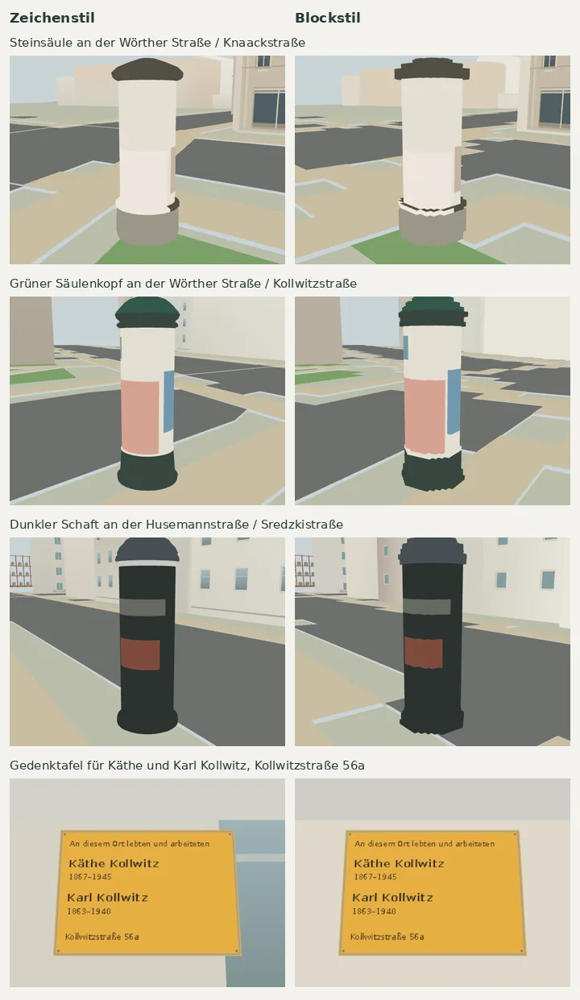

# Rund um Wasserturm, Rykestraße und Kollwitzplatz

Drei Ansichten führen direkt zum alten Wasserwerk, zur Synagoge und zum Platz. Alle drei Orte sind auch über die Ortssuche im Viewer erreichbar.

| Ort | Im Modell |
| --- | --- |
| [Wasserturm Prenzlauer Berg](https://klotzkette.github.io/isometric-berlin/?theme=day&lang=de#landmark=wasserturm-prenzlauer-berg) | Der große Wohnturm hat ein zurückgesetztes Obergeschoss, ein Kegeldach und einen Schornstein. Der schlankere Standrohrturm gehört zum selben Wasserwerk. Über die Treppen erreicht man die bepflanzten Hochbehälter. |
| [Synagoge Rykestraße](https://klotzkette.github.io/isometric-berlin/?theme=day&lang=de#landmark=synagoge-rykestrasse) | Das Vorderhaus mit seinen beiden breiten Bögen steht an der Straße. Dahinter ist die neoromanische Basilika an ihren drei Rosetten, den seitlichen Staffelgiebeln und den hohen Rundbogenfenstern erkennbar. |
| [Kollwitzplatz](https://klotzkette.github.io/isometric-berlin/?theme=day&lang=de#landmark=kollwitzplatz) | Wege, Gebüsche und drei Spielflächen gliedern den Platz. Die sitzende Käthe Kollwitz von Gustav Seitz und die Gedenktafel für Käthe und Karl Kollwitz am früheren Wohnort haben jeweils eine eigene Nahansicht. |

Für neun angrenzende Straßen wurden auf 5,32 km die vermessenen Beläge, Übergänge und Bordsteine nachgezogen. An der Rykestraße lässt sich das Großsteinpflaster bis zur Danziger Straße verfolgen. Die 583 Straßenbäume umfassen 57 Standorte an der Rykestraße. Im Wasserturmpark und auf dem Kollwitzplatz wurden die Baumkataster für die Grünanlagen gesondert ausgewertet. [Straßen, Quellen und Bildvergleich](ryke-strassen-v381.md)

An 32 Häusern rund um die beiden Plätze wurden 1.189 Fenster und 28 breite Erdgeschossöffnungen nach Luftaufnahmen verortet. Die Bilder dokumentieren einen bestimmten Bauzustand. Farben, die Tiefe von Erkern und Gesimsen sowie feiner Bauschmuck sind anhand dieser Aufnahmen angenähert. [Fassaden in beiden Stilen](kollwitz-fassaden-v381.md) · [Synagoge und Vorderhaus im Vergleich](rykestrasse-synagoge-v381.md)

Der Park am Wasserwerk enthält 132 katalogisierte Bäume. Auf dem Kollwitzplatz sind 82 Bäume verortet, darunter die Kronen rund um die sitzende Bronzefigur. Am Fuß des Denkmals lässt sich der Schriftzug auf dem Muschelkalksockel lesen. [Wasserturm, Treppen und Hochbehälter im Bildvergleich](wasserturmpark-v381.md) · [Platz und Denkmal vor und nach der Überarbeitung](kollwitzplatz-v381.md)

## Litfaßsäulen und Gedenktafel

An der Wörther Straße stehen zwei unterschiedliche denkmalgeschützte Litfaßsäulen. Die Säule an der Knaackstraße hat einen steinernen Sockel und einen breiten dunklen Abschluss, die an der Kollwitzstraße eine grüne Haube. An der Husemannstraße, Ecke Sredzkistraße, steht eine dritte, dunkle Säule. Ihre Standorte stammen aus der Berliner Straßenbefahrung und weichen um höchstens 0,6 m von den zugehörigen OpenStreetMap-Punkten ab. Die verschiedenen Profile und Höhen sind aus den einzelnen Denkmalfotos abgeleitet. Die Plakate sind freie Darstellungen. [Denkmalliste mit Fotos, Seite 1](https://www.berlin.de/landesdenkmalamt/_assets/pdf-und-zip/aktuelles/kurzmeldungen/litfasssaeulen_berlin_denkmalgeschuetzt.pdf) · [Berliner Straßenbefahrung](https://gdi.berlin.de/services/wfs/strassenbefahrung?service=WFS&request=GetCapabilities)

An der Kollwitzstraße 56a erinnert eine gelbe Tafel an Käthe und Karl Kollwitz. Im Viewer sitzt sie an der Straßenfassade oberhalb des Eingangs. Die Beschriftung wurde für die Nahansicht gekürzt, Maße und Höhe über der Tür wurden nach der Außenaufnahme angenähert. [Gedenktafel im Viewer](https://klotzkette.github.io/isometric-berlin/?theme=day&lang=de#landmark=gedenktafel-fur-kathe-und-karl-kollwitz) · [Gedenktafeln in Berlin](https://www.gedenktafeln-in-berlin.de/gedenktafeln/detail/kollwitz/2595)

## Größe der veröffentlichten Fassung

| Messung am Produktionsbuild | v1.0.260 | v1.0.261 | v1.0.262 |
| --- | ---: | ---: | ---: |
| Drei JavaScript-Dateien des ersten Starts, unkomprimiert | 415.971 Byte | 415.971 Byte | 415.971 Byte |
| Dieselben Dateien, mit gzip Stufe 9 komprimiert | 127.621 Byte | 127.631 Byte | 127.616 Byte |
| Vollständiger GitHub-Pages-Dateibaum | 990.651.261 Byte | 992.251.602 Byte | 992.251.456 Byte |

Die neuen Ortsmodelle werden erst bei einem Besuch im Viertel geladen. In der dokumentierten Rykestraßen-Ansicht verringerte die räumliche Gruppierung der Bäume die von WebGL verarbeiteten Dreiecke von 256.026 auf 162.874. Ein Pixelvergleich mit unveränderter Kamera bestätigte die identische Darstellung. Die tatsächliche Bildrate und Startzeit hängen vom Gerät und vom Browser ab. [Prüfansicht und Messverfahren](ryke-strassen-v381.md)
