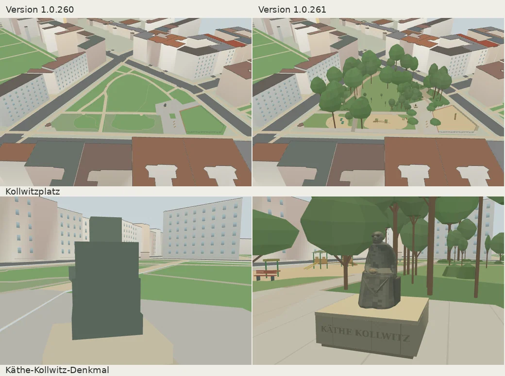
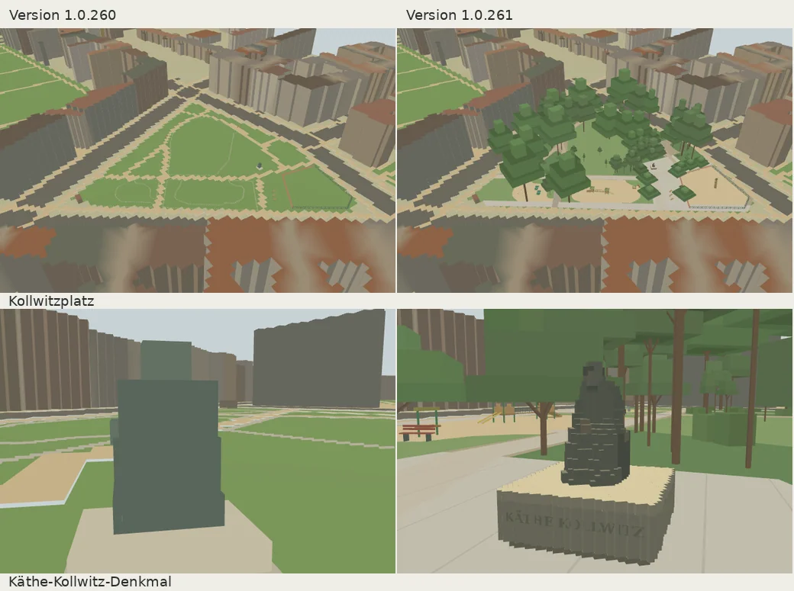

# Kollwitzplatz und Käthe-Kollwitz-Denkmal

Die Platzansicht zeigt das Dreieck zwischen Kollwitzstraße, Knaackstraße und Wörther Straße. Ein zweites Sprungziel führt vor Gustav Seitz’ sitzende Käthe Kollwitz. Auf dem Muschelkalksockel ist ihr Name zu lesen. [Kollwitzplatz im Viewer](https://klotzkette.github.io/isometric-berlin/#landmark=kollwitzplatz) · [Denkmaldatenbank Berlin](https://denkmaldatenbank.berlin.de/daobj.php?obj_dok_nr=09070144)

## Der Platz

Zwölf kartierte Parkwege, die befestigte Fläche am Denkmal, Rasenstücke, sieben Gebüschflächen und drei Spielbereiche bestimmen den Grundriss. An vier Teilflächen der Gehwege folgt die Platzgrenze den Polygonen der Berliner Straßenbefahrung. Wegbreiten wurden am TrueDOP 2026 abgeschätzt. Gras, Sand, befestigte Wege und platzseitige Gehwege teilen sich eine zusammenhängende Oberfläche. In der südlichen Spitze spart sie das vorhandene Gebäude aus. Die acht früher modellierten Bänke und die Einfassung des nordöstlichen Spielbereichs bleiben sichtbar. [Parkgrundriss](https://www.openstreetmap.org/way/24638848) · [OpenStreetMap-Mitwirkende](https://www.openstreetmap.org/copyright) · [Berliner Straßenbefahrung](https://gdi.berlin.de/services/wfs/strassenbefahrung?service=WFS&request=GetCapabilities) · [TrueDOP 2026](https://gdi.berlin.de/services/wms/truedop_2026?service=WMS&request=GetCapabilities)

82 Bäume liegen innerhalb der Parkgrenze. Standort, Baumhöhe, Kronendurchmesser und Stammumfang stammen aus dem Anlagenbaumkataster. Unter den Kronen haben nur nachweislich niedrige Gebüschbereiche plastisches Laub erhalten. Dafür wurde die Differenz zwischen dem bildbasierten Oberflächenmodell 2026 und dem Geländemodell in den kartierten Gebüschen ausgewertet. Saison und Aufnahmewinkel beeinflussen die Modellierung der Kronen. [Baumkataster](https://gdi.berlin.de/services/wfs/baumbestand?service=WFS&request=GetCapabilities) · [Oberflächenmodell](https://gdi.berlin.de/data/bdom/atom/) · [Geländemodell](https://gdi.berlin.de/data/dgm1/atom/)

Die mittlere Spielfläche besitzt zwei verbundene Holztürme mit grün gefassten Pfosten, eine Rutsche, eine niedrige Zugangsrampe, eine Spielecke und zwei zusätzliche Bänke. Weitere Details sind die Holzeisenbahn, die Slackline und zwei Tischtennisplatten an getrennt erfassten Standorten. Die Veröffentlichung des Bezirks beschreibt die Erneuerung 2025, die Bezirkszeitung zeigt die Ausführung der Mittelgruppe. Einzelne Geräteabmessungen, Farben und Anschlüsse sind angenähert. [Bezirksamt Pankow zur Neuausstattung](https://www.berlin.de/ba-pankow/aktuelles/pressemitteilungen/2025/pressemitteilung.1536346.php) · [Foto der neuen Anlage](https://www.berlin.de/ba-pankow/aktuelles/pankow-news/dokumente/pankow-news-fruehjahr-2025_web.pdf)

## Die Sitzfigur

Front-, Profil- und Schrägaufnahmen der Bronze auf dem Kollwitzplatz liefern die Kontur des vorgebeugten Rumpfs, den leicht gewendeten Kopf, die Ärmelformen und den zwischen den Knien fallenden Stoff. Ihre rechte Hand liegt mit dem Zeichenstift auf dem Schoß, die linke hält die aufgestellte Mappe. Die Figur ist 2,10 Meter hoch. Die Sockelproportionen und die Ausrichtung auf dem Platz wurden aus den Aufnahmen abgeleitet. Die ältere Figur am Standort ist anhand ihrer elf Originalteile und 41 Blockelemente einzeln abgeglichen. [Katalog und Aufnahmen, Susanne Kähler u. a., Bildhauerei in Berlin](https://bildhauerei-in-berlin.de/bildwerk/kaethe-kollwitz-denkmal-5232/) · [Bildnachweis und Lizenz der Frontalaufnahme](https://creativecommons.org/licenses/by/4.0/) · [Angabe zur Höhe, Gustav-Seitz-Museum](https://gustav-seitz-museum.de/wp-content/uploads/210129_Leitfaden_Jugendliche_DE.pdf)

Die Helligkeit einzelner Bronzeflächen ist aus der Frontalaufnahme von Susanne Kähler (2013, CC BY 4.0) abgeleitet. Für die Silhouette wurde auch die Profilaufnahme von P. H. Feist (1987, HU Berlin, IKB, Sammlung Feist 150.14, CC BY-SA 4.0) herangezogen. [Frontalansicht](https://bildhauerei-in-berlin.de/wp-content/uploads/839af41b-68e5-41d4-b216-1c1913419e78.jpg) · [Lizenz zur historischen Aufnahme](https://creativecommons.org/licenses/by-sa/4.0/)

Die Blockdarstellung hat eine eigene, vom Volumen der Figur abgeleitete Außenfläche. In beiden Ansichten erscheinen die Statue, die Spielbereiche und die Bäume mit dem regionalen Platzpaket. Der Boden wird zwischen den Darstellungen geteilt. Der Quelldatensatz enthält die verwendeten Baumkennungen, Park- und Weggeometrien, Bildreferenzen und Maße. [Messdatensatz](../geo_data/regierungsviertel/kollwitzplatz-v381.json.gz) · [Geometrie des Denkmals](../scripts/build_kollwitz_denkmal_v381.py) · [Parkgeometrie](../scripts/build_kollwitzplatz_v381.py)

