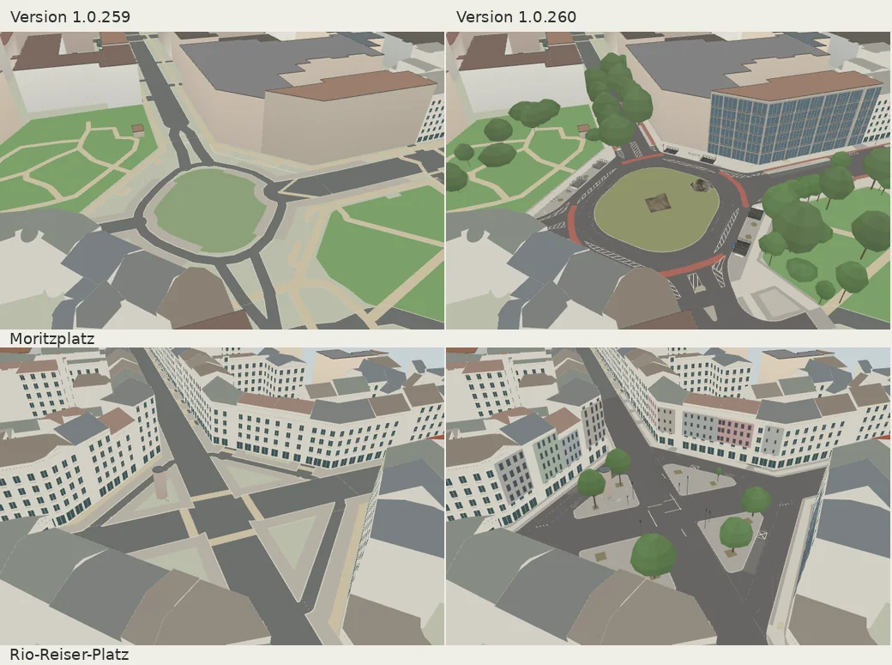
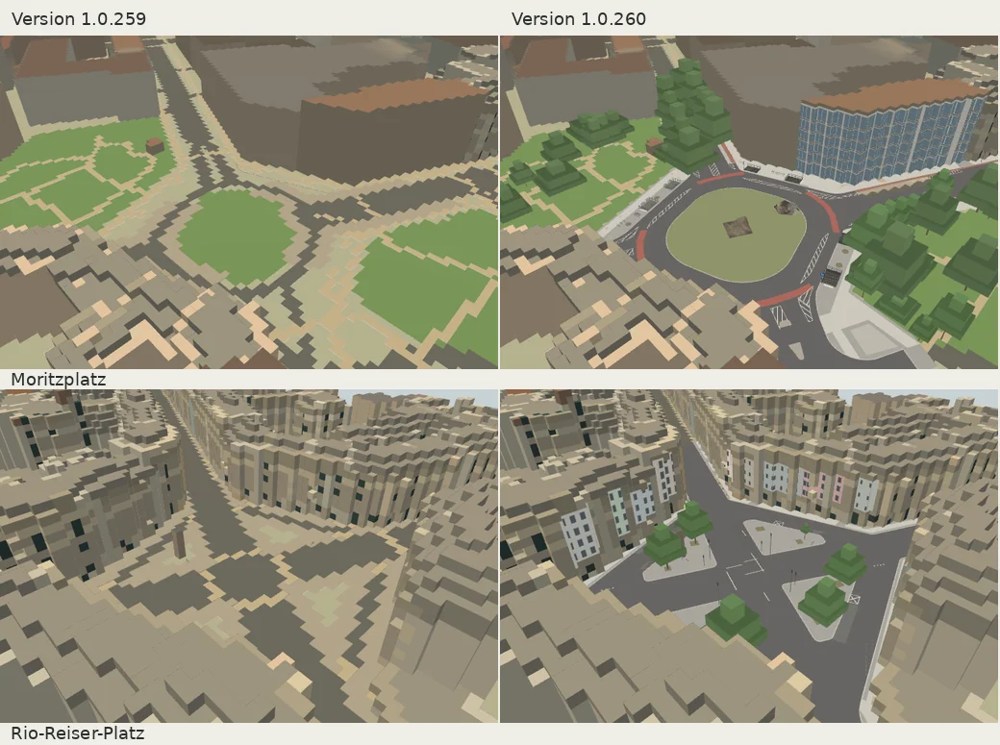

# Moritzplatz und Rio-Reiser-Platz

Am Moritzplatz folgt der Kreisverkehr der vermessenen Mittelinsel. Die roten Radquerungen führen über die vier Zufahrten, die Sperrflächen tragen ihre örtlichen Schraffuren. Sechs U-Bahn-Zugänge sind mit Treppenansatz, Geländer und blauem U erkennbar. Zwei weitere Zugänge auf der Südseite waren im verwendeten Kartenstand als Baustellen eingetragen. Die Darstellung zeigt ihre geschlossene Einfassung. Am Rio-Reiser-Platz fassen vier dreieckige Platzinseln die Kreuzung von Oranienstraße und Mariannenstraße. Der frühere Name Heinrichplatz steht beim Sprungziel. [OpenStreetMap am Moritzplatz](https://www.openstreetmap.org/way/441641842) · [Bezirksamt Friedrichshain-Kreuzberg zum Rio-Reiser-Platz](https://www.berlin.de/ba-friedrichshain-kreuzberg/politik-und-verwaltung/aemter/strassen-und-gruenflaechenamt/artikel.1236256.php)

## Straßen, Wege und Bäume

Die Ausschnitte enthalten 325 vermessene Straßenobjekte am Moritzplatz und 166 am Rio-Reiser-Platz. Fahrbahnen, Bordsteine, Gehwege, Verkehrsinseln, Baumscheiben, Radwege und Zugänge folgen den Flächen und Linien der Berliner Straßenbefahrung. Die Materialschlüssel unterscheiden unter anderem Gehwegplatten, Kleinpflaster und großformatige Granitplatten. Für die roten Furten und die Kreuzungsmarkierungen wurden zusätzlich das Berliner TrueDOP 2026 und OpenStreetMap vom 22. November 2026 herangezogen. An den zwei Beeten auf der Moritzplatzinsel folgt das Relief den verfügbaren Höhenpunkten des Oberflächenmodells. [Straßenbefahrung](https://gdi.berlin.de/services/wfs/strassenbefahrung?service=WFS&request=GetCapabilities) · [Materialkatalog](https://gdi.berlin.de/data/strassenbefahrung/docs/Datenformatbeschreibung_Stra%C3%9Fenbefahrung_2014.pdf) · [TrueDOP 2026](https://gdi.berlin.de/services/wms/truedop_2026?service=WMS&request=GetCapabilities) · [OpenStreetMap-Mitwirkende](https://www.openstreetmap.org/copyright)

Von den 91 Bäumen stammen 80 aus den Straßen- und Anlagenbaumkatastern des Landes. Elf weitere kartierte Baumstandorte wurden anhand von Oberflächen- und Geländeprofilen in einem Meterraster bestätigt. Ihre Höhen und Kronenbreiten sind daraus geschätzt. In beiden Ansichten stehen die Bäume an denselben Koordinaten. Die Baumkronen sind im Blockmodell abgestuft. Die Fällung der Ulme mit Standortnummer 4 am Rio-Reiser-Platz ist berücksichtigt. [Baumkataster](https://gdi.berlin.de/services/wfs/baumbestand?service=WFS&request=GetCapabilities) · [Oberflächenmodell](https://gdi.berlin.de/data/bdom/atom/) · [Geländemodell](https://gdi.berlin.de/data/dgm1/atom/) · [Mitteilung des Bezirks](https://www.berlin.de/ba-friedrichshain-kreuzberg/politik-und-verwaltung/aemter/strassen-und-gruenflaechenamt/artikel.1236256.php)

## Fassaden

Am Aufbau Haus 84 gibt das Modell das Betonraster, die dunkelgrauen Granitbrüstungen und die mehrteiligen Verglasungen der Prinzenstraße und der Platzfront wieder. Sechs durch die vorhandenen Gebäude- und Kachelgrenzen bestimmte Wandstücke tragen 78 modellierte Glasfelder. An weiteren 25 Wandstücken sind 344 Fenster nach den entzerrten Ansichten des historischen Berliner 3D-Modells gesetzt. Die Quellen und die Zuordnung zum Gebäudekörper stehen bei jeder Wand im Messdatensatz. Seit der Aufnahme können sich einzelne Fenster oder Ladenfronten verändert haben. [Aufbau Haus](https://www.aufbauhaus.de/architektur) · [Barkow Leibinger, Aufbau Haus 84](https://barkowleibinger.com/de/architektur/aufbau-haus-84) · [Historisches Berliner 3D-Modell](https://www.3dcitydb.net/3dcitydb/3dcitydb-web-map/) · [Messdatensatz](../geo_data/regierungsviertel/kreuzberg-plaetze-v380.json.gz)

Die neu gezeichneten Fenster sind auf den erhaltenen Außenwänden beschnitten. Für die Blockansicht wurden die Fenster auf die sichtbaren Flächen der vorhandenen Einzelblöcke projiziert. Der Boden verwendet in beiden Ansichten dieselben Zentimeterkoordinaten. Dadurch bleiben die Kurven und Platzkanten beim Umschalten erhalten. [Erzeugung der Geometrie](../scripts/build_kreuzberg_plaetze_v380.py)

## Prüfung und Größe

Die Bildpaare verwenden die ursprünglichen Stadt- und Gebäudekacheln mit identischen Kameras und derselben Beleuchtung. Pro Ort lädt der Viewer ein gemeinsames Bodenpaket und ein Paket für die gewählte Ansicht. Bei gzip-Stufe 9 umfassen beide zusammen am Moritzplatz rund 91 kB für die gezeichnete oder 62 kB für die Blockansicht. Am Rio-Reiser-Platz sind es rund 35 beziehungsweise 25 kB. Diese Werte beziehen sich auf die neuen lokalen JSON-Pakete. Jede Platzergänzung benötigt zwei zusätzliche Zeichenaufrufe. [Tests mit beiden Darstellungen](../src/app/tests/kreuzberg-plaetze-v380.test.ts) · [Prüfung von Quellen, Eingängen und Wandzuordnung](../tests/test_kreuzberg_plaetze_v380.py)
