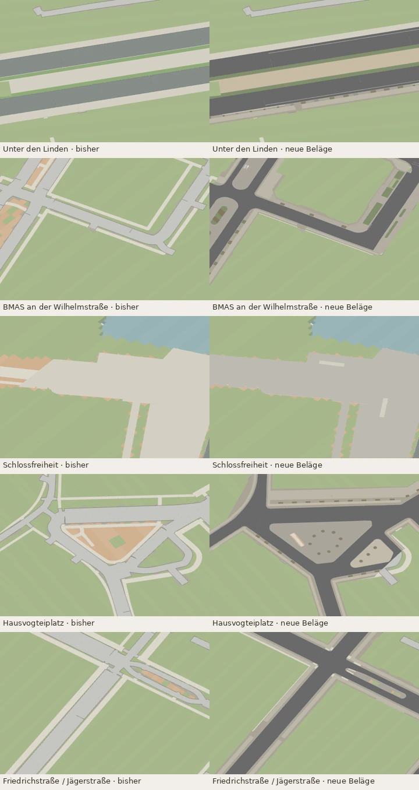

# Straßen zwischen Wilhelmstraße und Schlossplatz

Die Straßenflächen reichen vom östlichen Rand des Pariser Platzes über Unter den Linden bis zum Stadtschloss. Weitere Abschnitte folgen den Straßen zwischen Friedrichstraße und Gendarmenmarkt, den öffentlichen Wegen hinter dem Auswärtigen Amt bis zum Hausvogteiplatz und dem Umfeld des Bundesarbeitsministeriums. Die 337 Achsabschnitte zählen zusammen 13,42 km. Bei getrennten Richtungsfahrbahnen ist jede Achse mit ihrer eigenen Länge enthalten. [Unter den Linden im Viewer](https://klotzkette.github.io/isometric-berlin/?theme=day&lang=de#landmark=unter-den-linden)

Die Berliner Straßenbefahrung liefert 1.325 Gehwegflächen, 985 Bordsteinlinien, 325 Baumscheiben und 116 taktile Felder im Ausschnitt. Die Geometrie unterscheidet hohe, abgesenkte und bündige Borde. Der Gehweg fällt an abgesenkten Übergängen ab. Die Lage der Kanten ist vermessen, die sichtbaren Bordhöhen und das Gefälle der letzten 80 cm sind Modellmaße. Das zugrunde liegende städtische Höhenraster stammt aus dem bestehenden Viewer. [Straßenbefahrung Berlin](https://gdi.berlin.de/services/wfs/strassenbefahrung?service=WFS&request=GetCapabilities) · [Amtlicher Materialkatalog](https://gdi.berlin.de/data/strassenbefahrung/docs/Datenformatbeschreibung_Stra%C3%9Fenbefahrung_2014.pdf)

Die ältere Befahrung erfasst an Teilen der Allee noch den früheren Zustand während der U5-Bauarbeiten. Für die heutigen Mittelflächen, die gepflasterten öffentlichen Schlossfreiräume, die sechs Beete am Zietenplatz und die heutigen Fahrbahnränder wurden deshalb die kartierten Flächen des Berlin-Auszugs vom 22. November 2026 herangezogen und mit dem amtlichen Orthofoto verglichen. Auf Unter den Linden richten sich durchgezogene und gestrichelte Radspurbegrenzungen nach den erfassten Fahrtrichtungen, Breiten und Markierungsarten. Die Struktur der Pflasterfugen und des feinen Promenadenkieses ist für die Nahansicht angenähert. U-Bahn-Treppen, Brückendecks, Gebäude und das sanierte Platzinnere des Gendarmenmarkts haben eigene Modelle. [OSM-Auszug](https://download.geofabrik.de/europe/germany/berlin-261122.osm.pbf) · [OpenStreetMap-Mitwirkende](https://www.openstreetmap.org/copyright) · [TrueDOP 2026](https://gdi.berlin.de/services/wms/truedop_2026?service=WMS&request=GetCapabilities) · [Gendarmenmarkt](gendarmenquartier-v383.md)

Die Gegenüberstellung zeigt dieselben früheren Bodenschichten vor und nach dem Einblenden der neuen Flächen in fünf WebGL-Ansichten. Die isolierte Ansicht macht Fahrbahnränder, Baumstandorte als offene Erde und die unterschiedlichen Beläge sichtbar.

## Größe und Geometrie

Sieben lokal ladbare Pakete umfassen zusammen 481.582 Byte vor der Übertragungskompression. Sie stellen 271.858 m² dar. Darin liegen 31.415 m² der gepflasterten Schlossfreiräume und 7.356 m² verdichtete oder feinkiesige Flächen im Ausschnitt. Die Pakete enthalten 72.789 Dreiecke, einschließlich der sichtbaren Bordseiten. Der Offline-Generator verwendet ausschließlich den eingecheckten Quellenausschnitt und das bestehende Geländemodell. [Quelldaten](../geo_data/regierungsviertel/core-mitte-streets-v383-source.json.gz) · [Generator](../scripts/build_core_mitte_streets_v383.py) · [Sichtstrahl- und Ladetests](../src/app/tests/core-mitte-streets-v383.test.ts)

## Sichtfeldprüfung der stadtweiten Straßen

Der Viewer prüft zusammenhängende Indexabschnitte der vorhandenen stadtweiten Bordsteine, Fahrbahnen und Gehwege gegen die aktive Kamera. Der sichtbare Teil behält seine ursprünglichen Vertices, Indizes, Farben und Reihenfolge. Weit herausgezoomte Ansichten können das ganze Mesh in einem Draw aufbauen. Die Konstruktion der neuen Ortsmodelle und diese Optimierung der stadtweiten Straßen lassen sich getrennt vergleichen.

| WebGL-Test mit identischer Kamera | Dreiecke vorher | Mit Sichtfeldprüfung |
| --- | ---: | ---: |
| Unter den Linden | 852.027 | 186.680 |
| Am Bundesarbeitsministerium | 854.504 | 218.341 |
| Schlossfreiheit | 951.850 | 219.649 |
| Hausvogteiplatz | 854.420 | 186.193 |
| Zwischen Friedrichstraße und Gendarmenmarkt | 849.756 | 213.017 |

Gemessen wurde der Boden- und Straßenaufbau mit den neuen Ortsflächen in Chromium und WebGL2. Die fünf Bildpaare waren Pixel für Pixel identisch. In der Allee-Ansicht gingen allein bei den bestehenden Bordsteinen die eingereichten Dreiecke von 444.354 auf 1.728 zurück. Die Tabelle misst die Grafikarbeit für diese Szenen. Bildrate und Startdauer des vollständigen Viewers hängen zusätzlich vom Gerät und von den übrigen sichtbaren Modellen ab. [Renderer](../src/app/src/districtDrawCullingV383.ts) · [Prüfung von Indexreihenfolge, Gruppengrenzen und Sichtfeld](../src/app/tests/district-draw-culling-v383.test.ts)
