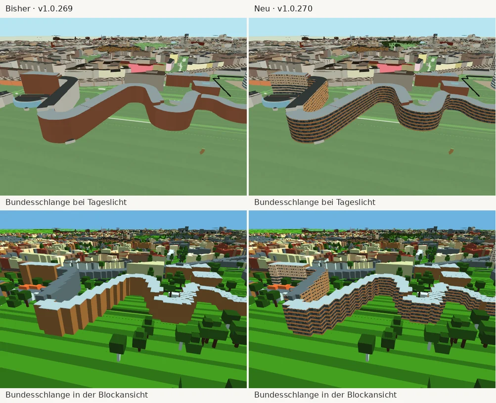
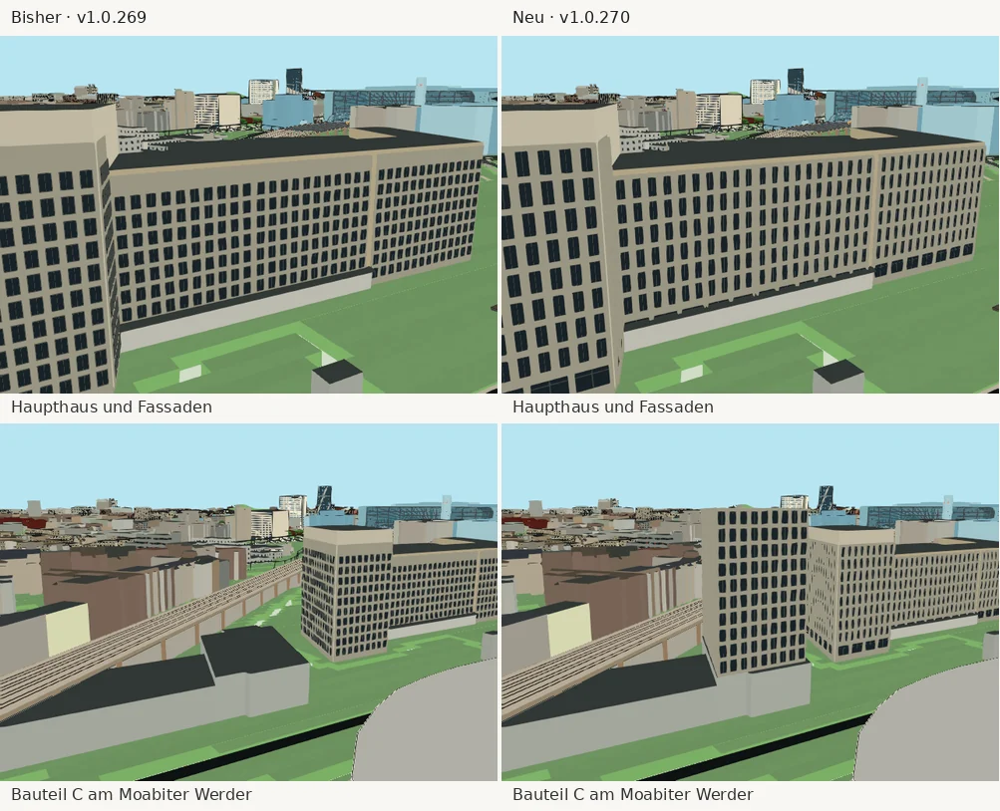
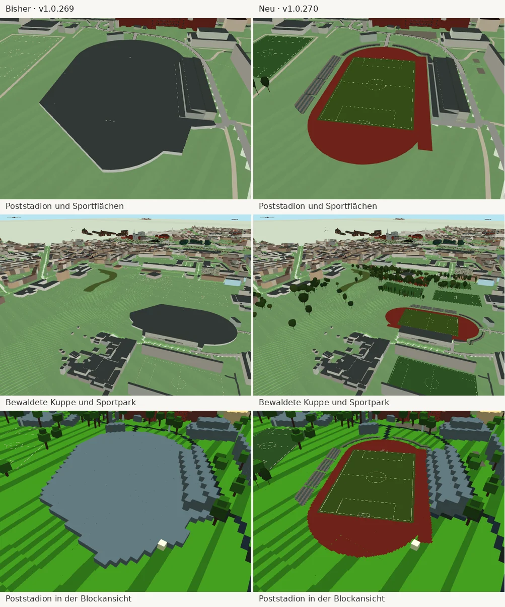

# Moabit und der Blick in die Ferne

## Bundesschlange am Moabiter Werder

[Zur Bundesschlange](https://klotzkette.github.io/isometric-berlin/?theme=day&lang=de#landmark=bundesschlange-am-moabiter-werder) · [Modell und Quellen](moabiter-werder-v390.md)

## Innenministerium

[Zum Innenministerium](https://klotzkette.github.io/isometric-berlin/?theme=day&lang=de#landmark=bundesinnenministerium-am-moabiter-werder) · [Grundriss und Dachmessung](bmi-moabiter-werder-v390.md)

## Poststadion und Fritz-Schloß-Park

[Zum Sportpark](https://klotzkette.github.io/isometric-berlin/?theme=day&lang=de#landmark=poststadion-im-fritz-schloss-park) · [Zum Wahlort von 2026](https://klotzkette.github.io/isometric-berlin/?theme=day&lang=de#landmark=wahllokal-2026-am-poststadion) · [Flächen, Bäume und Quellen](fritz-sportpark-v390.md)

## Start und Navigation

Gemessen am vollständigen Pages-Paket sank das für die Modusauswahl geladene JavaScript von 416.817 auf 267.865 Bytes. Unter denselben gzip-Einstellungen sind das 128.206 gegenüber 86.598 Bytes. In Chromium mit 2 Mbit/s und 65 ms Latenz erschien die Modusauswahl im Median nach 1,63 statt 2,25 Sekunden. Gemessen wurden vier Kaltstarts je Version in wechselnder Reihenfolge.

Im vollständigen Viewer am Brandenburger Tor übergibt der Renderer 17.306 statt 78.992 Bordstein- und Markierungssegmente an WebGL. In einer zweiten, flacheren Perspektive sind es 40.058 statt 78.992. In beiden Perspektiven blieben alle 640 × 460 Bildpunkte gleich, wenn der neue Sichtbarkeitstest ein- und ausgeschaltet wurde. Ein separater Test der Liniengeometrie an fünf Kamerapositionen ergab zusammen 693.000 identische Bildpunkte. In der Gesamtübersicht blieben sämtliche Segmente sichtbar.

Im mobilen WebKit mit iPhone-16-Profil wurde beim ersten Schwenk vom Zentrum Richtung Charlottenburg die erste sichtbare Außenkachel nach 13,1 statt 32,3 Sekunden gezeichnet. Beide Versionen zeigten dieselbe Kachel mit 12.622 Dreiecken. Beim sofort anschließenden Sprung zum Ostkreuz dauerte es 7,3 statt 5,9 Sekunden. Zu diesem Zeitpunkt lief in v1.0.270 noch die Speicherfreigabe nach dem ersten GPU-Upload. Diese beiden Zeiten stammen aus je einer Fahrt mit Softwaregrafik.

Der erste vollständige Aufbau der Blockstadt ist in dieser Umgebung weiterhin langsam. Beim isolierten Kaltstart von v1.0.270 waren Modell, Zielkamera und Bedienoberfläche nach rund 198 Sekunden bereit. Die drei Orte konnten anschließend im selben Browser besucht werden. In v1.0.269 war die Stadt im Test innerhalb von 185 Sekunden bereit. Ein physisches iPhone war für diese Messungen nicht verfügbar.

[Stadtmodell und Downloads](https://github.com/Klotzkette/isometric-berlin/releases/tag/v1.0.270)
