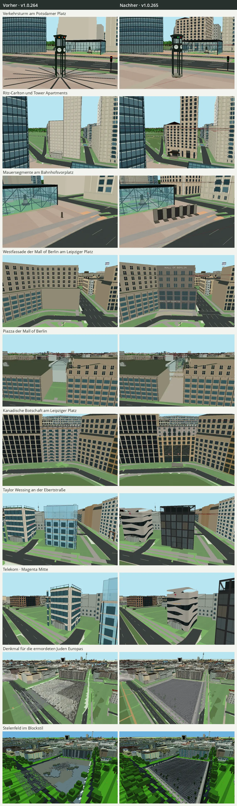

# Potsdamer Platz, Leipziger Platz und Stelenfeld

Die Übersicht zeigt, wie Bahnhof, Verkehrsturm, Ritz-Carlton und das Leipziger Achteck zueinander liegen. Sieben Orte im Quartier haben eigene Ansichten. Die Mall lässt sich sowohl von der Platzfront als auch durch den Zugang zur Piazza an der Leipziger Straße betrachten. [Potsdamer Platz im Viewer](https://klotzkette.github.io/isometric-berlin/?lang=de&theme=day#landmark=potsdamer-platz)

Die Aufnahmen vom 25. November 2026 zeigen neun Ansichten bei Tag und das Stelenfeld zusätzlich im Blockstil. In jedem Bildpaar stimmen Kamerastandort, Blickrichtung und Sichtfeld überein. Für Ritz-Carlton und Piazza zeigen eigene Detailansichten die Architektur. [Bildtafel in voller Größe öffnen](potsdamer-platz-v385.webp)

## Verkehrsturm am Potsdamer Platz

Die „alte Ampel“ im Viewer ist die heutige Nachbildung des Verkehrsturms von 1924. Sie steht am kartierten Standort der Replik. Das 8,50 Meter hohe Modell zeigt fünf Stützen, fünf Uhren und 15 waagerecht angeordnete Signalleuchten. Stahlstreben und ein flaches Haubendach bilden den oberen Abschluss. Rund um den Sockel ist der im Orthofoto erkennbare freie Platz wieder sichtbar. Die Signalschaltung ist als langsamer Anschauungszyklus modelliert. [Verkehrsturm öffnen](https://klotzkette.github.io/isometric-berlin/?lang=de&theme=day#landmark=verkehrsturm-am-potsdamer-platz) · [Berliner Senatsverwaltung zur Geschichte der Ampel](https://www.berlin.de/sen/uvk/presse/pressemitteilungen/2024/pressemitteilung.1512202.php) · [Bildhauerei in Berlin](https://bildhauerei-in-berlin.de/bildwerk/verkehrsturm-7891/) · [Modellvergleich des Turms und des Hotels](ritz-und-verkehrsturm-v385.md)

## Ritz-Carlton und ausgestellte Mauerstücke

Am Ritz-Carlton bleibt der Raum unter dem trapezförmigen Vordach über dem Haupteingang offen. Seine vier Ecken folgen dem amtlichen Gebäudeteil. Gläserne Doppeltüren, Bronzeprofile und zwei Leuchten gliedern die Südfront. Zwei amtlich erfasste Dachflächen geben dem Hotelflügel und dem benachbarten Wohnturm ihr gestuftes Profil. Der Wohnturm hat ein eigenes schmaleres Portal. [Ritz-Carlton öffnen](https://klotzkette.github.io/isometric-berlin/?lang=de&theme=day#landmark=ritz-carlton-am-potsdamer-platz) · [Hilmer & Sattler und Albrecht](https://www.h-s-a.de/projekte/ritz_carlton) · [Foto des Haupteingangs](https://commons.wikimedia.org/wiki/File:Eingangsbereich_The_Ritz-Carlton_Berlin_2_ShiftN.jpg) · [Amtliche Dachflächen im Projekt](../geo_data/regierungsviertel/ritz-roofs-v385.json.gz)

Vor dem Bahnhof stehen die sechs ausgestellten Mauersegmente auf ihren einzelnen Betonfüßen. Ihre Positionen wurden im Berliner Orthofoto von 2026 bestimmt. Zwischen ihnen stehen die Informationstafeln der Ausstellung. Zwei weitere Paare stehen am nördlichen und südlichen Leipziger Platz. Die Modelltafeln zeigen die Anordnung der Ausstellung, ihre Textflächen sind vereinfacht. [Mauersegmente öffnen](https://klotzkette.github.io/isometric-berlin/?lang=de&theme=day#landmark=mauersegmente-am-potsdamer-platz) · [Ausstellung vor dem Bahnhof](https://www.potsdamerplatz.de/de/explore/berliner-mauer-potsdamer-platz/) · [Landesdenkmalamt zum Leipziger Platz](https://www.berlin.de/landesdenkmalamt/denkmale/highlight-berliner-mauer/mauer-denkmale/leipziger-platz-648152.php)

## Mall of Berlin und ihre Piazza

Die Platzansicht blickt vom U-Bahneingang auf die rund 31 Meter breite Westfront von Leipziger Platz 12. Hier sitzen die beiden dauerhaften Schriftzüge der Mall, die fünf großen Schaufensterfelder und darüber fünf Fensterpaare pro Reihe im zurückgesetzten Obergeschoss. In der früheren Darstellung lag der Schriftzug hinter einer schräg zum Platz stehenden Nachbarfassade. Der kartierte Haupteingang, der Standort des U-Bahneingangs und das Fassadenfoto legen die richtige Straßenfront fest. [Westfront öffnen](https://klotzkette.github.io/isometric-berlin/?lang=de&theme=day#landmark=mall-of-berlin) · [Haupteingang in OpenStreetMap](https://www.openstreetmap.org/node/5479015632) · [Fassadenfoto von Membeth](https://commons.wikimedia.org/wiki/File:Leipziger.Platz.Mall.of.Berlin.jpg)

Vom Fuß der Fassade bis zur Ringfahrbahn ergänzen rund 175 Quadratmeter Gehweg die grünen Lücken in der gezeichneten Ansicht. Im Blockstil reicht das ursprüngliche Geländegras weiter. Dort schließen rund 268 Quadratmeter Pflaster in kleinen Stufen an die Gehweghöhe vor der Drehtür an. Die Grenzen folgen dem Platzgrundstück, der kartierten Fahrbahnkante und dem Orthofoto. Für diesen Abschnitt fehlt in der Straßenbefahrung ein Materialcode. Der Viewer verwendet einen neutralen Pflasterton. In der gezeichneten Ansicht behalten die letzten Meter bis zur Drehtür ihren vorhandenen Belag. Auf der anderen Straßenseite sind der U-Bahn-Abgang, der registrierte Straßenbaum und das Platzgrün separat erkennbar. [Kartengrundlagen für den Westeingang](../geo_data/regierungsviertel/mall-westeingang-v385.json.gz) · [Test der sichtbaren Oberfläche in beiden Stilen](../src/app/tests/mall-westeingang-v385.test.ts)

Die zweite Ansicht schaut von der Leipziger Straße unter das gewölbte Glasdach. Heller Steinbelag verbindet Leipziger Straße und Voßstraße über die 2.329 Quadratmeter große kartierte Fußgängerfläche. An zwei Gefällewechseln reichte das frühere Grün durch den Boden. Am geprüften Punkt im südlichen Gefälle liegt die Oberseite des Pflasters im fertigen Blockmodell jetzt gut 15 Zentimeter über der alten Geländeplatte. Zwei Galeriegeschosse folgen dem Fußgängerring vor den verglasten Ladenfronten. An den beiden Enden ersetzen offene Querstege zwei zuvor bis zum Boden gefüllte, 24,3 Meter hohe Blöcke. Die Stege haben in beiden Darstellungen eine Stärke von 33 Zentimetern und liegen auf zwei Höhen. Ihre Unterkanten lassen die Sicht und den Weg auf Fußgängerhöhe frei. Ein Gehtest verfolgt die 101 Meter lange Mittelachse in Schritten von jeweils einem halben Meter durch beide früheren Sperren. Lage und Verlauf stammen aus dem Kartenmaterial. Höhen, Breiten und Geländerprofile sind aus den Architekturfotos angenähert. [Piazza öffnen](https://klotzkette.github.io/isometric-berlin/?lang=de&theme=day#landmark=piazza-der-mall-of-berlin) · [Tchoban Voss Architekten](https://tchobanvoss.de/de/projects/mall-of-berlin) · [Kartierter Galeriering](https://www.openstreetmap.org/way/380243143) · [Umriss des befestigten Fußwegs](https://www.openstreetmap.org/way/194066305)

## Kanadische Botschaft

Der Eingang ist auf der Diagonalfassade zum Leipziger Platz zu sehen. Drei breite Felder mit außen liegenden Lamellen stehen dort zwischen schmaleren Fensterachsen. Über ihnen sitzen zwei Reihen einzelner Fenster im hellen Stein. An der Ebertstraße hat dasselbe Haus einen breiten, zusammenhängenden Sonnenschutz. Beide öffentlichen Ansichten folgen den Fotos der Architekten und den Außenkanten des Berliner Gebäudemodells. Auch im Blockstil sitzen die Fenster und Lamellen auf den tatsächlich sichtbaren Wandflächen. [Botschaft öffnen](https://klotzkette.github.io/isometric-berlin/?lang=de&theme=day#landmark=kanadische-botschaft-am-leipziger-platz) · [Außenaufnahmen und Materialien bei KPMB](https://www.kpmb.com/project/canadian-embassy-berlin/) · [Registrierung der Platzfronten](../geo_data/regierungsviertel/leipziger-platzfronten-v385.json)

An den öffentlichen Eingängen von Botschaft und Ritz-Carlton waren zuvor Teile des Gehwegs grün. Die Berliner Straßenbefahrung belegt dort insgesamt 122,38 Quadratmeter Kleinsteinpflaster, Betonplatten und Natursteinplatten. Der Gehweg schließt jetzt an beide Eingänge an. Die benachbarte Asphaltfläche vor der Botschaft ist im Modell separat erkennbar. [Ableitung der Gehwegflächen](../scripts/build_potsdamer_forecourts_v385.py)

## Bürohäuser an der Ebertstraße

**Taylor Wessing.** Die Westfassade zeigt sechs Fensterachsen und den Schriftzug oben rechts. Das oberste Geschoss springt zurück. Darüber steht der offene Dachrahmen, der die Silhouette vom Bürgersteig aus prägt. Fünf Bürogeschosse sind im Projektbericht belegt. [Taylor Wessing öffnen](https://klotzkette.github.io/isometric-berlin/?lang=de&theme=day#landmark=taylor-wessing-an-der-ebertstrasse) · [Bosen Baumanagement](https://www.bosen-baumanagement.de/files/Bosen_Baumanagement_Referenzen.pdf) · [Gemeinsame Außenaufnahme der Bürohäuser](https://commons.wikimedia.org/wiki/File:Berlin-Ebertstr-02-Ottobock-Taylor_Wessing-2016-gje.jpg)

**Telekom – Magenta Mitte.** Die geschwungenen hellen Aluminiumbänder vor dem Glas, der ausgesparte Eingangsbogen und das T-Zeichen an der Ebertstraße bestimmen die Straßenansicht. Das ehemalige Otto-Bock-Gebäude behält seine eigene Dachterrasse. Für beide Häuser wurden die fotografierten Straßenansichten perspektivisch entzerrt. Einzelheiten auf den Parkseiten und Höhen von Dachaufbauten sind angenähert. [Magenta Mitte öffnen](https://klotzkette.github.io/isometric-berlin/?lang=de&theme=day#landmark=telekom-magenta-mitte) · [Gnädinger Architekten](https://www.gnaedinger-architekten.de/211-otto-bock-scmt/) · [Deutsche Telekom zur Magenta Mitte](https://www.telekom.com/de/medien/medieninformationen/detail/telekom-berlin-hat-jetzt-eine-magenta-mitte-1077000) · [Quellen und Maßbezüge beider Häuser](../geo_data/regierungsviertel/ebertstrasse-offices-v385.json)

## Denkmal für die ermordeten Juden Europas

Für Peter Eisenmans Stelenfeld nennt die Stiftung 2.710 Stelen, darunter 112 ebenerdige. Ihre Grundfläche beträgt jeweils etwa 0,95 × 2,38 Meter. Der Boden senkt sich zwischen den Reihen. Dadurch verändert sich die Höhe der seitlich sichtbaren Betonflächen auf dem Weg vom Rand ins Innere des Feldes. [Stelenfeld öffnen](https://klotzkette.github.io/isometric-berlin/?lang=de&theme=day#landmark=denkmal-fur-die-ermordeten-juden-europas) · [Stiftung Denkmal für die ermordeten Juden Europas](https://www.stiftung-denkmal.de/denkmaeler/denkmal-fuer-die-ermordeten-juden-europas-mit-ausstellung-im-ort-der-information/)

Die Darstellung enthält 2.598 über den Boden ragende Stelen und 112 ebenerdige Einlagen an den Rändern. Für 2.594 erhöhte Stelen lieferten die amtlichen Laserscandaten eine Höhe der Oberseite. Bei vier von Bäumen verdeckten Stelen ist die Höhe aus den Nachbarstelen geschätzt. Für die ebenen Randsteine wurden mehrere Orthofoto-Jahrgänge miteinander verglichen. Die Lage einzelner verdeckter Einlagen bleibt eine Annäherung. Der sichtbare Boden und die Höhe beim Gehen folgen denselben Geländedreiecken. Innerhalb des kartierten Umrings stehen 29 in OpenStreetMap erfasste Bäume. [Beispiel eines kartierten Baumstandorts](https://www.openstreetmap.org/node/3031599958)

In der früheren Blockansicht wirkte das Feld fast durchgehend grau. Im Bereich der Gassen lagen zwei flache Bodenplatten und ältere Pflasterflächen über dem abgesenkten Gelände. Im Winter deckte außerdem die durchgehende Schneefläche der Stadt das Feld zu. Diese Flächen enden jetzt am Umriss des Denkmals. Im Gehtest lässt sich eine Gasse in der Feldmitte mit 0,42 Meter Körperradius über 18 Meter am Stück durchqueren. [Gehtest und Höhenmodell](stelenfeld-v385.md)

Der kleine Oberbau am Zugang zum Ort der Information folgt dem rund 33 Quadratmeter großen Katasterumriss. Lasermessungen belegen seine flache Dachoberkante bei 37,98 m NHN. Die beiden Ansätze der Außentreppen sind begehbar. Im Blockstil wurden fünf früher fälschlich als Häuser dargestellte Gruppen von Rasterzellen entfernt. [Umriss des Oberbaus in OpenStreetMap](https://www.openstreetmap.org/way/166709624)

Am Rand des Denkmals liegen die Mittelpunkte von 81 bodenbündigen Einlagen außerhalb des amtlichen Bauwerksumrings im Straßenland. An 55 dieser Stellen fehlte im früheren Viewer Gehwegpflaster. Der Abgleich mit zwölf amtlichen Gehwegpolygonen ergänzt 1.986 Quadratmeter Belag und stellt den Anschluss an die Einlagen her. [Ableitung der Gehwegkanten](../scripts/build_stelenfeld_road_edges_v385.py)

Die Berliner Liegenschaftskarte enthält 2.599 einzelne Grundrisse, OpenStreetMap verzeichnet 2.604. Bei 2.593 stimmen die kartierten Positionen überein. Der Höhenvergleich beruht auf 597.156 Laserpunkten im örtlichen Ausschnitt der Befliegung von 2021. [Liegenschaftskataster ALKIS](https://gdi.berlin.de/services/wfs/alkis?SERVICE=WFS&REQUEST=GetCapabilities) · [Amtliche Laserscandaten](https://gdi.berlin.de/data/a_als/atom/) · [TrueDOP Berlin 2026](https://gdi.berlin.de/services/wms/truedop_2026?SERVICE=WMS&REQUEST=GetCapabilities)

## Wiederhergestellte Kleingartenflächen

Bei der Prüfung des Stadtmodells fiel auf, dass 14 bereits erfasste Kleingartenanlagen in der gezeichneten Ansicht ihre zusätzlichen Wege, Hecken und Vegetationsflächen verloren hatten. Die 168 Flächen aus 13 Kacheln waren im ausgelieferten Datenpaket enthalten. Beim Zeichnen überschritten ihre 255.912 Dreiecksecken jedoch die frühere Obergrenze von 250.000. Der Viewer verwarf deshalb die gesamte Gruppe. [Quellen der Kleingartenflächen](allotments-v360.md)

Der Viewer teilt jetzt Eckpunkte, deren Lage, Farbe und Flächennormale exakt übereinstimmen. Damit passen alle ursprünglichen Dreiecke in einen Zeichenaufruf. Alle 13 Kacheln wurden einzeln gegen die vollständig aufgebaute frühere Geometrie geprüft. Die Puffer der gezeichneten Gärten benötigen 6.186.516 statt 9.212.832 Byte, rund 33 Prozent weniger. Im Blockstil belegen dieselben 244.620 Dreiecksecken wie zuvor 8.806.320 Byte. [Geometrie- und Speichertest](../src/app/tests/core-allotment-v385.test.ts)

In fünf isolierten lokalen Bun-Läufen stieg der Median der gesamten Aufbauzeit dieser gezeichneten Gartengruppe durch die Indizierung von 124 auf 159 Millisekunden. Der längste einzelne Arbeitsschritt sank im Median von 35 auf 22 Millisekunden.

## Humboldthain und Gesundbrunnen

Im laufenden Block-Viewer war das Quartier am Humboldthain und in Gesundbrunnen wieder mit Gelände, Klinik und 28 Ausstattungsobjekten sichtbar. Ein Abgleich prüft bei allen 784 ursprünglichen Bodenzeilen die Positionen und Farben. Geometrietests bestätigen für beide Darstellungen die Höhen von zwei S-Bahn-Wagen am Bahnhof Gesundbrunnen und von taktilen Leitstreifen dort und an der Landsberger Allee. Bei der Browserprüfung der gezeichneten Nordansicht waren acht von 17 benötigten Datenpaketen geladen. Bis dahin blieb die bisherige Ansicht sichtbar. Der abschließende Wechsel im Nordquartier ist für diesen Stil im Browser noch offen. [Bodenprüfung am Humboldthain](../src/app/tests/north-core-native-v385.test.ts) · [Prüfung der Bahnhofsdetaillierung](../src/app/tests/rail-transport-remainder-v385.test.ts)

## Paketgröße und Speicherbedarf

Der Pages-Build von 1.0.265 umfasst 993.226.326 Byte, 407.244 Byte mehr als die 992.819.082 Byte von 1.0.264. Alle 6.214 bereits vorhandenen Dateien aus dem öffentlichen Quellverzeichnis wurden bytegenau übernommen. Die drei unmittelbar beim Start geladenen JavaScript-Dateien kommen gemeinsam mit gzip komprimiert auf 127.917 Byte. Bei 1.0.264 waren es 127.704 Byte. Der Unterschied von 213 Byte beschreibt das komprimierte Startpaket.

Für den lokalen Viewer umfasst das Standard-ZIP 964.802.079 Byte, das Compact-ZIP 785.219.866 Byte. Beim Herunterladen spart die kompakte Variante 179.582.213 Byte. [Downloads für Version 1.0.265](https://github.com/Klotzkette/isometric-berlin/releases/tag/v1.0.265)

Am Verkehrsturm sinkt der Speicherbedarf der Geometrie- und Instanzpuffer im gezeichneten Stil von 478.260 auf 322.884 Byte, im Blockstil von 135.512 auf 91.356 Byte. Beide Stile zeichnen den Turm weiterhin mit je drei Zeichenaufrufen. [Messung am Verkehrsturm](ritz-und-verkehrsturm-v385.md)
