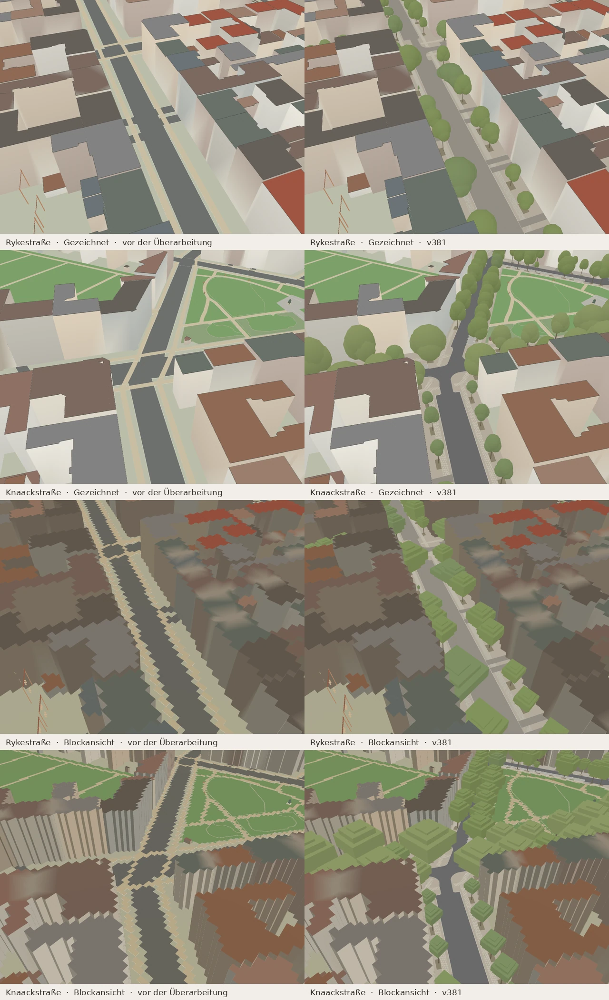

# Rykestraße und die Straßen um den Kollwitzplatz

In der Rykestraße reicht das Großsteinpflaster von der Knaackstraße bis zur Danziger Straße an die vermessenen Fahrbahnränder. An den Kreuzungen wechseln die Beläge. Straßenbäume, Grundstückszufahrten, Parkflächen und das durchgehende Band aus Gehwegplatten und Kleinpflaster folgen den öffentlichen Vermessungsdaten.

Die Bildpaare zeigen die Rykestraße und die Ecke Knaackstraße/Kollwitzstraße. Links ist das bestehende Stadtmodell zu sehen, rechts kommt die Straßenebene dieser Fassung hinzu. Kamera und Beleuchtung bleiben je Bildpaar identisch. Die zusätzlichen Gebäude- und Parkmodelle der gleichen Veröffentlichung sind separat dokumentiert.

## Abdeckung

Zusammen umfassen Rykestraße, Knaackstraße, Diedenhofer Straße, Kolmarer Straße, Belforter Straße, Kollwitzstraße, Wörther Straße, Husemannstraße und Sredzkistraße 5,32 km kartierte Straßenachsen. Rund 141.381 m² vermessene Straßenflächen liegen innerhalb des bearbeiteten Korridors.

- 110 Fahrbahnflächen unterscheiden unter anderem Asphalt, Kleinstein-, Großstein- und Betonpflaster. 1.365 Gehwegflächen, 181 Grundstücksüberfahrten und 81 Parkflächen geben den angrenzenden Belagswechseln ihre Form.
- 358 Hochbord-, 345 Tiefbord- und 23 bodengleiche Bordsteinlinien ergeben zusammen 726 vermessene Bordsteine. Die Gehwege gehen in den letzten 80 cm in die abgesenkten Übergänge über. 52 taktile Felder, 26 Radwegflächen und amtlich erfasste Markierungslinien ergänzen die Straßen.
- 583 Straßenbäume stehen auf Katasterkoordinaten, 57 davon an der Rykestraße. Baumhöhe, Kronendurchmesser und Stammumfang stammen für jeden dieser Bäume aus dem Berliner Bestand. Die Form der Baumkronen ist je Stil vereinfacht. In die Parkparzellen am Wasserturm und am Kollwitzplatz reichen die Straßenbeläge nicht hinein. Bäume innerhalb dieser Parzellen gehören zu den jeweiligen Parkmodellen.

Die Straßenbefahrung stammt von 2014/15. Der Vergleich mit OSM vom 22. November 2026 und den Orthofotos von 2026 stützt insbesondere die Materialwahl an der Rykestraße und den Verlauf der Anschlüsse am Kollwitzplatz. [Straßenbefahrung Berlin](https://gdi.berlin.de/services/wfs/strassenbefahrung?SERVICE=WFS&REQUEST=GetCapabilities) · [Material- und Objektkatalog](https://gdi.berlin.de/data/strassenbefahrung/docs/Datenformatbeschreibung_Stra%C3%9Fenbefahrung_2014.pdf) · [Berliner Baumkataster](https://gdi.berlin.de/services/wfs/baumbestand?SERVICE=WFS&REQUEST=GetCapabilities) · [Berliner Radverkehrsanlagen](https://gdi.berlin.de/services/wfs/radverkehrsanlagen?SERVICE=WFS&REQUEST=GetCapabilities) · [Geofabrik, Berlin-Auszug](https://download.geofabrik.de/europe/germany/berlin-261122.osm.pbf)

[Luftbild der Rykestraße](https://gdi.berlin.de/services/wms/truedop_2026?SERVICE=WMS&VERSION=1.3.0&REQUEST=GetMap&LAYERS=truedop_2026&STYLES=&CRS=EPSG:25833&BBOX=392741,5821687,392893,5821857&WIDTH=850&HEIGHT=951&FORMAT=image/jpeg) · [Luftbild der Ecke Knaackstraße/Kollwitzstraße](https://gdi.berlin.de/services/wms/truedop_2026?SERVICE=WMS&VERSION=1.3.0&REQUEST=GetMap&LAYERS=truedop_2026&STYLES=&CRS=EPSG:25833&BBOX=392560,5821697,392700,5821829&WIDTH=850&HEIGHT=801&FORMAT=image/jpeg)

## Paket und Prüfung

Die beiden Stile teilen sich sechs Geometriepakete mit insgesamt 588.011 Byte vor der Webkompression. Die Bäume nutzen gemeinsame Stamm- und Kronenmodelle. Der Renderer kann Baumgruppen außerhalb des Sichtfelds einzeln auslassen.

In der gezeichneten Rykestraßen-Ansicht übergab Chromium in der lokalen WebGL-Prüfung mit dieser Gruppierung 162.874 Dreiecke, zuvor mit demselben Modell 256.026. Beide Aufnahmen waren pixelgleich. Dieser Vergleich misst die an WebGL übergebenen Dreiecke in genau dieser Kameraansicht.

Die Lagekoordinaten werden im Paket auf ganze Zentimeter gerundet. Die Straßen schließen an das vorhandene Geländeniveau des äußeren Stadtmodells an. Die normalisierten Quellendaten enthalten die amtlichen IDs und WFS-Abfragen. Der Offline-Generator reproduziert die sechs Pakete und den Ortsindex byteidentisch. [Quellenausschnitt](../geo_data/regierungsviertel/ryke-streets-v381-source.json.gz) · [Generator](../scripts/build_ryke_streets_v381.py) · [Straßen- und Rendertests](../src/app/tests/ryke-streets-v381.test.ts)
