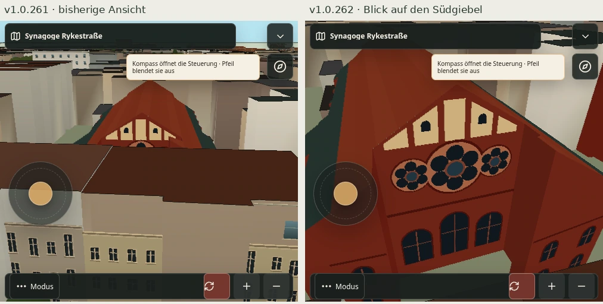
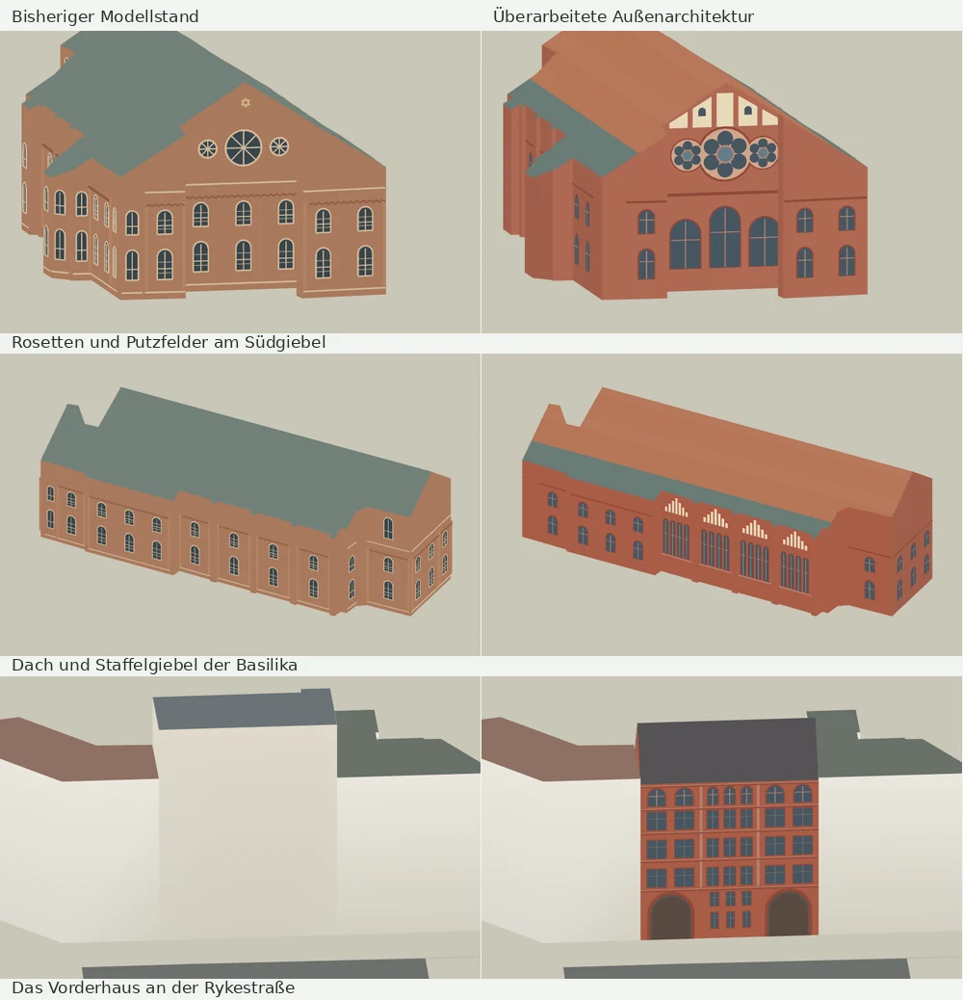
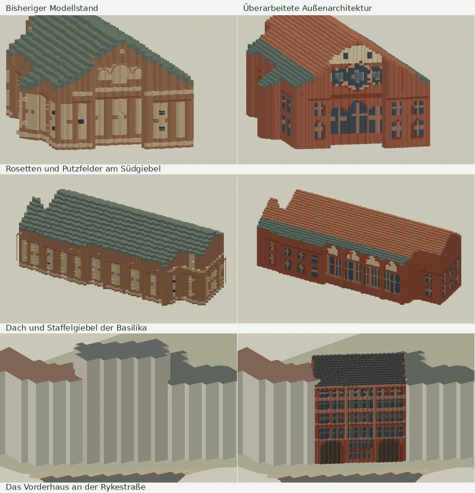

# Synagoge Rykestraße und historisches Vorderhaus

Johann Hoeniger entwarf das Ensemble in der Rykestraße für die Jüdische Gemeinde zu Berlin. 1903–1904 entstanden die neoromanische Basilika und das fünfgeschossige Vorderhaus mit Religionsschule. Das Landesdenkmalamt führt die Gesamtanlage als Denkmal 09070254. Im Viewer lassen sich die Synagoge und das Vorderhaus getrennt aufrufen. [Landesdenkmalamt Berlin](https://denkmaldatenbank.berlin.de/daobj.php?obj_dok_nr=09070254) · [Museum Pankow](https://www.berlin.de/museum-pankow/geschichte-vor-ort/touristisches-wegeleitsystem/dokumente/03-stele-j-disches-leben-jewish-life-friedhof-sch-nhauser-allee-cemetery-judengang-altenheim-home-for-the-aged-waisenhaus-orphanage-synagoge-synagogue-.pdf)

## Basilika

Der Südgiebel trägt eine große Rosette zwischen zwei kleineren. Im Modell umgeben sechs Rundfelder das mittlere Licht jeder Rosette. Darüber zeichnen helle Putzfelder den Giebel nach. Die Staffelgiebel der Ostseite fassen Gruppen hoher Rundbogenfenster zusammen. Die Aufnahmen von Mazbln vom September 2007 dokumentieren das Erscheinungsbild nach der Restaurierung. Die unterschiedlichen Farbbereiche des Hauptdachs und der seitlichen Dachflächen sind im Berliner Orthofoto 2026 erkennbar. Das Modell verwendet die bestehende amtliche Hülle für die Gebäudemaße. Farbwerte und Zierprofile sind für die Stadtansicht stilisiert. [Südgiebel, Mazbln, CC BY-SA 3.0](https://commons.wikimedia.org/wiki/File:Berlin_Synagoge_Rykestrasse_Suedseite.JPG) · [Staffelgiebel, Mazbln, CC BY-SA 3.0](https://commons.wikimedia.org/wiki/File:Berlin_Synagoge_Rykestrasse_Eingang.JPG) · [TrueDOP Berlin 2026](https://gdi.berlin.de/services/wms/truedop_2026?SERVICE=WMS&REQUEST=GetCapabilities)

## Blick aus dem Hof

Der Direktaufruf führt vor den Südgiebel. Im früheren Kamerabild verdeckte das gegenüberliegende Dach große Teile der Fassade. Für die Hofansicht wurden Sichtstrahlen gegen die vorhandenen Nachbargebäude geprüft. In beiden Modellstilen und in beiden geprüften Bildformaten sind alle 64 Prüfpunkte der zentralen Rosette und alle 189 Prüfpunkte am Giebel frei. Für die Rundbögen des Vorderhauses gibt es weiterhin eine eigene Straßenansicht. [Blick auf den Südgiebel](https://klotzkette.github.io/isometric-berlin/?theme=day&lang=de#landmark=synagoge-rykestrasse) · [Vorderhaus an der Straße](https://klotzkette.github.io/isometric-berlin/?theme=day&lang=de#landmark=vorderhaus-der-synagoge-rykestrasse)

## Historisches Vorderhaus

Der frühere flach gedeckte Block ist durch die amtlich erfasste Hülle mit Satteldach ersetzt. Die öffentliche Straßenfassade zeigt zwei breite Ziegelbögen, eine schmal gegliederte Mittelpartie, horizontale Gesimse und einen oberen Abschluss mit Rundbogenfenstern. Das Gesicht der Fassade folgt der von Berlin.de veröffentlichten Außenaufnahme. Die Nachbargebäude gehören weiterhin zu ihren ursprünglichen Stadtobjekten. [Außenaufnahme und Geschichte bei Berlin.de](https://www.berlin.de/sehenswuerdigkeiten/6426835-3558930-synagoge-rykestrasse.html) · [LoD2 Berlin, Kachel 392/5821](https://gdi.berlin.de/data/a_lod2/atom/LoD2_392_5821.zip)

## Modellvergleich

Jedes Bildpaar verwendet dieselbe Kamera und Beleuchtung. Die ersten beiden Reihen zeigen die Basilika mit ihren bisherigen beziehungsweise neuen Zierformen. Die dritte Reihe zeigt das Vorderhaus mit seinen Nachbarn aus der Stadtkachel.

## Technische Prüfung

Die Basilika verwendet weiterhin das amtliche Gebäude `DEBE03YY600004DV`. Basilika und Vorderhaus werden bereits mit ihrer örtlichen Stadtkachel geladen. Die Stadtansicht rendert die neue Außenarchitektur der Basilika in einer Zeichenoperation. Die frühere zweite Schicht geschätzter Fassadenakzente entfällt. Das Vorderhaus `DEBE03YY600007vG` wird erst mit seiner Stadtkachel ausgetauscht. Der gezeichnete Modus erhält die geneigten Dachflächen als begehbare Modelloberfläche, die Blockansicht verwendet das Höhenraster ihrer eigenen Geometrie. Falls der bisherige Gebäudekörper von der geprüften Quelle abweicht, zeigt die Kachel weiterhin ihren vorhandenen Stand.

Der Generator prüft die vier Geometriepakete mit `python scripts/build_rykestrasse_v381.py --check` bytegenau. Die Regressionstests laufen in `src/app` mit `bun test tests/rykestrasse-synagoge-v381.test.ts`. Sie kontrollieren die räumlichen Grenzen, beide Materialmodi, die rechtwinkligen Blockflächen, den Austausch des Vorderhauses sowie die Navigationsdaten der Nachbargebäude.
