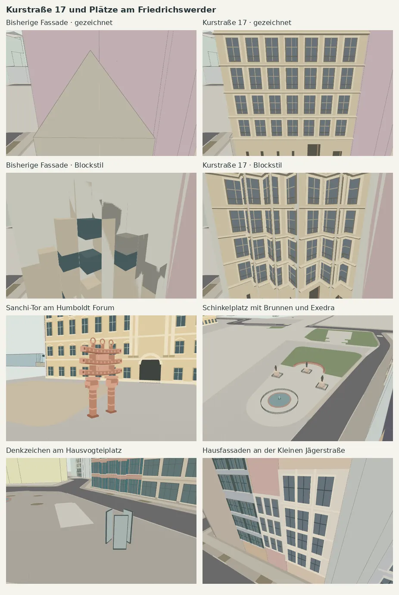

# Vom Schlossplatz zum Hausvogteiplatz

Am Humboldt Forum steht das Sanchi-Tor vor der Nordfassade. Die drei übereinanderliegenden Architrave, die Elefantenkapitelle, die aufgerollten Enden und der Aufbau über dem obersten Querbalken folgen der Westansicht der Ausführungsplanung. Die Oberkante liegt bei rund 9,8 Metern. Die Lage und die Ausrichtung der langen Achse wurden im TrueDOP 2026 an der sichtbaren roten Steinstruktur abgelesen. Die kleinen Reliefs und Figuren sind modelliert und vereinfacht. [Humboldt Forum](https://www.humboldtforum.org/de/programm/dauerangebot/ausstellung/das-tor-von-sanchi-79433/) · [Ausführungszeichnung](https://www.humboldtforum.org/wp-content/uploads/2022/11/20211107_SAN_300_A_SC_000_001_P_A_KWA.pdf) · [Geoportal Berlin, TrueDOP 2026](https://gdi.berlin.de/services/wms/truedop_2026?SERVICE=WMS&REQUEST=GetCapabilities)

Auf dem Schinkelplatz sind die halbrunde steinerne Sitzbank, das Brunnenrund mit seinem Gitter und die drei einzeln eingefassten Standbilder für Schinkel, Beuth und Thaer wiederzuerkennen. Die Standorte, Gittergrundrisse und der Verlauf der Bank folgen den kartierten Objekten. Die Figuren sind vereinfachte Silhouetten auf gestuften Sockeln. Am Hausvogteiplatz stehen die drei doppelseitigen Spiegel des Denkzeichens zur Geschichte des Berliner Konfektionsviertels am eigenen Standort. Ihre Oberkante liegt bei 2,70 Metern. Der Rundbrunnen auf dem Platz ist als eigenes Bauwerk dargestellt. [Schinkelplatz, Bezirk Mitte](https://www.berlin.de/kunst-und-kultur-mitte/geschichte/erinnerungskultur/gedenktafel-datenbank/id-1120_schinkelplatz.pdf) · [Denkzeichen Modezentrum Hausvogteiplatz](https://www.bpb.de/themen/holocaust/erinnerungsorte/503390/denkzeichen-modezentrum-hausvogteiplatz/) · [OpenStreetMap, Berliner Datenstand vom 22. November 2026](https://download.geofabrik.de/europe/germany/berlin.html)

Zwischen Hausvogteiplatz, Oberwallstraße, Falkoniergasse, Kleiner Jägerstraße, Kurstraße und Caroline-von-Humboldt-Weg erhielten 23 nach außen sichtbare Wandabschnitte von 18 Gebäuden 286 Fenster. Anzahl, Achsen, Geschosse und der Wechsel zwischen Putz, horizontalen Fensterbändern und gegliederten Werksteinfassaden wurden in registrierten historischen Fassadenaufnahmen gelesen. Farbtöne, Profile, Leibungstiefen und Fensterteilungen sind Annäherungen. Die Aufnahmen belegen historische Fassadenstände. Die Entstehung der Wohnbebauung am Friedrichswerder ist in der Vorlage des Senats dokumentiert. [3DCityDB, Berliner Gebäudemodell mit Fassadenaufnahmen](https://www.3dcitydb.net/3dcitydb/3dwebmap/) · [LoD2-Gebäudedaten des Landes Berlin](https://gdi.berlin.de/data/a_lod2/atom/LoD2_391_5819.zip) · [Abgeordnetenhaus, Friedrichswerder](https://www.parlament-berlin.de/ados/17/StadtUm/vorgang/su17-0297-v.pdf)

An der Kurstraße 17 zeigte die Sichtprüfung einen zweiten, rund 60 Zentimeter vor die Fassade ragenden Giebel aus dem Gebäudedatensatz. Die straßenseitige Ansicht des 2008 vollendeten Eckhauses zeigt dort sieben durchlaufende Fensterachsen in fünf Obergeschossen. Die Darstellung folgt dieser Aufnahme bis zu den schmalen Erdgeschossfenstern und dem zurückliegenden Eingang im Werksteinsockel. [Patzschke & Partner, Friedrichswerder K7](https://patzschke-architektur.de/portfolio/friedrichswerder-k7/)

Die registrierten Wandnummern, Fotomodelle, Fensterachsen und einzelnen Objektumrisse liegen in [den Quellenmessungen](../geo_data/regierungsviertel/schloss-quartier-v383.json). Das [Bauskript](../scripts/build_schloss_quartier_v383.py) rekonstruiert die Bindung an die ausgelieferten Wanddreiecke. Der [Regressionstest](../src/app/tests/schloss-quartier-v383.test.ts) lädt die tatsächlichen Pakete der beiden Darstellungen. Er prüft alle 23 Wandabschnitte, das Auslassen fehlender Gebäude und die Achsen des Blockstils.

Der alte Giebel besteht im Blockstil aus 360 Dreiecken der Familie `DEBE00YY1Ze00053`. Die Flächen seiner Rekonstruktion und des ausgelieferten Pakets stimmten auf allen Ebenen bis auf 0 cm² überein. Bei 350 Dreiecken stimmten zusätzlich sämtliche Koordinaten und Farben einzeln überein. Die übrigen zehn sind innerhalb derselben ebenen Polygone anders trianguliert. Sobald die siebenachsige Ersatzfassade nachgewiesen ist, werden genau 176 Dreiecke im vorderen Fassadenstreifen entnommen. Die 184 übrigen Dreiecke und die benachbarten Gebäude behalten ihre ursprünglichen Indexwerte. [Geometrienachweis](../src/app/src/data/kurstrasseGiebelV383.json)

Die Bildtafel zeigt Ausschnitte der tatsächlichen Gebäude- und Platzgeometrien mit festem Kamerastand. Die beiden Vergleichspaare an der Kurstraße verwenden je Stil dieselbe Projektion.

