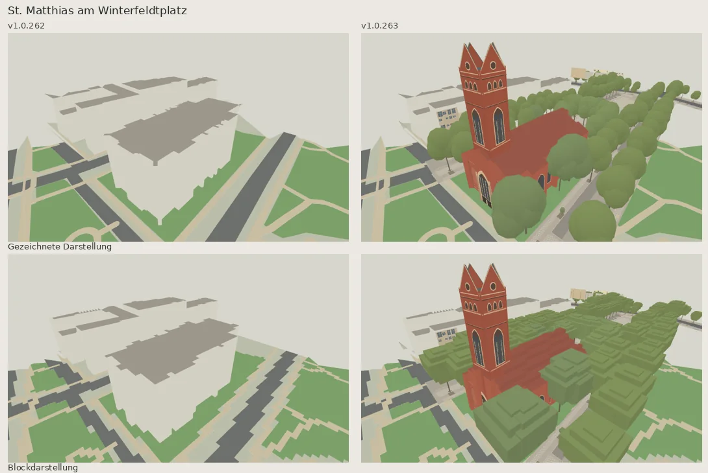

# Nollendorfplatz, Winterfeldtplatz und St. Matthias

Die beiden Plätze lassen sich in der Ortssuche direkt öffnen. Für die Himmelsrichtungen und die Lage der Gebäude verwendet die Darstellung die lokale Berliner Projektion in Metern. Die bestehende offene Stahlkuppel am U-Bahnhof, der Korbbogen am Metropol und die beispielhaften Marktstände auf dem Winterfeldtplatz sind weiter sichtbar. [Vorhandene Architektur](south-fidelity-v294.md)

## St. Matthias

Das frühere Kirchenmodell erreichte über die gesamte Grundfläche dieselbe Höhe von 28 Metern. Das neue Langhaus, die Sakristei und die Anbauten folgen fünf amtlichen Gebäudeteilen mit geneigten Dächern und gestuften Traufen. Das amtliche LoD2-Modell lässt den hohen Südturm aus. Ein gesonderter Abgleich zwischen digitalem Oberflächenmodell und Geländemodell im 1-Meter-Raster ergab in der Dachzone die hohe, ungefähr acht mal acht Meter breite Turmfläche. Das Dachraster erreicht dort 53,75 Meter über Gelände. Für die darüber aufragenden Giebel wurde die vom Landesdenkmalamt dokumentierte heutige Gesamthöhe von 60 Metern angesetzt. Die vier Giebel, Rundöffnungen, Schallöffnungen, Sandsteingliederungen und das Mittelportal orientieren sich am amtlichen Außenfoto. Profile, Glas- und Ziegelfarben sind modelliert. [Landesdenkmalamt Berlin](https://denkmaldatenbank.berlin.de/daobj.php?obj_dok_nr=09066735) · [Außenfoto](https://denkmaldatenbank.berlin.de/media/uploads/Sch/09066735.jpg) · [Amtliches LoD2-Modell](https://gdi.berlin.de/data/a_lod2/atom/LoD2_388_5817.zip) · [Digitales Oberflächenmodell](https://isk.geobasis-bb.de/ows/bdom_wcs?SERVICE=WCS&REQUEST=GetCapabilities)

Das Kirchenschiff im Blockstil nutzt zweimetergroße, an die ursprünglichen Grundrisse gebundene Rasterzellen. Die schmalen Giebel und Fenster folgen den Turmseiten. Beide Darstellungen ersetzen auf zwei benachbarten Kacheln genau die alten Dach- und Wanddreiecke. Die bisher vermessene Bebauung auf der südlichen Kachel behält ihren eigenen Gebäudekörper. Die Bildtafel zeigt die beiden Baustände mit gleicher Kamera. Sie zeigt das primäre Stadtmodell in der Kirchenumgebung und die neuen örtlichen Details. [Quelldaten, Baumvergleiche und Fotoregistrierung](../geo_data/regierungsviertel/schoeneberger-plaetze-v383.json.gz)

## Verkehrsraum, Bäume und Häuser

Auf den Plätzen und unmittelbar angrenzenden Straßen folgen Fahrbahnen, Gehwege, Belagswechsel, Parkbuchten, Tastfelder und Bordkanten den Polygonen und Linien der Berliner Straßenbefahrung. Durchgehend abgesenkte Bordsteine und Übergangsrampen sind separat berücksichtigt. Die kartierten roten Radfurten am Nollendorfplatz wurden mit dem Orthofoto von 2026 abgeglichen. Die offene Mitte des Winterfeldtplatzes folgt der kartierten Platzgrenze einschließlich der Aussparung für die vorhandenen Baukörper. Dazu kommen 27 amtliche Banklinien in den beiden Gebieten und vier Geländerlinien am Winterfeldtplatz. Die Bankleisten und Handläufe sind schematisch ausgeführt. [Straßenbefahrung Berlin](https://gdi.berlin.de/services/wfs/strassenbefahrung?SERVICE=WFS&REQUEST=GetCapabilities) · [TrueDOP Berlin 2026](https://gdi.berlin.de/services/wms/truedop_2026?SERVICE=WMS&REQUEST=GetCapabilities) · [OpenStreetMap Winterfeldtplatz](https://www.openstreetmap.org/way/168901481)

Nach Abgleich mit dem bisherigen Baumbestand ergänzen 47 Straßenbäume den Nollendorfplatz und sein Umfeld, 110 den Winterfeldtplatz mit den angrenzenden Straßen. Standort, Gattung, Höhe und Stammumfang kommen aus dem Berliner Baumkataster. Wo der Kronendurchmesser im Kataster mit null erfasst war, wurde er aus den gemessenen Kronen vergleichbarer Berliner Straßenbäume geschätzt. Die archivierten Vergleichsdatensätze machen diese Schätzung nachvollziehbar. [Baumbestand Berlin](https://gdi.berlin.de/services/wfs/baumbestand?SERVICE=WFS&REQUEST=GetCapabilities)

Elf Straßenwände an acht Häusern erhalten 181 aus entzerrten Fassadenbildern abgeleitete obere Fensteröffnungen. Dazu gehören Goltzstraße 24 und 25, mehrere Adressen in der Winterfeldtstraße, die Eckbebauung an der Hohenstaufenstraße und die Motzstraße neben dem Metropol. Die Bildauswertung erfasst sichtbare Fenstergruppen. Fensterrahmen, Farbtöne und Tiefen sind angenähert. Die Quellbelege nennen die jeweilige Wandlage, archivierte Fototextur und Registrierung. [Historisches Berliner Stadtmodell mit Fototexturen](https://www.3dcitydb.net/3dcitydb/berlin-3d/) · [Lokale Belege](../geo_data/regierungsviertel/schoeneberger-plaetze-v383.json.gz)
