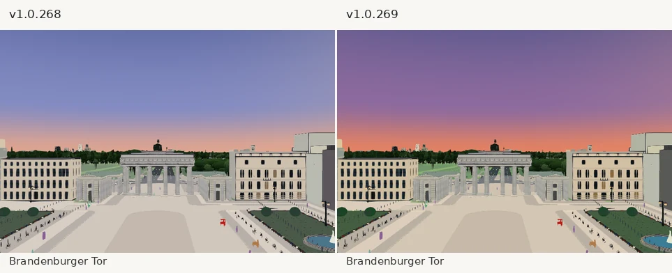

# Schwellentraum · Videogame-Modus

The Dreamcore presentation takes its colour direction from the Vice City
airport approach and Leonida Keys outdoor scenes in Rockstar's official
gallery. Apricot at the horizon passes through rose-lilac into blue overhead.
Warm stone highlights sit against blue-green shadows, with enough local colour
to distinguish Berlin's brick, trees and roofs. The existing light corridors,
everyday-object vignettes and soundscape accompany the city.
[Official screenshots](https://www.rockstargames.com/VI/media/screenshots)

The source-bound building geometry, roof silhouettes and surface positions stay
unchanged. The material-integrated grade retains more facade colour, separates
warm pale-stone highlights from cool blue-green shadows and restores the original
Day material on exit. Protected memorial subtrees continue to use exact Day
materials through the shared object-mode dispatcher.

A static, texture-free background triangle supplies a peach-pearl horizon,
lavender middle sky and blue zenith. Its direction derives from the
camera matrices, so the gradient remains attached to the world as the camera
turns. It renders before scene geometry, writes no depth, cannot receive
pointer hits and disappears with the existing obstructed/underwater/underside
presentation gate. It introduces no fog, render target or postprocessing pass.

The eight existing light thresholds retain their locations, safe clearances,
frame echoes and instanced stationary motes. Their amber, sea-glass and lilac
palette now uses veils that fade from a luminous centre toward quiet edges.
The extra triangles remain inside each existing veil draw call. The sky adds
one draw call; the complete threshold/sky/Pariser-Platz presentation stores
5,760 vertices in the full profile and 4,416 in mobile, within respective
5,800/4,450 limits and a common ceiling of 32 renderables, 25 geometries,
11 materials and 42 objects.

The existing source-water overlay gains broad, fixed pearl reflection ribbons
and a blue/peach colour transition. No water vertex, wave, shoreline, vessel or
wake moves. The existing 3.75 Hz light update, 18–38 second sparse glints and
reduced-motion freeze remain unchanged. Existing memorial fragment masks,
duplicate-Spree exclusion and top-surface-only guard still apply.

Focused regression coverage lives in `schwellenraum-presentation.test.ts`,
`schwellenraum-material-grade.test.ts` and the existing Schwellenraum water,
motion and memorial-protection suites. Browser QA should inspect a low-angle
Schwellenraum view, a water view and a return to Day; the sky shader is evaluated
by WebGL only when the mode is entered.
