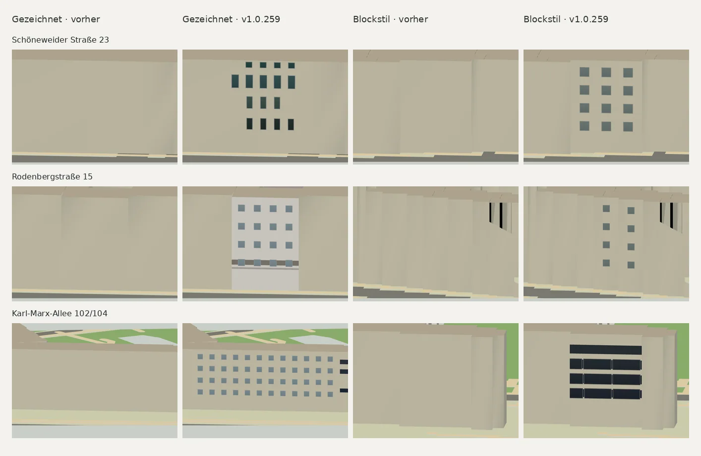

# Straßenfassaden in elf Berliner Bezirken

307 vorher einfarbige Gebäude erhalten zusammen 404 gegliederte Straßenfronten in der gezeichneten Ansicht. Der Blockstil verwendet 457 unabhängig geprüfte Wandstücke seiner eigenen Gebäude. Unterschiedliche Stückzahlen ergeben sich aus den rechtwinkligen und teilweise gestuften Blockumrissen. Beispiele sind die Häuser an der Schöneweider Straße 23 in Neukölln, der Rodenbergstraße 15 in Pankow und der Karl-Marx-Allee 102/104 in Friedrichshain. [Standortnachweise aller Gebäude](../geo_data/regierungsviertel/district-fronts-v379-evidence.json.gz)

Die Bildtafel zeigt die tatsächlichen Hausoberflächen der sechs Stadtkacheln im WebGL-Renderer. Jede Bildpaarung verwendet dieselbe Kamera und denselben Grundkörper. Die Fenster und Fassadenfarben lassen sich als eigene Geometrie einzeln ein- und ausblenden. Nachbarhäuser, weitere Kartenebenen und die normale Bedienoberfläche gehören zum vollständigen Viewer.

| Bezirk | Gebäude |
| --- | ---: |
| Steglitz-Zehlendorf | 70 |
| Pankow | 58 |
| Charlottenburg-Wilmersdorf | 49 |
| Lichtenberg | 33 |
| Tempelhof-Schöneberg | 29 |
| Treptow-Köpenick | 21 |
| Neukölln | 17 |
| Friedrichshain-Kreuzberg | 13 |
| Mitte | 7 |
| Spandau | 6 |
| Marzahn-Hellersdorf | 4 |

## Standorte und erkennbare Einzelheiten

Für jedes Haus enthält der Beleg das zugehörige Berliner Modellobjekt, den OpenStreetMap-Grundriss, die kartierte Nutzung und Geschosszahl sowie die ID des betreffenden Straßenabschnitts. Die Schnittfläche von Modell- und Kartengrundriss beträgt mindestens 83 Prozent ihrer Vereinigungsfläche. Auch die beiden aneinandergrenzenden Dreiecke jeder sichtbaren Wand wurden in der Originalkachel nachgewiesen. Straßenrichtung, Nachbargebäude, belegte frühere Fassaden, vorhandene zusätzliche Wandgeometrie und mögliche doppelte Gebäudekörper flossen in die Auswahl ein. In Reinickendorf hatten die vier zusätzlich untersuchten, eindeutig zugeordneten Gebäude dieser Auswahl bereits Fassadendetails. [Berliner OpenStreetMap-Auszug vom 22. November 2026](https://download.geofabrik.de/europe/germany/berlin.html) · [Berliner 3D-Stadtmodell](https://fbinter.stadt-berlin.de/fb_daten/beschreibung/lod2.html)

Für **131 Fronten von 102 Gebäuden** konnten ältere Texturfotos aus dem Berliner 3D-Modell an der heutigen Wand ausgerichtet werden. Die ausgewerteten Bildteile decken jeweils mindestens 60 Prozent der Wand ab. Der Abstand der registrierten Bildfläche zum heutigen Modell beträgt höchstens einen Meter. Wiederkehrende Öffnungen ließen sich auf zwölf Fronten auszählen, Fassadenfarbtöne auf 117 und waagerechte Materialstreifen auf 40. Diese Angaben können dieselbe Front betreffen. Aufnahmen von 2013 können von der heutigen Fassung abweichen. [Texturiertes Berliner Stadtmodell](https://www.3dcitydb.net/3dcitydb/fileadmin/mydata/Berlin_Demo/Berlin_Buildings_rgbTexture_ScaleFactor_0.3/Berlin_Buildings_rgbTexture_collada_MasterJSON.json) · [Quellmodelle und SHA-256-Prüfsummen je Haus](../geo_data/regierungsviertel/district-fronts-v379-evidence.json.gz)

Bei den übrigen Öffnungen sind Breite und Abstand modelliert. Die Geschosszahl und Gebäudenutzung stammen aus der Karte. So erhalten Mietshäuser, Schulen, Hotels und Büros unterschiedliche Achsabstände. Wo bildliche Belege für eine Ladenfront oder Tür fehlen, bleibt das Erdgeschoss frei. Der Blockstil übernimmt ein fotografiertes Muster, wenn die Richtung und Lage des eigenen Wandstücks mit der Bildfront übereinstimmen.

Die Angaben sind auf 30 regionale Dateien verteilt, zusammen 40.108 Byte bei einzelner gzip-Kompression auf Stufe 9. Beim Annähern wird die erforderliche Region geladen. Alle zugehörigen Fenster und Farbfelder einer sichtbaren Kachel werden in einem Mesh gezeichnet. Beim Wechsel der Darstellungsart gelten die erhobenen Wände der jeweils aktiven Geometrie. [Erzeugung und Prüfung der Regionaldaten](../scripts/build_district_fronts_v379.py)
