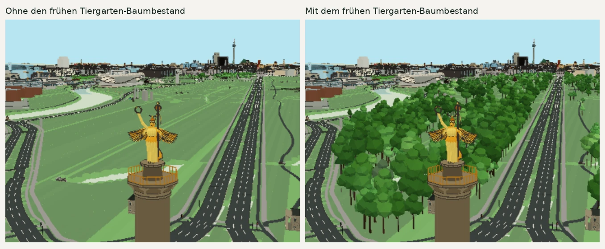

# Bäume beim Anflug auf den Großen Tiergarten

Zwischen Siegessäule, Rosengarten und Brandenburger Tor erscheinen die Kronen jetzt schon beim ersten Zeichnen der Parkansicht. Der Viewer wählt pro belegtem 36-Meter-Quadrat einen tatsächlich verzeichneten Baum aus. Sein Stamm steht am ursprünglichen Punkt. Höhe, Kronenradius und Farbe stammen aus demselben Datensatz wie die spätere Detailansicht. Im gezeichneten Stil erscheinen so sofort 1.376 Bäume über den Park verteilt. [Siegessäule öffnen](https://klotzkette.github.io/isometric-berlin/#landmark=siegessaule) · [Rosengarten öffnen](https://klotzkette.github.io/isometric-berlin/#landmark=rosengarten-im-tiergarten)

Die früheren 483 detaillierten Frühbäume lagen in einem 440 × 350 Meter großen Ausschnitt am östlichen Parkrand. Für die übrige Parkfläche musste zunächst die separate 6,1-MB-Datei mit 45.540 Berliner Bäumen, Wegen und weiteren Objekten eintreffen und verarbeitet werden. Im Blockstil wurden die Stämme und Kronen erst in einem späten Arbeitsschritt des Voxelmodells erzeugt.

Beim Direktstart an der Siegessäule standen in Version 1.0.258 zur Freigabe der Bedienoberfläche noch keine Bäume im 160-Meter-Umkreis. Im fertig gebauten Viewer 1.0.259 zählte der Chromium-Test am gleichen Kamerastandpunkt bei der ersten Stichprobe 307 eingetragene Standorte und vor der Freigabe bereits 345. Die Messung zählt gezeichnete Stamm-Instanzen innerhalb des Radius. Ein Teil davon liegt seitlich oder hinter der Kamera.

Beide Bilder zeigen dieselbe Kameraposition und denselben Zeitpunkt im fertig gebauten Viewer 1.0.259. Links wurde für den Bildvergleich die frühe Baumgruppe ausgeblendet. Die rechte Seite zeigt den regulären Anblick. Beim Vergleich der ursprünglichen Einzelbilder (660 × 500 Pixel) unterscheiden sich 94.992 Pixel um mehr als acht Helligkeitsstufen in mindestens einem Farbkanal.

## Umfang und Quellen

Die Auswahl folgt der kartierten Grenze des Großen Tiergartens. Sie enthält 13.156 mit dem Berliner Baumkataster verknüpfte Standorte und 1.443 zusätzliche Standorte aus OpenStreetMap. Alle 14.599 gehören bereits zum vollständigen Stadtmodell. Der Blockstil verwendet seine eigenen 4-Meter-Zellen und die geltende Ausdünnung für Desktop und Mobilgeräte. Im vollständigen Parkumfang sind das 6.164 beziehungsweise 3.084 Zellen. 1.280 beziehungsweise 1.107 davon stehen für die erste Ansicht bereit. Tunnelzufahrten, Aussparungen und frühere Korrekturen der Stammhöhe werden bei der Auswahl berücksichtigt. [Parkgrenze](https://www.openstreetmap.org/relation/7643526) · [Berliner Baumkataster](https://gdi.berlin.de/services/wfs/baumbestand?SERVICE=WFS&REQUEST=GetCapabilities) · [Herkunft, Prüfsummen und Stückzahlen](../geo_data/regierungsviertel/tiergarten-tree-arrival-v379.json)

## Übergang beim Näherkommen

Die ersten Laubkronen bestehen aus drei gegeneinander versetzten, gemeinsam gezeichneten Kronenteilen. Höhe, Durchmesser und die Ausrichtung der jeweiligen Baumvariante bestimmen die Silhouette. Für Nadelbäume gibt es spitz zulaufende Kronen. Der Blockstil behält seine kantigen Kronen samt gestapelten Kappen. Beim Anflug ergänzt der Viewer die weiteren Standorte in der Nähe der Kamera in höchstens neun Gruppen, jeweils eine pro Animationsschritt. Die gemeinsamen Kronen- und Stammformen werden pro Gruppe instanziert. Beim Verlassen des Parks werden die zusätzlichen Instanzpuffer freigegeben. Die frühen Ostbäume und anschließend das vollständige Park- oder Voxelmodell übernehmen ihre Standorte jeweils im selben Bildwechsel. In der fertigen gezeichneten Nahansicht bleiben Verzweigungen, Artenformen, Einzelmodelle und saisonale Details des Vollmodells erhalten.

Das Paket für den ersten Anflug einschließlich beider Stile benötigt 23.750 Byte bei gzip-Stufe 9. Die 164.220 Byte mit zusätzlichen Nahbereichsstandorten lädt der Viewer bei einer Parkansicht. Die Werte beziehen sich auf die Quelldaten, die tatsächliche Übertragung hängt vom Browsercache und der Serverkompression ab. [Erzeugung aus den Modelldaten](../src/app/scripts/bake-tiergarten-arrival-v379.ts) · [Prüfung der Standortabdeckung und des Modellwechsels](../src/app/tests/tiergarten-tree-arrival-v379.test.ts)

## Rechenzeit und Detailtreue

Beim späteren Aufbau des gesamten Parkmodells verarbeitet der Viewer Baumdaten und Instanzmatrizen in Gruppen von höchstens 256 Einträgen. Ein CPU-Vergleich mit Bun 1.3.10 und den 45.540 Originalbäumen misst die Arbeit bis zur ersten fertigen Weggeometrie. Im Median von sieben Durchläufen sank die längste zusammenhängende Rechenphase von 37,06 auf 3,56 Millisekunden, die gesamte Rechenarbeit in diesem Abschnitt von 45,67 auf 23,07 Millisekunden. Im vollständigen Parkmodell ergab der Vergleich der fertigen Geometriepuffer und Instanzmatrizen mit Version 1.0.258 identische Prüfsummen. Das Desktopprofil enthält weiter 501.163 Instanzen, das Mobilprofil 451.159.
