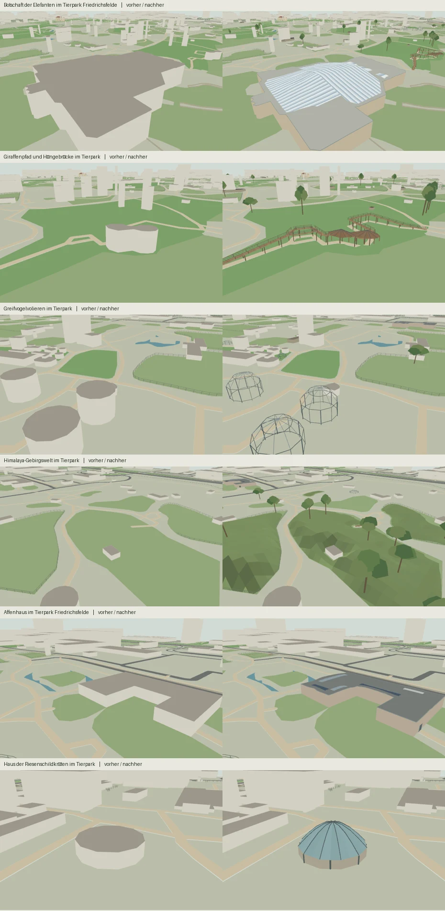

# Tierpark Friedrichsfelde

Die sechs Ansichten zeigen die tatsächlichen Kachelmeshes aus derselben Kamera. Die Vergleichsaufnahme enthält die früheren statischen Ost-Berliner Landmarken. Die kartierten Häuser und Gehege außerhalb der dargestellten Ausschnitte sind im Viewer über **Sehenswürdigkeiten → Ort suchen** erreichbar, soweit sie ein eigenes Kameraziel haben.

## Die Tierhäuser

Das Dach der **Botschaft der Elefanten** folgt 1.993 örtlichen Farb- und Höhenstützpunkten. Die zwei großen gewellten Hallendächer wechseln sichtbar ihre Laufrichtung. Der nördliche Gebäudetrakt hat drei kleinere gewölbte Oberlichter. Für das **Affenhaus** sind 526 Stützpunkte und fünf im Luftbild erkennbare Dachfelder erfasst. Die Eingänge beider Häuser folgen jeweils zwei kartierten Zugangspunkten. Breite und Laibungstiefe sind angenähert. Die gemessenen Höhen beziehen sich im Viewer auf das Parkgelände bei drei Szenenmetern. Im Blockmodus bilden eigene gestufte Zellen die Baukörper. Nach Betreiberangabe waren Afrikanische Elefanten im November 2026 bereits eingezogen. Die öffentliche Eröffnung des Hauses war für 2027 vorgesehen. [Elefantenhaus öffnen](https://klotzkette.github.io/isometric-berlin/#landmark=botschaft-der-elefanten-im-tierpark-friedrichsfelde) · [Tierpark Berlin](https://www.tierpark-berlin.de/de/aktuelles/news/artikel/kiekste-kibo) · [Dachtragwerk](https://www.brueninghoff.de/news/details/mammutprojekt-fuer-dickhaeuter/) · [Dachbeobachtungen und vier Eingänge](../geo_data/regierungsviertel/tierpark-east-v379-roof-observations.json)

Am **Giraffenpfad** sind die gedeckten Aussichtsplätze, die geraden Deckabschnitte und der durchhängende Brückenast zu erkennen. Der Betreiber zählt 120 m Steg und 8 m Hängebrücke. Die vollständigen kartierten Wege einschließlich Anschlüssen messen in der Projektion 157,32 m und 12,60 m. Das Modell folgt diesen Wegen. Höhenprofil, Breiten, Trägerabstände und Handläufe sind angenähert. Ein weiterer, 16 m langer Holzsteg liegt im nordöstlichen Park. [Giraffenpfad öffnen](https://klotzkette.github.io/isometric-berlin/#landmark=giraffenpfad-und-hangebrucke-im-tierpark) · [Afrikanische Savanne](https://www.tierpark-berlin.de/de/tierpark-erleben/tiere-erlebniswelten/savanne) · [Schindeldächer der beiden Aussichtsplätze](https://www.tierpark-berlin.de/de/aktuelles/news/artikel/richtfest-fuer-den-giraffenpfad-im-tierpark-berlin)

Das Haus der Riesenschildkröten hat eine gegliederte Glaskuppel. Für das Pelikanhaus und die Konzertbühne sind gewalmte Dächer kartiert. **14 Drahtgehege** zeigen jetzt offene Stützen, gebogene Netzrippen und umlaufende Spannseile. Dazu gehören die Anlagen für Manul, Möwen, Seeadler, Kaiseradler, Braungeier, Mönchsgeier und Virginia-Uhu. Die Umrisse sind kartiert. Das Modell veranschaulicht die Netzführung und die Pfeilerabstände. Die 2026 eröffneten Großvolieren am Pelikan- und Flamingoteich sind gesonderte Anlagen. Für ihren exakten äußeren Netzverlauf fehlen in diesem Bestand vollständige geometrische Nachweise. [Greifvogelvolieren öffnen](https://klotzkette.github.io/isometric-berlin/#landmark=greifvogelvolieren-im-tierpark) · [Abgleich der 20 Baukörper](../geo_data/regierungsviertel/tierpark-east-v379-owners.json) · [Tierparkbericht zu den neuen Großvolieren](https://www.tierpark-berlin.de/de/aktuelles/news/artikel/neues-zuhause-fuer-pelikan-flamingo-co)

## Gelände, Bäume und frühere Hochkörper

Sieben kartierte Tieranlagen umfassen rund **18.270 m² Relief**. Die Innenflächen folgen dem amtlichen Geländemodell, darunter die Anlagen für Schneeleoparden, Rote Pandas und Steinböcke. An den Grenzen laufen die Höhen zum vorhandenen Wegeniveau aus. Bestehende Gebäude, Wege und Tierbewegungen wurden aus der Reliefbearbeitung ausgespart. **77 Baumkronen** sind durch lokale Maxima im digitalen Oberflächenmodell belegt. Kronenbreite, Stammfuß und Belaubung sind Annäherungen an diese Messungen. [Himalaya öffnen](https://klotzkette.github.io/isometric-berlin/#landmark=himalaya-gebirgswelt-im-tierpark) · [Tierpark zur Gebirgswelt](https://www.tierpark-berlin.de/de/aktuelles/news/artikel/der-berg-ruft-1) · [Flächenbilanz und Stege](../geo_data/regierungsviertel/tierpark-east-v379-landscape.json)

In den älteren Kacheln standen ungewöhnlich hohe, schmale Prismen. Bei **17 Standorten** ließ sich die Korrektur aus dem amtlichen Oberflächenmodell von 2026 und dem Geländemodell ableiten. 13 davon zeigen jetzt die gemessene niedrige Dachhöhe. Vier wurden wieder als offene Flächen dargestellt. Beim Reiherhaus betrug die alte Modellhöhe 33,3 m. Die aktuelle Messung innerhalb des Grundrisses ergibt einen Median von rund 3,8 m über dem örtlichen Gelände. Jeder Austausch ist für beide Darstellungsfamilien an die ursprünglichen Dach-, Wand- und Kantendaten gebunden. Bei gemeinsam genutzter Geometrie oder uneindeutigen Messwerten bleibt der frühere Bestand erhalten. [Höhen und Gebäude](../geo_data/regierungsviertel/tierpark-east-v379-low-owners.json) · [Messdaten](../geo_data/regierungsviertel/tierpark-east-v379-low-buildings.json.gz)

Die Viewer-Geometrien kommen aus 36 örtlichen Teildateien für beide Darstellungsfamilien. Zusammen umfassen diese mit gzip auf Stufe 9 **635.718 Byte**. Die Region nutzt die bestehenden Sicht- und Entladegrenzen der Stadtkacheln. Es gibt keine zusätzliche Texturdatei und keine laufende Tierpark-Animation aus dieser Überarbeitung. [TrueDOP 2026](https://gdi.berlin.de/services/wms/truedop_2026?SERVICE=WMS&REQUEST=GetCapabilities) · [Digitales Oberflächenmodell Berlin](https://gdi.berlin.de/data/bdom/atom/) · [Digitales Geländemodell Berlin](https://gdi.berlin.de/data/dgm1/atom/) · [OpenStreetMap und Lizenz](https://www.openstreetmap.org/copyright) · [Erhaltene Quellen](../geo_data/regierungsviertel/tierpark-east-v379-source.json.gz)
