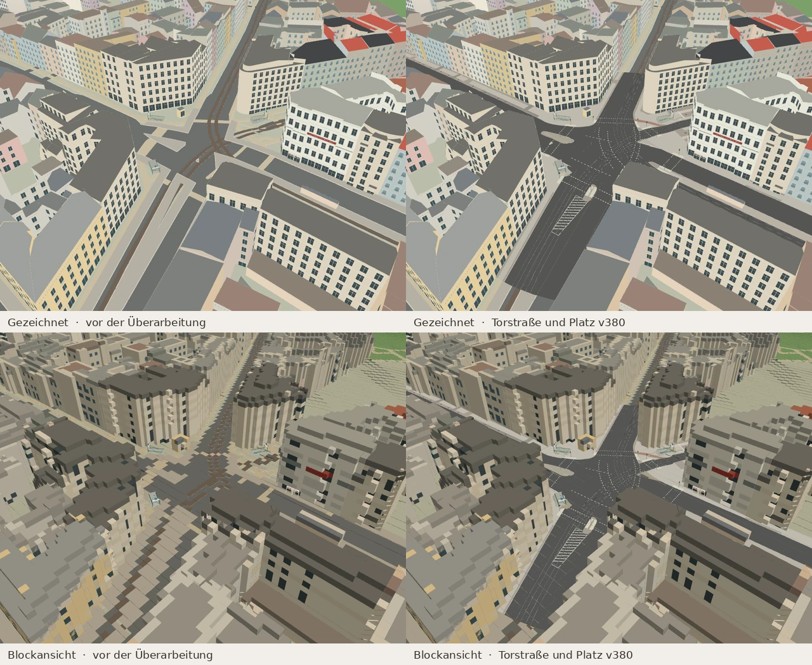

# Torstraße und Rosenthaler Platz

Die überarbeitete Straße reicht vom Oranienburger Tor an der Friedrichstraße bis zur Kreuzung mit der Prenzlauer Allee. Am Rosenthaler Platz sind die fünf einmündenden Straßen, die abzweigenden Straßenbahngleise, die Inseln und die vier U8-Eingänge einzeln zu erkennen. Die Platzansicht blickt von Südosten auf das Gleisdreieck zwischen Rosenthaler Straße, Weinbergsweg und Torstraße.

Der Vergleich zeigt dieselben zwei Stadtmodell-Kacheln und die bestehenden Fassaden und U8-Treppen in Chromium mit WebGL. Linke und rechte Spalte verwenden dieselbe Kamera, Beleuchtung und Bildschirmauflösung.

## Straßenraum

- 88.743 m² Straßenraum umfassen Fahrbahnen, Gehwege, Grundstückszufahrten, Baumgruben, Radwege, Inseln und Haltestellen. 435 vermessene Bordsteinlinien unterscheiden Hochbord, Tiefbord und bodengleiche Übergänge. Bei den Gehwegen wechseln unter anderem Natursteinplatten, Betonplatten und Kleinsteinpflaster.
- 32 oberirdische OSM-Gleiswege ergeben Schienenpaare mit 1.435 mm Spurweite. Die Schienen folgen den Weichen und Kurven durch den Platz. Sieben oberirdische Bahnsteigflächen liegen im bearbeiteten Korridor. Drei offene Wartehallen ergänzen die vorhandenen amtlichen Unterstandsmodelle. Dachhöhen, Stützen und Bänke dieser drei Unterstände sind gestalterische Annäherungen.
- Fußgängerfurten schließen die ausgesparten Stellen zwischen den Fahrbahnpolygonen der Befahrung. Die gestrichelten Furtränder folgen den kartierten Querungen. Leitlinien im Knoten und die südliche Sperrfläche sind dem Luftbild von 2026 nachgezeichnet. 72 zusätzliche Fußgängersignalmasten stammen aus der Befahrung und stehen an weiterhin kartierten signalisierten Übergängen. Die Signalgehäuse sind vereinfacht. Wo die Befahrung keine Masthöhe enthält, verwendet das Modell 3,25 m.
- An den vier U8-Zugängen bleiben die Treppenöffnungen beider Darstellungen frei. Die neuen Beläge schließen an die Höhe der vorhandenen oberen Treppenstufe an. Die bestehenden Ladenfronten der Torstraße und die Modelle von St. Oberholz und The Circus bleiben Teil der Szene.

## Daten und Wiedergabe

Die amtlichen Flächen und Straßenobjekte stammen aus der Berliner Straßenbefahrung 2014/15. Die Referenz umfasst 1.770 örtliche Befahrungsobjekte, 70 Abschnitte der benannten Straßenachsen und 148 ausgewählte OSM-Wege. Linienbreiten für Schienenköpfe, Bordsteine und Markierungen sind Darstellungsmaße. [Straßenbefahrung im Geoportal Berlin](https://gdi.berlin.de/services/wfs/strassenbefahrung?SERVICE=WFS&REQUEST=GetCapabilities) · [Amtlicher Attributkatalog](https://gdi.berlin.de/data/strassenbefahrung/docs/Datenformatbeschreibung_Stra%C3%9Fenbefahrung_2014.pdf) · [TrueDOP 2026 am Rosenthaler Platz](https://gdi.berlin.de/services/wms/truedop_2026?SERVICE=WMS&VERSION=1.3.0&REQUEST=GetMap&LAYERS=truedop_2026&STYLES=&CRS=EPSG:25833&BBOX=391485,5821085,391680,5821220&WIDTH=1000&HEIGHT=692&FORMAT=image/jpeg) · [Berliner OSM-Auszug vom 22. November 2026, Geofabrik](https://download.geofabrik.de/europe/germany/berlin-261122.osm.pbf)

Sieben räumlich getrennte Datenpakete enthalten zusammen 378.225 Byte JSON vor der Webkompression. Beide Ansichten teilen sich die Dreiecke, Materialien und Positionen im Grundriss. Im Bereich des Weinbergs haben die beiden Geländeformen eigene Höhen. Bei gleichzeitig geladenem Gesamtkorridor belegen die neuen Geometriepuffer rund 1,09 MB pro Darstellung. Das sind Zusatzkosten dieser Verfeinerung. Sie benötigt keine Bildtexturen. Tatsächliche Bildraten hängen von Gerät und Stadtausschnitt ab.

Der Generator erzeugt aus dem mitgelieferten Quellenausschnitt dieselben sieben Pakete. Der gezielte Test prüft unter anderem alle fünf Straßenarme, die freien Treppen, deren höhengleiche Anschlüsse, die Speicherabrechnung und einen abgebrochenen Ladevorgang. [Generator](../scripts/build_torstrasse_v380.py) · [Quellenausschnitt](../geo_data/regierungsviertel/torstrasse-v380-survey.json.gz) · [Geometrie- und Ladetests](../src/app/tests/torstrasse-v380.test.ts)
