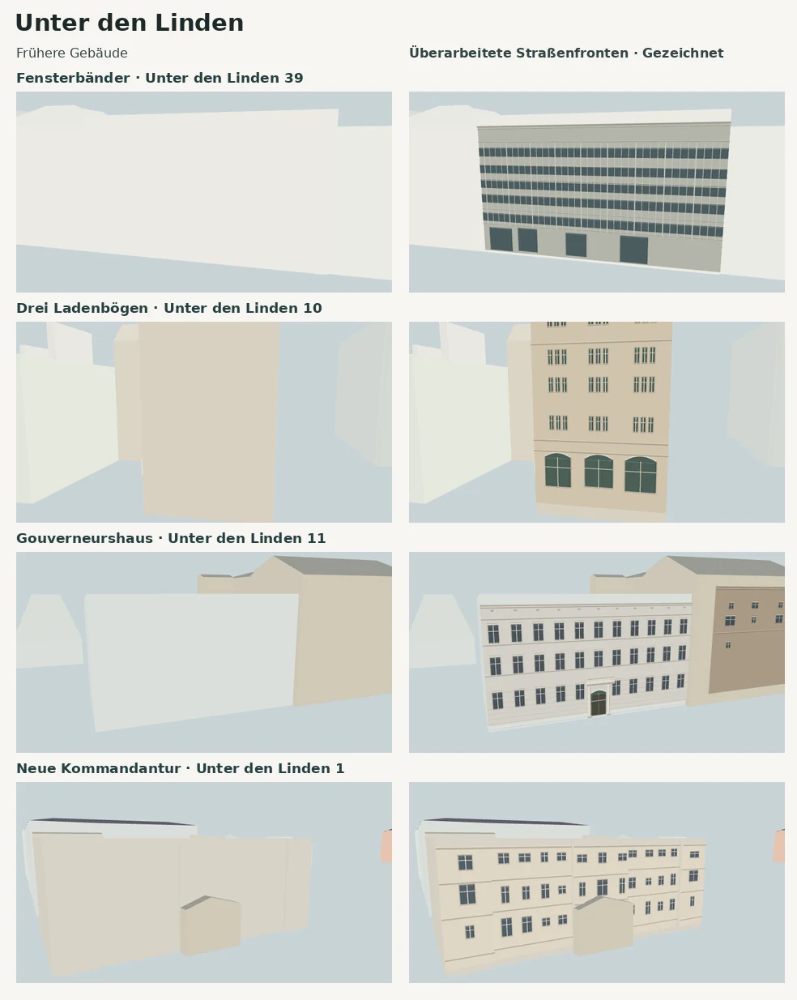
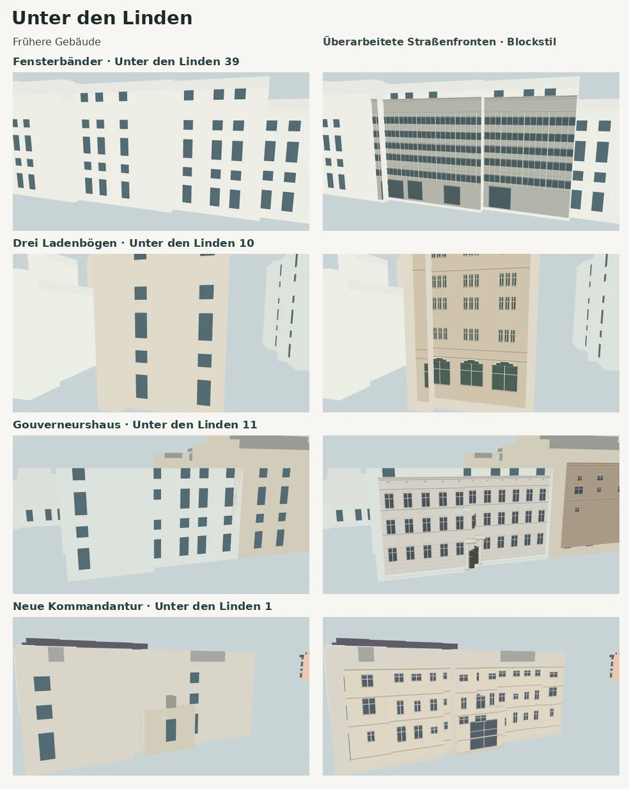
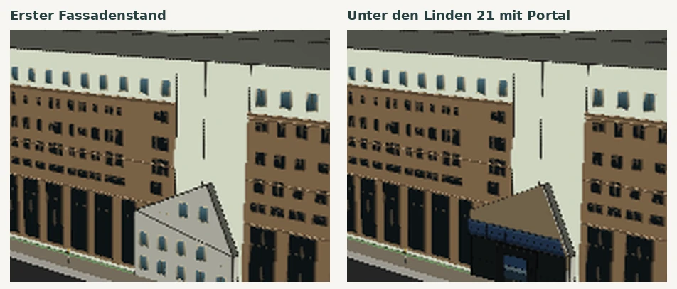

# Unter den Linden

Wer von der Friedrichstraße nach Osten schaut, sieht im Erdgeschoss des Lindencorsos hohe Schaufenster. Am Zugang Unter den Linden 21 stehen dunkle Natursteinplatten vor dem zurückgesetzten Eingang. Zwei Glastürflügel, feste Seitenteile und Oberlichter gliedern das Portal unter der waagrechten, blau-grauen Glasblende. Die geneigte Dachkontur bleibt im amtlichen Baukörper erhalten. [Aktuelle Portalaufnahme des Eigentümers](https://www.premium-properties.com/wp-content/uploads/2025/05/lc-eingang-1199x843.jpg) · [Schrägansicht des Zugangs](https://api.immobilie1.de/estates/30218801/image/377808567/expose-estate-gallery-main-desktop-webp.webp)

Auf der gegenüberliegenden Straßenseite stehen an Hausnummer 10 drei Ladenbögen unter drei Gruppen schmaler Fenster. Das Gouverneurshaus an Nummer 11 trägt über dem mittleren Eingang einen vorspringenden Balkon, darüber zwei Fensterreihen mit jeweils elf Achsen. Für diesen Eingang war eine Aufnahme ohne Laub nötig. [Kreuzung Friedrichstraße im Viewer](https://klotzkette.github.io/isometric-berlin/?theme=day&lang=de#landmark=friedrichstrasse-und-unter-den-linden) · [Lindencorso im Archiv des Architekturpreises Berlin](https://www.architekturpreis-berlin.de/Archiv/2016/Projekte/049/index.html) · [Straßenansicht des Gouverneurshauses](https://commons.wikimedia.org/wiki/File:Berlin,_Mitte,_Unter_den_Linden_11,_Gouverneurshaus.jpg)

Die Modellkorrektur umfasst 17 sichtbare Wandabschnitte an sieben Gebäuden. Dazu gehören die gestaffelte Straßenwand an den Nummern 55–61, die Fensterbänder an Nummer 39, das Lindencorso an der Friedrichstraße, die Nummern 10, 11 und 13 sowie die Neue Kommandantur an Nummer 1. Die Fensterachsen und Ladenöffnungen wurden aus fotografierten Ansichten am Berliner LoD2-Stadtmodell eingemessen. Beim Blockstil folgt der Schmuck den tatsächlich sichtbaren gestuften Wänden. Rahmenbreiten, Metall- und Glasfarben sowie verdeckte Einzelheiten sind Annäherungen. Die Bildquellen dokumentieren unterschiedliche Aufnahmejahre. [Berliner LoD2-Stadtmodell, Kachel Friedrichstraße](https://gdi.berlin.de/data/a_lod2/atom/LoD2_390_5819.zip) · [Quellmodell mit historischen Fassadenfotos, Beispiel](https://www.3dcitydb.net/3dcitydb/fileadmin/mydata/Berlin_Demo/Berlin_Buildings_rgbTexture_ScaleFactor_0.3/Tiles/133/135/854039/BLDG_00030009007e9208.dae) · [Neue Kommandantur](https://www.bertelsmann.com/de/unternehmen/unternehmensprofil/bertelsmann-in-berlin/) · [Registrierte Wände und Fotoreferenzen](../geo_data/regierungsviertel/linden-front-v383-facades.json.gz)

Entlang der Mittelpromenade und der seitlichen Gehwege wurden 243 Linden aus dem Straßenbaumkataster den bereits vorhandenen Stadtbäumen einzeln zugeordnet. Hinzu kommen 71 Kastanien aus dem Anlagenbaumkataster im Kastanienwäldchen an der Neuen Wache. Die Gruppen erscheinen bereits mit der frühen Baumschicht. Die endgültige Parkdarstellung übernimmt dieselben Standorte, Stammumfänge, Höhen und Kronendurchmesser. [Baumbestand Berlin](https://gdi.berlin.de/services/wfs/baumbestand?service=WFS&request=GetCapabilities) · [Zuordnung der 314 Einzelbäume](../geo_data/regierungsviertel/linden-front-v383-trees.json.gz)

## Modellvergleich

Die Bildpaare zeigen jeweils die frühere und die überarbeitete Straßenseite mit identischer Kamera. Für den direkten Vergleich sind nur Gebäudegrundkörper und Fassadendetails sichtbar. Der reguläre Viewer ergänzt Fahrbahnen, Gehwege und Bäume.

Die Aufnahme des Lindencorso-Portals stammt aus dem vollständigen gezeichneten Viewer. Der Ausschnitt ist in beiden Bildern identisch. Links ist der erste Fassadenstand der Überarbeitung zu sehen, rechts der dunkle Naturstein mit Tür und Vordachblende.

## Datenübertragung

Für ältere Fahrbahn- und Platzkantendaten setzt der Build vier bestehende Binärfelder beim Packen um. Die Byte-Spuren wiederkehrender Koordinaten und Indizes lassen sich zusammen besser komprimieren. Beim ersten Zugriff erhält der Viewer die ursprünglichen vier Zeichenketten und sämtliche Koordinaten bitgenau zurück.

| Vergleich der zwei Datenmodule mit Decoder | Bisher | Jetzt |
| --- | ---: | ---: |
| Minifiziertes JavaScript in Bytes | 2.143.880 | 938.505 |
| Einzeln mit gzip Stufe 9 komprimiert, in Bytes | 1.009.372 | 689.179 |

Gemessen wurden die Produktionsausgaben von Vite für zwei separate Einstiegspunkte in die unveränderten Quelldaten von RoadGroundV343 und MittePlazaEdgesV367, einschließlich aller ausgelieferten Decoder-Abhängigkeiten. Die tatsächliche Übertragung hängt vom HTTP-Server und dem Browsercache ab. Neue Stadtansichten und andere Viewer-Module sind separat geladen.

Der Aufbau der 172.339 Bodenläufe des Stadtmodells wurde mit der früheren Fassung im gleichen Prozess verglichen. In V8 sank seine Medianzeit von 42,45 auf 28,43 Millisekunden, in JavaScriptCore von 43,95 auf 30,80 Millisekunden. Gemessen wurde der gesamte Bodenkonstruktor mit denselben Quelldaten, nach vier Aufwärmrunden über jeweils 20 gewertete Durchläufe je Fassung. Die GPU-Puffer für Geometrie und Farben ergaben dieselbe SHA-256-Prüfsumme. Die Werte beschreiben die CPU-Arbeit dieses Bausteins in der Linux-Testumgebung. [Benchmark mit optionalem Vergleichsmodul](../src/app/scripts/benchmark-terrain-writer-v383.ts) · [Regressionstest für sämtliche Matrix- und Farbwerte](../src/app/tests/terrain-writer-v383.test.ts)
