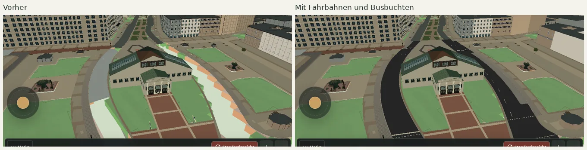
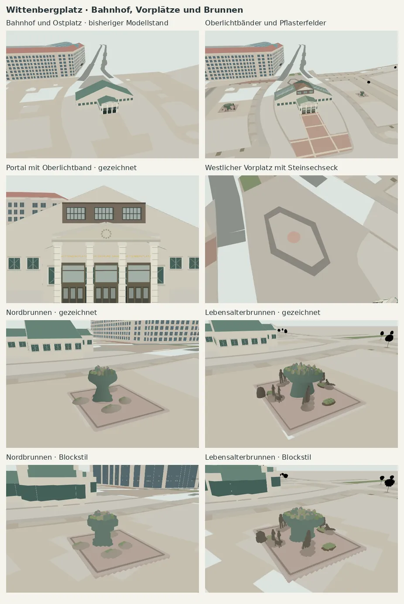

# Vom Aquarium über die Tauentzienstraße zum Wittenbergplatz

Auf beiden Seiten des U-Bahnhofs stehen die bepflanzten Brunnen. Der Nordbrunnen hat ein Bronzekapitell mit vier Ausbuchtungen. Am größeren Lebensalterbrunnen umgeben Figurengruppen, das Windspiel und zwei abstrakte Plastiken eine ovale, kupferverkleidete Schale. Becken und Figurengruppen sind an den kartierten Standorten modelliert. Körperhaltung, Werkstoff und Form beruhen auf der Berliner Skulpturendokumentation. Die Details der Figuren, die Profile und das Pflanzbild sind angenähert. Das Bezirksamt eröffnete beide bepflanzten, stillgelegten Brunnen am 1. September 2026. [Nordbrunnen](https://bildhauerei-in-berlin.de/bildwerk/nordbrunnen-5659/) · [Brunnen der Generationen](https://bildhauerei-in-berlin.de/bildwerk/brunnen-der-generationen-4802/) · [Bezirksamt Tempelhof-Schöneberg, Bepflanzung](https://www.berlin.de/ba-tempelhof-schoeneberg/aktuelles/pressemitteilungen/2026/pressemitteilung.1709121.php)

Vom Südrand des Aquariums an der Budapester Straße bis zum Wittenbergplatz sind rund 49.300 Quadratmeter öffentlicher Gehweg- und Nebenflächen erfasst. Die vier räumlich geladenen Pakete bilden 301 Bordsteinobjekte sowie Flächen von Radwegen, Gehwegüberfahrten, Baumscheiben, Grün und weiteren Straßenbestandteilen ab. Erhöhte Bordsteine besitzen sichtbare Seitenflächen, abgesenkte Übergänge flachere Profile. Die Straßenbefahrung bildet einen historischen Vermessungsstand ab. Die Straßenachsen und ausgesparten Gebäude, Gewässer und Zooflächen wurden mit dem Berliner OSM-Auszug vom 22. November 2026 abgeglichen. [Geoportal Berlin, Straßenbefahrung](https://gdi.berlin.de/services/wfs/strassenbefahrung?SERVICE=WFS&REQUEST=GetCapabilities) · [OpenStreetMap, Geofabrik](https://download.geofabrik.de/europe/germany/berlin.html)

Die nördliche und südliche Fahrbahn um den Bahnhof und die Einfahrten von der Tauentzien- und Kleiststraße folgen sieben vermessenen Asphaltflächen. Innerhalb des kartierten Wittenbergplatzes sind das 3.162 m² Asphalt mit 43 m² Fahrbahnmarkierungen. Drei separat vermessene Haltebereiche ergeben innerhalb der Platzgrenze 291 m² Busbeton. Die nördliche Bucht neben dem Bahnhof umfasst 215 m². Auf dem Orthofoto lassen sich die durchgehende Fahrbahn, die Haltebuchten, die Bahnsteigvorplätze und die Rasenstreifen getrennt erkennen. Die in beiden Darstellungen verwendete Geometrie folgt ihren jeweiligen Grenzen. [Berliner Straßenbefahrung](https://gdi.berlin.de/services/wfs/strassenbefahrung?SERVICE=WFS&REQUEST=GetCapabilities) · [Kartierte Platzgrenze](https://www.openstreetmap.org/way/564030191) · [Berliner TrueDOP 2026](https://gdi.berlin.de/services/wms/truedop_2026?SERVICE=WMS&REQUEST=GetCapabilities)

71 zusätzliche Straßenbäume stammen aus dem Berliner Baumkataster. Der Vergleich mit den bereits dargestellten Stammstandorten verhindert Doppelungen im Umkreis von 1,70 Metern. Die neuen Exemplare übernehmen Stammumfang, Kronendurchmesser, Baumhöhe und Gattung aus dem Kataster. Gezeichnete Kronengruppen und gestufte Blockkronen verwenden dieselben Maße. Die vier Bodenpakete umfassen insgesamt 41.584 Dreiecke. [Geoportal Berlin, Baumkataster](https://gdi.berlin.de/services/wfs/baumbestand?SERVICE=WFS&REQUEST=GetCapabilities)

43 Außenwände von 30 zusätzlichen Bestandsgebäuden erhalten zusammen 591 Fenster, 89 Glasfelder und 40 Brüstungsfelder. Die Aufnahmen sind auf die ausgelieferten Grundrisse unter anderem an der Tauentzienstraße, Budapester Straße, Nürnberger Straße, Ansbacher Straße und am Wittenbergplatz registriert. Die Ansichten dokumentieren den historischen Aufnahmezeitpunkt. Einzelnachweise enthalten die Quelldateien, geometrische Abstände, abgeleitete Maße und Farben. Die erzeugten Pakete verwenden diese Werte ohne Fototexturen. [Berliner 3DCityDB-Archiv](https://www.3dcitydb.net/3dcitydb/3dwebmap/) · [Fassadennachweise](../geo_data/regierungsviertel/wittenberg-fronts-v383.json.gz)

[Gebiets- und Katasterauszug](../geo_data/regierungsviertel/wittenberg-strassen-v383.json.gz) · [Bauskript](../scripts/build_wittenberg_quartier_v383.py) · [Test für beide Darstellungsstile](../src/app/tests/wittenberg-quartier-v383.test.ts)

Die Straßenbefahrung enthält rund um die Empfangshalle Messlücken. Der Ost- und der Westvorplatz wurden deshalb entlang ihrer kartierten Pflastergrenzen ergänzt. Das Orthofoto zeigt die dunkle sechseckige Einfassung westlich des Gebäudes und die rötlichen Plattenfelder mit hellen Querbändern am östlichen Zugang. Neben dem Mittelweg bleiben die im Orthofoto erkennbaren Rasenstreifen offen. Am Empfangsgebäude sind zwei gebänderte Dachverglasungen, die vier Felder der kupfernen Dachmitte, das obere Fensterband und die dreiteiligen Portale mit ihren Oberlichtern zu sehen. In beiden Darstellungen folgt die Auflage den bestehenden LoD2-Dachflächen bzw. deren Blockstufen. Die ursprüngliche Gebäudehöhe und Dachhülle sind weiterhin Grundlage der Darstellung. [Kartierte Vorplätze West](https://www.openstreetmap.org/way/26369804) und [Ost](https://www.openstreetmap.org/way/26369805) · [Landesdenkmalamt](https://denkmaldatenbank.berlin.de/daobj.php?obj_dok_nr=09066746) · [Baufoto nach der Instandsetzung](https://www.gazette-berlin.de/artikel/1376-alte-pracht-ueberm-ubahnschacht.html) · [Georeferenzierte Messungen](../geo_data/regierungsviertel/wittenberg-bahnhof-v383.json)

Der rechteckige Brunnenbereich auf der Südseite folgt den vier Punkten des kartierten Beckens. Die Umfassung auf der Nordseite und die Ausrichtung der beiden deutlich unterschiedlichen Schalen wurden am Orthofoto geprüft. Die Nahaufnahmen zeigen die Bestandsteile, die im Modellprotokoll für die beiden Plätze geladen wurden. [Berliner TrueDOP 2026](https://gdi.berlin.de/services/wms/truedop_2026?SERVICE=WMS&REQUEST=GetCapabilities)

