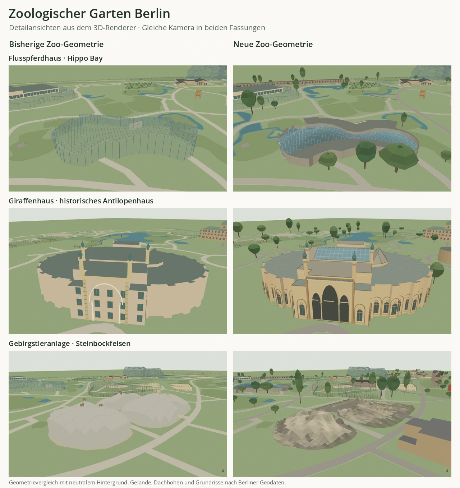

# Zoologischer Garten Berlin

**Hippo Bay.** Das 1997 eröffnete Flusspferdhaus hat zwei unterschiedlich große, zusammenhängende Glaskuppeln. Im früheren Modell lag das Tragwerksraster auf drei flach geneigten Dachflächen. Die neue Ansicht folgt den Höhen des bildbasierten Oberflächenmodells im Einmeterraster. Die hellen Reflexe des Glases haben örtlich Ausreißer bis hinunter zum Beckenboden verursacht. Solche Lücken wurden aus benachbarten Dachmessungen interpoliert. Die Kontur der Glasfläche und die Abgrenzung zum niedrigeren Betriebsdach beruhen auf dem Berliner TrueDOP 2026. Das Stahlnetz folgt der Krümmung und dem beim Tragwerksplaner veröffentlichten Nennraster von 1,20 m. Die Blockdarstellung bildet beide Kuppeln mit eigenen Höhenstufen ab. [Bauwerksbeschreibung des Tragwerksplaners](https://www.sbp.de/projekt/flusspferdehaus-zoo-berlin/) · [Hippo Bay beim Zoo](https://www.zoo-berlin.de/de/zoo-erleben/tiere-erlebniswelten/hippo-bay)

**Antilopen- und Giraffenhaus.** Das denkmalgeschützte Haus von 1872 hat zwei gerundete Flügel, eine verglaste Palmenhalle und einen Eingang mit drei Bogenöffnungen. Sechs amtliche Gebäudeteile bestimmen die Umrisse, Wandhöhen und Dachlagen. Farben, Glasstreben, Friese, Öffnungen und Minarettaufsätze sind an Fotografien und am Denkmalinventar orientiert. Für die Giraffen an der Savannenanlage und das Okapi auf der gegenüberliegenden Seite liegen im Kartenbestand drei getrennte Standorte vor. Ihre Figuren zeigen beispielhafte Haltungen. [Denkmalinventar und Archivfotografien](https://denkmaldatenbank.berlin.de/daobj.php?obj_dok_nr=09050439) · [Antilopenhaus](https://www.zoo-berlin.de/de/zoo-erleben/tiere-erlebniswelten/antilopenhaus) · [Besatz nach der Modernisierung, Oktober 2026](https://www.zoo-berlin.de/de/aktuelles/news/artikel/herbstzeit-ist-zoozeit)

**Gebirgstieranlage.** Die Suche nach „Gemsenhügel“ führt zum Steinbockfelsen neben den Anlagen der Sichuantakine und Himalaya-Tahre. Für jedes der drei Gehege wurden die kartierte Grenze, die Geländehöhen und die unmittelbar umliegenden Wegehöhen ausgewertet. Die Felsformen sind im Gelände- und Oberflächenmodell getrennt erkennbar. Kleine Oberflächenaufschläge sind auf helle, felsartige Bereiche im Luftbild begrenzt, um Bäume von den Felsen zu unterscheiden. Die bestehenden Tierfiguren stehen an die gemessene Oberfläche angepasst. [Historisches Erbe des Zoologischen Gartens](https://www.zoo-stiftung-berlin.de/unterstuetzen/zoo-berlin/historisches-erbe)

**Weitere Tierhäuser und Pavillons.** Zwölf weitere Standorte besitzen zusammen 50 amtliche Gebäudeteile. Dazu gehören das Persische Pferdehaus mit der Kuppel über dem Turm, das afrikanische Tierhaus für Pferdeartige, die Fasanerie, das Hühner- und Taubenhaus, der Storchenstall, das Schweinehaus, drei Hirschhäuser, der Panda Garden, der Chinesische Musikpavillon und der Neptuntempel. Die Rekonstruktionen der Säulengalerie am Teich und des offenen Musikpavillons verwenden amtliche Dachkonturen und fotografisch angenäherte Säulen und Gesimse. Die horizontale und vertikale Lage des Panda-Hauptbaus stammt aus dem Stadtmodell. Das Kartenpolygon umfasst darüber hinaus offene Hoffläche. Für den getrennt kartierten Musikpavillon östlich des Panda Gardens ließ sich in der geprüften Auswahl kein vollständiges vermessenes Dach zuordnen. [Panda Garden](https://www.zoo-berlin.de/de/zoo-erleben/tiere-erlebniswelten/panda-garden) · [Stadtmodell Berlin](https://gdi.berlin.de/data/a_lod2/atom/)

**Teiche, Wege und Gehölze.** Für rund 1,14 Hektar Wasserfläche fehlten im bisherigen Zoo-Datensatz die vollständigen mehrteiligen Kartenobjekte. Sieben Teiche, darunter Neptun- und Grottenteich, sind mit ihren Außenringen und Inseln eingepasst. Kartierte Laufwege erhalten getrennte Beläge für Pflaster, Kies, befestigte Erde und Asphalt. Baumkronen ergänzen den früheren Bestand anhand lokaler Höhenmaxima. Gebäude, Volieren, Felsgehege, Wasserflächen und bereits erfasste Stämme wurden bei der Platzierung berücksichtigt. Die Höhen sind aus den Rasterdaten abgeleitet. Eine einzelne geschätzte Krone kann bei mehrstämmigen oder dicht aneinanderstehenden Bäumen mehrere benachbarte Kronenteile umfassen. [OpenStreetMap](https://www.openstreetmap.org/#map=17/52.5075/13.3384) · [Geländemodell](https://isk.geobasis-bb.de/ows/dgm_wcs?service=WCS&request=GetCapabilities) · [Oberflächenmodell](https://isk.geobasis-bb.de/ows/bdom_wcs?service=WCS&request=GetCapabilities) · [TrueDOP 2026](https://gdi.berlin.de/services/wms/truedop_2026?service=WMS&request=GetCapabilities)

Die Geometrie wird nach Darstellungsart und Standort geladen. Das Einmeterraster, Herkunft, Datum, Prüfsummen und Gebäudezuordnungen sind im Repository hinterlegt. Positionen, Farbwerte, Normalen, Indizes und Sichtgrenzen werden beim Bauen des Viewers vorbereitet. [Messdaten](../geo_data/regierungsviertel/zoo-west-survey-v379.json.gz) · [Vollständige Wasserpolygone](../geo_data/regierungsviertel/zoo-west-ponds-v379.json.gz)
